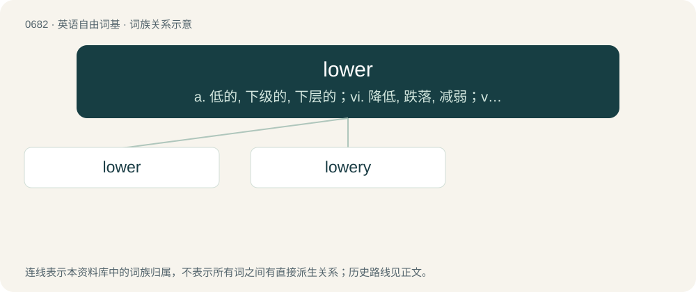

# 0758 · lower — a. 低的, 下级的, 下层的；vi. 降低, 跌落, 减弱；vt. 放下, 降下, 减弱, 贬低

[总目录](../00_总目录_按常用程度.md)

**类型**：英语自由词基　｜　**来源语言**：见词源记录

## 核心含义与来源

- 核心含义：a. 低的, 下级的, 下层的；vi. 降低, 跌落, 减弱；vt. 放下, 降下, 减弱, 贬低
- 英文含义：Bottom; more towards the bottom than the middle of an object.
- 词形：lower

**来源记录 1**（形容词；Bottom; more towards the bottom than the middle of an object.）

From low + -er (comparative suffix).

## 词族图

## 单词速览（常用到不常用）

| 单词 | 音标 | 释义 |
|---|---|---|
| [lower](#w-1) | 英 /ˈləʊ.ə/；美 /ˈloʊ.ɚ/ | a. 低的, 下级的, 下层的；vi. 降低, 跌落, 减弱；vt. 放下, 降下, 减弱, 贬低 |
| [lowery](#w-2) | 英 /ˈlaʊəɹi/；美 /ˈlaʊəɹi/ | a. 阴暗的, 阴霾的 |

## 逐词详解

### 1. lower

**词性**：形容词　｜　**音标**：英 /ˈləʊ.ə/；美 /ˈloʊ.ɚ/

**中文释义**：a. 低的, 下级的, 下层的；vi. 降低, 跌落, 减弱；vt. 放下, 降下, 减弱, 贬低

**英文义项**：Bottom; more towards the bottom than the middle of an object. / Situated on lower ground, nearer a coast, or more southerly.

**构词拆分**：low + -er (comparative suffix)

**词源与演化**：

From low + -er (comparative suffix).

**用法示例／搭配（非完整句）**：

> Lower Manhattan

该用例对应义项：Situated on lower ground, nearer a coast, or more southerly.

### 2. lowery

**词性**：形容词　｜　**音标**：英 /ˈlaʊəɹi/；美 /ˈlaʊəɹi/

**中文释义**：a. 阴暗的, 阴霾的

**英文义项**：Dark and gloomy; threatening; lowering.

**构词拆分**：From lower (“to frown”) + -y.

**词源与演化**：

From lower (“to frown”) + -y.

**例句**：

> But director Lowery Stokes Sims said the Studio Museum is benefiting from a new recognition and a surge in Black philanthropy.
