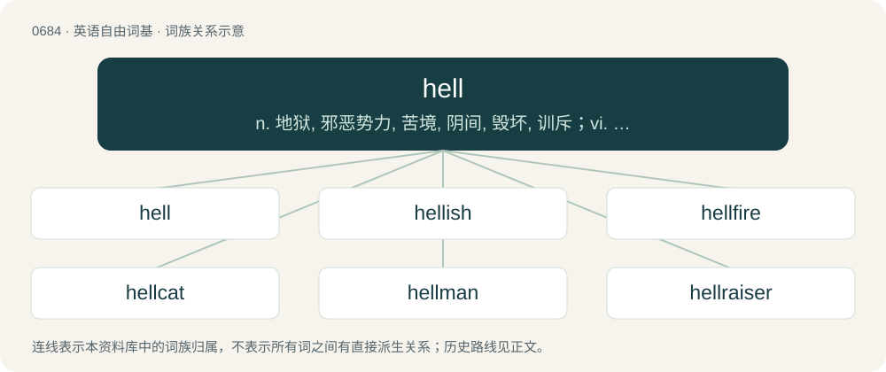

# 0761 · hell — n. 地狱, 邪恶势力, 苦境, 阴间, 毁坏, 训斥；vi. 狂饮, 飞驰

[总目录](../00_总目录_按常用程度.md)

**类型**：英语自由词基　｜　**来源语言**：见词源记录

## 核心含义与来源

- 核心含义：n. 地狱, 邪恶势力, 苦境, 阴间, 毁坏, 训斥；vi. 狂饮, 飞驰
- 英文含义：A place or situation of great suffering in life.
- 词形：hell

**多个词源／构词路径**：同一拼写可能有不同来源；以下按词性和含义分别列出。

**来源记录 1**（名词；A place or situation of great suffering in life.）

From Middle English hel, hell, helle, hælle, from Old English hel, hell, from Proto-West Germanic \*hallju, from Proto-Germanic \*haljō (“hell, netherworld”), from Proto-Indo-European \*ḱel- (“to cover”). First attested in c. 725. Cognates Cognate with Yola helle (“hell”), Saterland Frisian Hälle (“hell”), West Frisian hel (“hell”), Alemannic German Hell (“hell”), Cimbrian hélla (“hell”), Dutch hel (“hell”), German Hölle (“hell”), Limburgish hel, Héll, Höll (“hell”), Luxembourgish Häll (“hell”), Vilamovian heł, hełł (“hell”), Danish helvede (“hell”), ihjel (“to death”), Faroese helviti (“hell”), Icelandic hel (“death, hell”), helvíti (“hell”), Norwegian Nynorsk hel (“death, underworld”), helvete (“hell”), Swedish helvete (“hell”), ihjäl (“to death”), Gothic 𐌷𐌰𐌻𐌾𐌰 (halja, “hell”), Estonian koll (“bugbear”), Finnish koljo (“giant; evil spirit; devil”); also Cornish keles (“to conceal, hide”), Irish ceil (“to conceal, hide; to cover up”), Welsh celu (“to conceal, hide”), Faliscan 𐌂𐌄𐌋𐌀 (cela, “tomb”), Latin cella (“hut, storeroom; barn, granary”), Greek κολεός (koleós, “vagina; sheath; scabbard; coleus”), Lithuanian šalmas (“helmet”), Belarusian шало́м (šalóm, “helmet”), Bulgarian and Macedonian шлем (šlem, “helmet”), Old Polish szłom (“helmet”), Russian шело́м (šelóm), шлем (šlem, “helmet”), Serbo-Croatian шле̏м, шље̏м, šlȅm, šljȅm (“helmet”), Ukrainian шолом (šolom, “helmet”), Sanskrit शर्मन् (śarman, “safety, shelter; house; bliss, happiness, joy”). Also related to the Hel of Germanic mythology. See also hele.

**来源记录 2**（动词；To add luster to; to burnish (silver or gold).）

From German hellen (“to brighten, burnish”). Related to Dutch hel (“clear, bright”) and German hell (“clear, bright”).

**来源记录 3**（动词；To pour.）

From Middle English hellen, from Old Norse hella (“to pour”), from Proto-Germanic \*halþijaną (“to incline, tip; to pour out, empty”), from Proto-Indo-European \*ḱel- (“to lean, incline”). Cognate with Icelandic hella (“to pour”), Norwegian helle (“to pour”), Swedish hälla (“to pour”). See also English hield.

## 词族图

## 单词速览（常用到不常用）

| 单词 | 音标 | 释义 |
|---|---|---|
| [hell](#w-1) | /hɛl/ | n. 地狱, 邪恶势力, 苦境, 阴间, 毁坏, 训斥；vi. 狂饮, 飞驰 |
| [hellish](#w-2) | 英 /ˈhɛlɪʃ/ | a. 地狱的, 凶恶的, 令人毛骨悚然的 |
| [hellfire](#w-3) | 英 /ˈhɛlˌfaɪə/；美 /ˈhɛlˌfaɪəɹ/ | n. 地狱之火, 严酷的苦难 |
| [hellcat](#w-4) | 美 /ˈhɛlˌkæt/ | n. 悍妇, 泼妇人, 巫婆 |
| [hellman](#w-5) |  | 赫尔曼（姓氏） |
| [hellraiser](#w-6) |  | 吵闹捣蛋的人；胡打瞎闹的人；（尤指）耍酒疯的人 |
| [helly](#w-7) |  | \[人名\] 赫利 |

## 逐词详解

### 1. hell

**词性**：名词　｜　**音标**：/hɛl/

**中文释义**：n. 地狱, 邪恶势力, 苦境, 阴间, 毁坏, 训斥；vi. 狂饮, 飞驰

**英文义项**：A place or situation of great suffering in life. / A place for gambling.

**词源与演化**：

From Middle English hel, hell, helle, hælle, from Old English hel, hell, from Proto-West Germanic \*hallju, from Proto-Germanic \*haljō (“hell, netherworld”), from Proto-Indo-European \*ḱel- (“to cover”). First attested in c. 725. Cognates Cognate with Yola helle (“hell”), Saterland Frisian Hälle (“hell”), West Frisian hel (“hell”), Alemannic German Hell (“hell”), Cimbrian hélla (“hell”), Dutch hel (“hell”), German Hölle (“hell”), Limburgish hel, Héll, Höll (“hell”), Luxembourgish Häll (“hell”), Vilamovian heł, hełł (“hell”), Danish helvede (“hell”), ihjel (“to death”), Faroese helviti (“hell”), Icelandic hel (“death, hell”), helvíti (“hell”), Norwegian Nynorsk hel (“death, underworld”), helvete (“hell”), Swedish helvete (“hell”), ihjäl (“to death”), Gothic 𐌷𐌰𐌻𐌾𐌰 (halja, “hell”), Estonian koll (“bugbear”), Finnish koljo (“giant; evil spirit; devil”); also Cornish keles (“to conceal, hide”), Irish ceil (“to conceal, hide; to cover up”), Welsh celu (“to conceal, hide”), Faliscan 𐌂𐌄𐌋𐌀 (cela, “tomb”), Latin cella (“hut, storeroom; barn, granary”), Greek κολεός (koleós, “vagina; sheath; scabbard; coleus”), Lithuanian šalmas (“helmet”), Belarusian шало́м (šalóm, “helmet”), Bulgarian and Macedonian шлем (šlem, “helmet”), Old Polish szłom (“helmet”), Russian шело́м (šelóm), шлем (šlem, “helmet”), Serbo-Croatian шле̏м, шље̏м, šlȅm, šljȅm (“helmet”), Ukrainian шолом (šolom, “helmet”), Sanskrit शर्मन् (śarman, “safety, shelter; house; bliss, happiness, joy”). Also related to the Hel of Germanic mythology. See also hele.

**例句**：

> I’m as mad as hell and I’m not going to take it anymore.

该用例对应义项：Used as an intensifier in phrases grammatically requiring a noun.

### 2. hellish

**词性**：形容词　｜　**音标**：英 /ˈhɛlɪʃ/

**中文释义**：a. 地狱的, 凶恶的, 令人毛骨悚然的

**英文义项**：infernal, related or similar to hell. / causing great pain, discomfort or distress.

**构词拆分**：hell + -ish

**词源与演化**：

From hell + -ish.

**例句**：

> I woke up from a hellish noise coming from the house next door.

该用例对应义项：causing great pain, discomfort or distress.

### 3. hellfire

**词性**：名词　｜　**音标**：英 /ˈhɛlˌfaɪə/；美 /ˈhɛlˌfaɪəɹ/

**中文释义**：n. 地狱之火, 严酷的苦难

**英文义项**：The fire of Hell. / Fire produced by the Devil, or a similar supernatural creature connected to Hell.

**构词拆分**：hell + fire

**词源与演化**：

From Middle English helle fire, helever, from Old English hellefȳr, equivalent to hell + fire. Cognate with West Frisian helfjoer (“hellfire”), Dutch hellevuur (“hellfire”), German Höllenfeuer (“hellfire”).

**例句**：

> Mennad is going to burn in eternal hellfire.

### 4. hellcat

**词性**：名词　｜　**音标**：美 /ˈhɛlˌkæt/

**中文释义**：n. 悍妇, 泼妇人, 巫婆

**英文义项**：A witch. / A spiteful and violent person, especially a woman.

**构词拆分**：hell + cat

**词源与演化**：

From hell + cat.

### 5. hellman

**词性**：名词

**中文释义**：赫尔曼（姓氏）

**英文义项**：A daredevil. / Evil man; devil.

**构词拆分**：hell + man

**词源与演化**：

From hell + man.

### 6. hellraiser

**词性**：名词

**中文释义**：吵闹捣蛋的人；胡打瞎闹的人；（尤指）耍酒疯的人

**英文义项**：A person who engages in wild, wanton behavior: one who raises hell.

**构词拆分**：hell + raiser

**词源与演化**：

From hell + raiser. Coined in 1914.

### 7. helly

**词性**：名词

**中文释义**：\[人名\] 赫利

**英文义项**：Synonym of hell.

**构词拆分**：hell + -y

**词源与演化**：

From hell + -y
