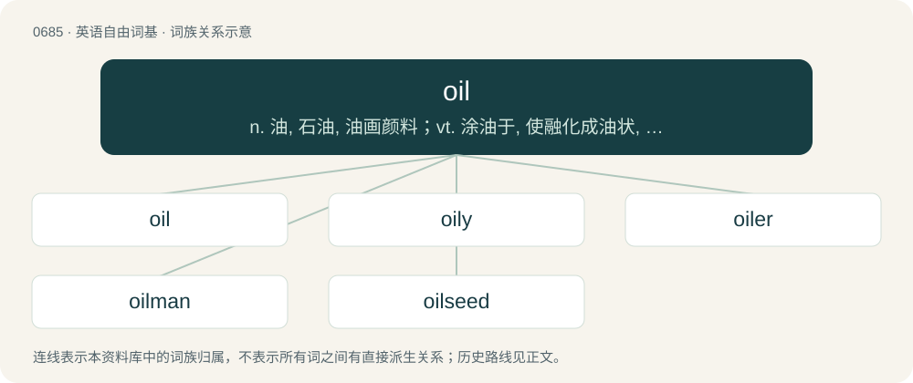

# 0762 · oil — n. 油, 石油, 油画颜料；vt. 涂油于, 使融化成油状, 加油于；vi. 加燃油, 融化

[总目录](../00_总目录_按常用程度.md)

**类型**：英语自由词基　｜　**来源语言**：见词源记录

## 核心含义与来源

- 核心含义：n. 油, 石油, 油画颜料；vt. 涂油于, 使融化成油状, 加油于；vi. 加燃油, 融化
- 英文含义：Liquid fat.
- 词形：oil

**多个词源／构词路径**：同一拼写可能有不同来源；以下按词性和含义分别列出。

**来源记录 1**（名词；Liquid fat.）

From Middle English oyle, oile (“olive oil”), borrowed from Old French oile, from Latin oleum (“oil, olive oil”), from Ancient Greek ἔλαιον (élaion, “olive oil”), from ἐλαία (elaía, “olive”). Compare Proto-Slavic \*lojь. More at olive. Doublet of oleum. Supplanted Middle English ele (“oil”), from Old English ele (“oil”), also from Latin.

**来源记录 2**（动词；To lubricate with oil.）

From Middle English oylen, from the noun (see above).

## 词族图

## 单词速览（常用到不常用）

| 单词 | 音标 | 释义 |
|---|---|---|
| [oil](#w-1) | 英 /ɔɪl/ | n. 油, 石油, 油画颜料；vt. 涂油于, 使融化成油状, 加油于；vi. 加燃油, 融化 |
| [oily](#w-2) | /ˈɔɪli/ | a. 油的, 油滑的, 油嘴的；\[化\] 油的; 含油的; 油性的; 油质的; 多油的; 油腻的; 油滑的 |
| [oiler](#w-3) | 英 /ˈɔɪlə/；美 /ˈɔɪlɚ/ | n. 油商, 加油工, 涂油者, 注油壶；\[化\] 加油器; 加油者 |
| [oilman](#w-4) | /ˈɒilmən/ | n. 石油工人, 石油商 |
| [oilseed](#w-5) | /ˈɔilsiːd/ | \[经\] 油籽 |

## 逐词详解

### 1. oil

**词性**：名词　｜　**音标**：英 /ɔɪl/

**中文释义**：n. 油, 石油, 油画颜料；vt. 涂油于, 使融化成油状, 加油于；vi. 加燃油, 融化

**英文义项**：Liquid fat. / Petroleum-based liquid used as fuel or lubricant.

**词源与演化**：

From Middle English oyle, oile (“olive oil”), borrowed from Old French oile, from Latin oleum (“oil, olive oil”), from Ancient Greek ἔλαιον (élaion, “olive oil”), from ἐλαία (elaía, “olive”). Compare Proto-Slavic \*lojь. More at olive. Doublet of oleum. Supplanted Middle English ele (“oil”), from Old English ele (“oil”), also from Latin.

**例句**：

> Oil is found in countries such as Saudi Arabia and is transported all over the world.

该用例对应义项：Petroleum.

### 2. oily

**词性**：形容词　｜　**音标**：/ˈɔɪli/

**中文释义**：a. 油的, 油滑的, 油嘴的；\[化\] 油的; 含油的; 油性的; 油质的; 多油的; 油腻的; 油滑的

**英文义项**：Covered with or containing oil. / Resembling oil.

**构词拆分**：oil + -y

**词源与演化**：

From Middle English oylei, equivalent to oil + -y. Compare German ölig (“oily”), Swedish oljig (“oily”).

**用法示例／搭配（非完整句）**：

> oily machinery; oily rags; oily fish; oily cooking

该用例对应义项：Covered with or containing oil.

### 3. oiler

**词性**：名词　｜　**音标**：英 /ˈɔɪlə/；美 /ˈɔɪlɚ/

**中文释义**：n. 油商, 加油工, 涂油者, 注油壶；\[化\] 加油器; 加油者

**英文义项**：An assistant in the engine room of a ship, senior only to a wiper, mainly responsible for keeping machinery lubricated. / Any of various automatic devices for oiling pneumatic tools or other tools.

**构词拆分**：oil + -er

**词源与演化**：

From Middle English oyler, equivalent to oil + -er.

### 4. oilman

**词性**：名词　｜　**音标**：/ˈɒilmən/

**中文释义**：n. 石油工人, 石油商

**英文义项**：Somebody (especially a man) involved in the production, refinement or delivery of oil; such as an oil field worker or executive, or the owner of an oil well. / A retailer who sells vegetable oils, and food preserved in oil

**构词拆分**：oil + -man

**词源与演化**：

From oil + -man.

### 5. oilseed

**词性**：名词　｜　**音标**：/ˈɔilsiːd/

**中文释义**：\[经\] 油籽

**英文义项**：The seed of any of several plants which are used commercially as a source of vegetable oil. / The plant that yields such seed.

**构词拆分**：oil + seed

**词源与演化**：

From oil + seed.
