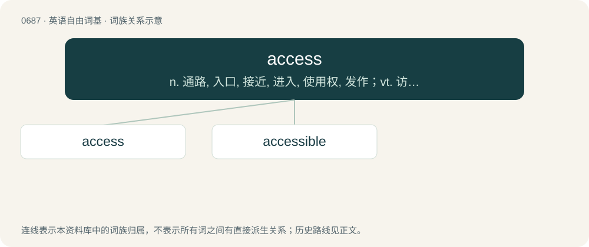

# 0763 · access — n. 通路, 入口, 接近, 进入, 使用权, 发作；vt. 访问, 存取, 接近, 使用；\[计\] 访问, 存取

[总目录](../00_总目录_按常用程度.md)

**类型**：英语自由词基　｜　**来源语言**：见词源记录

## 核心含义与来源

- 核心含义：n. 通路, 入口, 接近, 进入, 使用权, 发作；vt. 访问, 存取, 接近, 使用；\[计\] 访问, 存取
- 英文含义：A way or means of approaching or entering; an entrance; a passage.
- 词形：access

**多个词源／构词路径**：同一拼写可能有不同来源；以下按词性和含义分别列出。

**来源记录 1**（名词；A way or means of approaching or entering; an entrance; a passage.）

From Middle English accesse, acces, borrowed from Middle French acces (“attack, onslaught”) or from its source Latin accessus, perfect passive participle of accēdō (“approach; accede”), from ad (“to, toward, at”) + cēdō (“move, yield”). Doublet of accessus. First attested in the early 14th century. The sense "entrance" was first attested about 1380.

**来源记录 2**（动词；To gain or obtain access to.）

First attested in 1962.

## 词族图

## 单词速览（常用到不常用）

| 单词 | 音标 | 释义 |
|---|---|---|
| [access](#w-1) | 英 /ˈæksɛs/；美 /ˈækˌsɛs/ | n. 通路, 入口, 接近, 进入, 使用权, 发作；vt. 访问, 存取, 接近, 使用；\[计\] 访问, 存取 |
| [accessible](#w-2) | 英 /əkˈsɛs.ɪ.bəl/ | a. 易接近的, 可进入的, 可使用的, 易受影响的, 可理解的 |

## 逐词详解

### 1. access

**词性**：名词　｜　**音标**：英 /ˈæksɛs/；美 /ˈækˌsɛs/

**中文释义**：n. 通路, 入口, 接近, 进入, 使用权, 发作；vt. 访问, 存取, 接近, 使用；\[计\] 访问, 存取

**英文义项**：A way or means of approaching or entering; an entrance; a passage. / The act of approaching or entering; an advance.

**词源与演化**：

From Middle English accesse, acces, borrowed from Middle French acces (“attack, onslaught”) or from its source Latin accessus, perfect passive participle of accēdō (“approach; accede”), from ad (“to, toward, at”) + cēdō (“move, yield”). Doublet of accessus. First attested in the early 14th century. The sense "entrance" was first attested about 1380.

**例句**：

> They gained access to the basement from the stairs.

该用例对应义项：The act of approaching or entering; an advance.

### 2. accessible

**词性**：形容词　｜　**音标**：英 /əkˈsɛs.ɪ.bəl/

**中文释义**：a. 易接近的, 可进入的, 可使用的, 易受影响的, 可理解的

**英文义项**：Easy of access or approach. / Built or designed as to be usable by people with disabilities.

**构词拆分**：access + -ible

**词源与演化**：

First attested in 1400, from French, from Late Latin accessibilis, from accessus, perfect passive participle of accēdō (“approach”), equivalent to access + -ible.

**用法示例／搭配（非完整句）**：

> an accessible town or mountain

该用例对应义项：Easy of access or approach.
