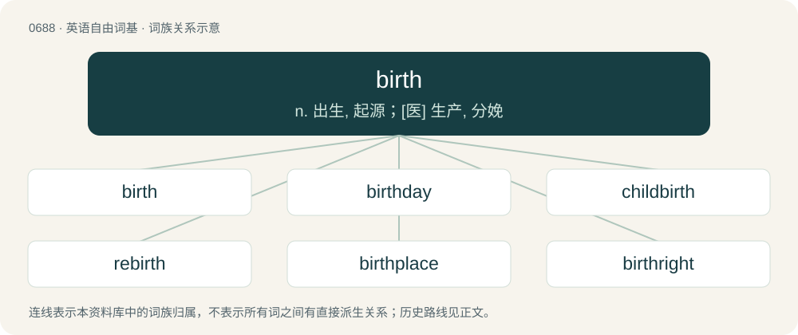

# 0764 · birth — n. 出生, 起源；\[医\] 生产, 分娩

[总目录](../00_总目录_按常用程度.md)

**类型**：英语自由词基　｜　**来源语言**：见词源记录

## 核心含义与来源

- 核心含义：n. 出生, 起源；\[医\] 生产, 分娩
- 英文含义：The process of childbearing; the beginning of life; the emergence of a human baby or other viviparous animal offspring from the mother's body into the environment.
- 词形：birth

**多个词源／构词路径**：同一拼写可能有不同来源；以下按词性和含义分别列出。

**来源记录 1**（名词；The process of childbearing; the beginning of life; the emergence of a human baby or other viviparous animal offspring from the mother's body into the environment.）

From Middle English birthe (1250), from earlier burthe, burde, from Old Norse burðr, byrd (Old Swedish byrth, Swedish börd), replacing Old English ġebyrd (rare variant byrþ), equivalent to bear + -th (thus a piecewise doublet of berth). The Old Norse is from Proto-Germanic \*burdiz (compare Old Frisian berde, berd); Old English ġebyrd is from prefixed \*gaburþiz (compare Dutch geboorte, German Geburt), from Proto-Indo-European \*bʰŕ̥tis (compare Latin fors (“luck”), Old Irish brith), from \*bʰer- (“to carry, bear”). More at bear.

**来源记录 2**（动词；To bear or give birth to (a child).）

From Middle English birthen, birðen, from the noun (see above).

## 词族图

## 单词速览（常用到不常用）

| 单词 | 音标 | 释义 |
|---|---|---|
| [birth](#w-1) | 英 /bɜːθ/；美 /bɜɹθ/ | n. 出生, 起源；\[医\] 生产, 分娩 |
| [birthday](#w-2) | 英 /ˈbɜːθ.deɪ/；美 /ˈbɝθˌdeɪ/ | n. 生日 |
| [childbirth](#w-3) | 美 /ˈt͡ʃaɪldˌbɝθ/ | n. 分娩；\[医\] 分娩, 生产 |
| [rebirth](#w-4) | 英 /ɹiːˈbɜːθ/；美 /ɹiˈbɝθ/ | n. 再生, 复活, 新生 |
| [birthplace](#w-5) | 美 /ˈbɝθˌpleɪs/ | n. 诞生地 |
| [birthright](#w-6) | 英 /ˈbɜːθ.ɹaɪt/；美 /ˈbɝθ.ɹaɪt/ | n. 生来就有的权利, 长子继承权 |
| [birthing](#w-7) | 英 /ˈbɜːθ.ɪŋ/；美 /ˈbɝθ.ɪŋ/ | a. 和生育有关的；在分娩过程中使用的 |
| [birthmark](#w-8) | 美 /ˈbɝθˌmɑɹk/ | n. 胎记, 胎痣；\[医\] 胎记, 胎痣 |
| [birthdate](#w-9) | /ˈbɜːθdeɪt/ | n. 出生日期 |
| [stillbirth](#w-10) | /ˈstilbəːθ/ | n. 死产, 死胎；\[医\] 死产 |
| [birther](#w-11) | 美 /ˈbɝθɚ/ | 出生地质疑者（奥巴马并非出生在夏威夷，因此没资格做总统的怀疑论者） |
| [birthstone](#w-12) | /ˈbəːθstəun/ | n. 诞生石 |
| [birthrate](#w-13) | /ˈbəːθreit/ | n. 出生率 |
| [afterbirth](#w-14) | 美 /ˈæf.tɚ.bɚθ/ | n. 胞衣；\[法\] 遗腹子, 胎胞 |

## 逐词详解

### 1. birth

**词性**：名词　｜　**音标**：英 /bɜːθ/；美 /bɜɹθ/

**中文释义**：n. 出生, 起源；\[医\] 生产, 分娩

**英文义项**：The process of childbearing; the beginning of life; the emergence of a human baby or other viviparous animal offspring from the mother's body into the environment. / An instance of childbirth.

**构词拆分**：bear + -th

**词源与演化**：

From Middle English birthe (1250), from earlier burthe, burde, from Old Norse burðr, byrd (Old Swedish byrth, Swedish börd), replacing Old English ġebyrd (rare variant byrþ), equivalent to bear + -th (thus a piecewise doublet of berth). The Old Norse is from Proto-Germanic \*burdiz (compare Old Frisian berde, berd); Old English ġebyrd is from prefixed \*gaburþiz (compare Dutch geboorte, German Geburt), from Proto-Indo-European \*bʰŕ̥tis (compare Latin fors (“luck”), Old Irish brith), from \*bʰer- (“to carry, bear”). More at bear.

**例句**：

> Intersex babies account for roughly one per cent of all births.

该用例对应义项：An instance of childbirth.

### 2. birthday

**词性**：名词　｜　**音标**：英 /ˈbɜːθ.deɪ/；美 /ˈbɝθˌdeɪ/

**中文释义**：n. 生日

**英文义项**：The anniversary of the day on which someone is born. / The anniversary of the day on which something is created.

**构词拆分**：birth + day

**词源与演化**：

From Middle English birthdai, birtheday, from Old English ġebyrddæġ (“birthday”), influenced by Old Norse burðr, equivalent to birth + day. Compare Saterland Frisian Gebuursdai (“birthday”), Dutch geboortedag (“birthday”), Low German Geboortsdag (“birthday”), German Geburtstag (“birthday”), Norwegian bursdag, gebursdag (“birthday”). Eclipsed non-native Middle English nativitee (“birth, nativity, birthday”), from Old French nativité, nativited, from Latin nātīvitas.

**例句**：

> I'll be thirty-seven (years old) next birthday.

该用例对应义项：The anniversary of the day on which someone is born.

### 3. childbirth

**词性**：名词　｜　**音标**：美 /ˈt͡ʃaɪldˌbɝθ/

**中文释义**：n. 分娩；\[医\] 分娩, 生产

**英文义项**：The fact or action of giving birth to a child, as the culmination of pregnancy; the process by which it happens.

**构词拆分**：child + birth

**词源与演化**：

From Middle English childbyrth \[and other forms\], perhaps a partial calque of Old Norse barnburðr (“childbearing, childbirth”, literally “bairn birth”); equivalent to child + birth. Compare Swedish barnsbörd (“childbirth”), Icelandic barnsburður (“childbirth”).

**例句**：

> Many women pursue higher education and careers, thus delaying marriage and childbirth.

### 4. rebirth

**词性**：名词　｜　**音标**：英 /ɹiːˈbɜːθ/；美 /ɹiˈbɝθ/

**中文释义**：n. 再生, 复活, 新生

**英文义项**：Reincarnation; new birth subsequent to one's first. / Revival, reinvigoration.

**构词拆分**：re- + birth

**词源与演化**：

From re- + birth.

**例句**：

> Bennu is the ancient Egyptian deity linked with the Sun, creation and rebirth.

### 5. birthplace

**词性**：名词　｜　**音标**：美 /ˈbɝθˌpleɪs/

**中文释义**：n. 诞生地

**英文义项**：The location where a person or an animal was born. / The location where something was created or devised.

**构词拆分**：birth + place

**词源与演化**：

From birth + place.

**例句**：

> Coney Island was the birthplace of the hot dog.

该用例对应义项：The location where something was created or devised.

### 6. birthright

**词性**：名词　｜　**音标**：英 /ˈbɜːθ.ɹaɪt/；美 /ˈbɝθ.ɹaɪt/

**中文释义**：n. 生来就有的权利, 长子继承权

**英文义项**：Something a person is entitled to due to the circumstances of their birth, such as an inheritance or citizenship.

**构词拆分**：birth + right

**词源与演化**：

From birth + right. Compare West Frisian berterjocht (“birthright”), Dutch geboorterecht (“birthright”), German Geburtsrecht (“birthright”). Compare also Icelandic frumburðarréttur (“birthright”).

**例句**：

> Freedom of speech is our birthright.

该用例对应义项：Something a person is entitled to due to the circumstances of their birth, such as an inheritance or citizenship.

### 7. birthing

**词性**：名词　｜　**音标**：英 /ˈbɜːθ.ɪŋ/；美 /ˈbɝθ.ɪŋ/

**中文释义**：a. 和生育有关的；在分娩过程中使用的

**英文义项**：The act of giving birth.

**构词拆分**：birth + -ing

**词源与演化**：

From birth + -ing.

**例句**：

> Mary was adamant that Tom attend the birthing course with her.

### 8. birthmark

**词性**：名词　｜　**音标**：美 /ˈbɝθˌmɑɹk/

**中文释义**：n. 胎记, 胎痣；\[医\] 胎记, 胎痣

**英文义项**：A mark on the skin formed before birth.

**构词拆分**：birth + mark

**词源与演化**：

From birth + mark. Displaced earlier terms longing mark and mother's mark.

**例句**：

> The detective identified him by a distinctive birthmark.

该用例对应义项：A mark on the skin formed before birth.

### 9. birthdate

**词性**：名词　｜　**音标**：/ˈbɜːθdeɪt/

**中文释义**：n. 出生日期

**英文义项**：The year, month, and day of someone's birth; a date of birth.

**构词拆分**：birth + date

**词源与演化**：

From birth + date.

**例句**：

> My birthdate can't be missed out and I have quite a rememberable birthday!

### 10. stillbirth

**词性**：名词　｜　**音标**：/ˈstilbəːθ/

**中文释义**：n. 死产, 死胎；\[医\] 死产

**英文义项**：The birth of a dead fetus; the delivery of an infant which is dead at birth. / The birth of a dead fetus after 20 weeks of gestation.

**构词拆分**：still + birth

**词源与演化**：

From still + birth.

**例句**：

> Prevention of stillbirth is very difficult, as many causes of stillbirth remain either unknown or untreatable.

### 11. birther

**词性**：名词　｜　**音标**：美 /ˈbɝθɚ/

**中文释义**：出生地质疑者（奥巴马并非出生在夏威夷，因此没资格做总统的怀疑论者）

**英文义项**：One who gives birth. / A believer in the conspiracy theory that Barack Obama, 44th president of the United States (2009–2017), is not a natural-born US citizen, and was therefore ineligible for the presidency under the United States Constitution (Article II, Section 1).

**构词拆分**：birth + -er (agent noun suffix)

**词源与演化**：

From birth + -er (agent noun suffix) or + -er (“supporter”).

### 12. birthstone

**词性**：名词　｜　**音标**：/ˈbəːθstəun/

**中文释义**：n. 诞生石

**英文义项**：Any of twelve gemstones traditionally associated with the month of one's birth. / Any of a similar list of less costly substitutes.

**构词拆分**：birth + stone

**词源与演化**：

From birth + stone.

**例句**：

> The birthstone of February is amethyst. It's Japanese name is "Murasaki Suishou".

### 13. birthrate

**词性**：名词　｜　**音标**：/ˈbəːθreit/

**中文释义**：n. 出生率

**英文义项**：The ratio of total live births to total population for a specific community or nation in a specified period; often expressed in births per thousand per year.

**构词拆分**：birth + rate

**词源与演化**：

From birth + rate.

**例句**：

> If your group has a low birthrate, congratulations! You're enjoying prosperity.

### 14. afterbirth

**词性**：名词　｜　**音标**：美 /ˈæf.tɚ.bɚθ/

**中文释义**：n. 胞衣；\[法\] 遗腹子, 胎胞

**英文义项**：The placenta and other material expelled via the birth canal following childbirth or parturition in mammals.

**构词拆分**：after- + birth

**词源与演化**：

From after- + birth (in the sense of delivery). Cognate with Danish efterbyrd (“afterbirth”), Swedish efterbörd (“afterbirth”). Compare also afterburden, afterburthen.
