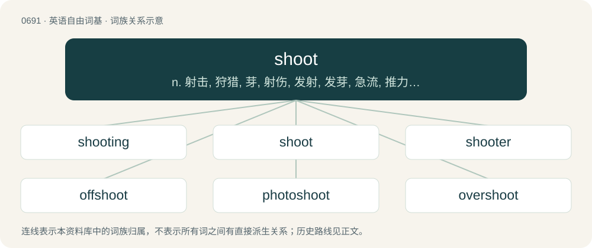

# 0765 · shoot — n. 射击, 狩猎, 芽, 射伤, 发射, 发芽, 急流, 推力, 摄影, 急送, 滑运道, 浪费；vt. 射击, 射中, 损毁, 拍摄, 喷出, 投射, 挥出, 飞速行进, 挥霍, 给...注射；vi. 射出, 射击, 发出, 拍电影, 射门, 发芽

[总目录](../00_总目录_按常用程度.md)

**类型**：英语自由词基　｜　**来源语言**：见词源记录

## 核心含义与来源

- 核心含义：n. 射击, 狩猎, 芽, 射伤, 发射, 发芽, 急流, 推力, 摄影, 急送, 滑运道, 浪费；vt. 射击, 射中, 损毁, 拍摄, 喷出, 投射, 挥出, 飞速行进, 挥霍, 给...注射；vi. 射出, 射击, 发出, 拍电影, 射门, 发芽
- 英文含义：To fire (a weapon that releases a bullet or other projectile).
- 词形：shoot

**多个词源／构词路径**：同一拼写可能有不同来源；以下按词性和含义分别列出。

**来源记录 1**（动词；To fire (a weapon that releases a bullet or other projectile).）

Inherited from Middle English scheten, schoten, from Old English scēotan, from Proto-West Germanic \*skeutan, from Proto-Germanic \*skeutaną, from Proto-Indo-European \*(s)kéwd-e-ti, thematic present of \*(s)kewd- (“to shoot, throw”). Cognates Cognate with West Frisian sjitte, Low German scheten, Dutch schieten, German schießen, Danish skyde, Norwegian Bokmål skyte, Norwegian Nynorsk skyta, Swedish skjuta; and also, through Indo-European, with Russian кида́ть (kidátʹ), Albanian hedh (“to throw, toss”), Persian چست (čost, “quick, active”), Lithuanian skudrùs.

**来源记录 2**（感叹词；A mild expletive, expressing disbelief or dismay）

Minced oath for shit.

## 词族图

## 单词速览（常用到不常用）

| 单词 | 音标 | 释义 |
|---|---|---|
| [shooting](#w-1) | /ˈʃuːtɪŋ/ | n. 发射, 猎场, 射击 |
| [shoot](#w-2) | 英 /ʃuːt/；美 /ʃut/ | n. 射击, 狩猎, 芽, 射伤, 发射, 发芽, 急流, 推力, 摄影, 急送, 滑运道, 浪费；vt. 射击, 射中, 损毁, 拍摄, 喷出, 投射, 挥出, 飞速行进, 挥霍, 给...注射；vi. 射出, 射击, 发出, 拍电影, 射门, 发芽 |
| [shooter](#w-3) | 英 /ˈʃuːtəː/；/ˈʃʉːtə/ | n. 射手, 狩猎者, 手枪 |
| [offshoot](#w-4) | 英 /ˈɒf.ʃuːt/；美 /ˈɔf.ʃuːt/ | n. 分支, 旁系, 衍生事物 |
| [photoshoot](#w-5) |  | 【英文】A session in which a photographer takes a number of photographs of a person or group of people. |
| [overshoot](#w-6) | 英 /ˈəʊ.və.ʃuːt/；美 /ˈoʊ.vɚˌʃut/ | vt. 打过头, 越过；vi. 射击越标, 过火；n. 超越目标, 讲话(或行动)过火 |
| [reshoot](#w-7) | /ɹiːˈʃuːt/ | \[网络\] 再回头重拍；补拍 |

## 逐词详解

### 1. shooting

**词性**：形容词　｜　**音标**：/ˈʃuːtɪŋ/

**中文释义**：n. 发射, 猎场, 射击

**英文义项**：Moving or growing quickly / Of a pain, sudden and darting

**构词拆分**：shoot + -ing

**词源与演化**：

From Middle English shoting, schoting, from Old English scotung (“shooting”), from Proto-Germanic \*skutungō, equivalent to shoot + -ing. Cognate with Dutch schieting, German Erschießung (“shooting”), Swedish skjutning (“shooting”).

**例句**：

> Shooting beams of light played over the sea.

该用例对应义项：Moving or growing quickly

### 2. shoot

**词性**：动词　｜　**音标**：英 /ʃuːt/；美 /ʃut/

**中文释义**：n. 射击, 狩猎, 芽, 射伤, 发射, 发芽, 急流, 推力, 摄影, 急送, 滑运道, 浪费；vt. 射击, 射中, 损毁, 拍摄, 喷出, 投射, 挥出, 飞速行进, 挥霍, 给...注射；vi. 射出, 射击, 发出, 拍电影, 射门, 发芽

**英文义项**：To fire (a weapon that releases a bullet or other projectile). / To fire or launch (a projectile).

**词源与演化**：

Inherited from Middle English scheten, schoten, from Old English scēotan, from Proto-West Germanic \*skeutan, from Proto-Germanic \*skeutaną, from Proto-Indo-European \*(s)kéwd-e-ti, thematic present of \*(s)kewd- (“to shoot, throw”). Cognates Cognate with West Frisian sjitte, Low German scheten, Dutch schieten, German schießen, Danish skyde, Norwegian Bokmål skyte, Norwegian Nynorsk skyta, Swedish skjuta; and also, through Indo-European, with Russian кида́ть (kidátʹ), Albanian hedh (“to throw, toss”), Persian چست (čost, “quick, active”), Lithuanian skudrùs.

**例句**：

> The man, in a desperate bid for freedom, grabbed his gun and started shooting anyone he could.

该用例对应义项：To fire a projectile at (a person or target).

### 3. shooter

**词性**：名词　｜　**音标**：英 /ˈʃuːtəː/；/ˈʃʉːtə/

**中文释义**：n. 射手, 狩猎者, 手枪

**英文义项**：Someone who shoots something; a gunner, archer, etc. / The player throwing the dice.

**构词拆分**：shoot + -er

**词源与演化**：

From Middle English schoter, schuter, schotter, scheter, schetare, scheotere, from Old English sċēotere (“shooter”), equivalent to shoot + -er. Compare Dutch schieter, schutter (“shooter”), German Schießer (“shooter”), Swedish skjutare, West Frisian sjitter (“shooter”).

**例句**：

> We drink tequila as a shooter, but prefer to sip gin slowly to appreciate the flavour.

该用例对应义项：An alcoholic beverage typically served in a shot glass.

### 4. offshoot

**词性**：名词　｜　**音标**：英 /ˈɒf.ʃuːt/；美 /ˈɔf.ʃuːt/

**中文释义**：n. 分支, 旁系, 衍生事物

**英文义项**：Something which shoots off or separates from a main stem or branch of a plant. / Something which develops from something else.

**构词拆分**：off- + shoot

**词源与演化**：

From off- + shoot.

**用法示例／搭配（非完整句）**：

> an offshoot of a criminal organization

该用例对应义项：Something which develops from something else.

### 5. photoshoot

**词性**：名词

**英文义项**：A session in which a photographer takes a number of photographs of a person or group of people.

**构词拆分**：photo + shoot

**词源与演化**：

From photo + shoot.

**例句**：

> We were so excited for the photoshoot.

### 6. overshoot

**词性**：名词　｜　**音标**：英 /ˈəʊ.və.ʃuːt/；美 /ˈoʊ.vɚˌʃut/

**中文释义**：vt. 打过头, 越过；vi. 射击越标, 过火；n. 超越目标, 讲话(或行动)过火

**英文义项**：The amount by which something goes too far. / The situation where the population of a species exceeds its environment's carrying capacity.

**构词拆分**：over- + shoot

**词源与演化**：

From Middle English overshoten, oversheten (“to shoot beyond, shoot past, pour down from above”), perhaps continuing Old English ofersċēotan (“to shoot down”), equivalent to over- + shoot.

**例句**：

> Let's see if we can predict and correct for the overshoot.

该用例对应义项：The amount by which something goes too far.

### 7. reshoot

**词性**：动词　｜　**音标**：/ɹiːˈʃuːt/

**中文释义**：\[网络\] 再回头重拍；补拍

**英文义项**：To shoot again, especially of video recording.

**构词拆分**：re- + shoot

**词源与演化**：

From re- + shoot.

**例句**：

> They had to reshoot the scene because the explosion had made everyone jump.

该用例对应义项：To shoot again, especially of video recording.
