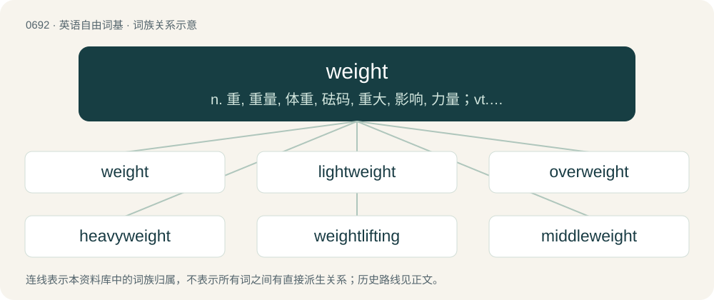

# 0766 · weight — n. 重, 重量, 体重, 砝码, 重大, 影响, 力量；vt. 加重量于, 压迫, 使加权, 称重量；\[计\] 粗细

[总目录](../00_总目录_按常用程度.md)

**类型**：英语自由词基　｜　**来源语言**：见词源记录

## 核心含义与来源

- 核心含义：n. 重, 重量, 体重, 砝码, 重大, 影响, 力量；vt. 加重量于, 压迫, 使加权, 称重量；\[计\] 粗细
- 英文含义：The downwards force an object experiences due to gravity.
- 词形：weight

**来源记录 1**（名词；The downwards force an object experiences due to gravity.）

From Middle English weight, weiȝte, weght, wight, from Old English wiht, ġewiht (“weight”), from Proto-Germanic \*wihtiz ("weight"; compare \*weganą (“to move”)), from Proto-Indo-European \*weǵʰ- (“to move; pull; draw; drive”). Equivalent to weigh + -t (abstract nominal suffix). Cognate with Scots wecht, weicht (“weight”), Saterland Frisian Wächte (“scale”), Gewicht (“weight”), West Frisian gewicht (“weight”), Dutch gewicht (“weight”), German Low German Wicht, Gewicht (“weight”), German Wucht (“massiveness, force”), Gewicht (“weight”).

## 词族图

## 单词速览（常用到不常用）

| 单词 | 音标 | 释义 |
|---|---|---|
| [weight](#w-1) | /weɪt/ | n. 重, 重量, 体重, 砝码, 重大, 影响, 力量；vt. 加重量于, 压迫, 使加权, 称重量；\[计\] 粗细 |
| [lightweight](#w-2) | 美 /ˈlaɪt.weɪt/ | n. 不到平均重量的人/物, 轻量级, 无足轻重的人, 性格不够强的人；a. 平均重量以下的, 重量轻的；\[计\] 轻便的, 轻量的 |
| [overweight](#w-3) | 英 /ˌəʊvəˈweɪt/；美 /ˌoʊvɚˈweɪt/ | n. 超过重量, 过重, 优势；a. 超过重量的, 超重的；vt. 使超重, 重于, 过于重视 |
| [heavyweight](#w-4) | /ˈhɛ.vi.weɪt/ | n. 重量级拳击运动员, (非正式)有影响的要人；a. 最重量级的 |
| [weightlifting](#w-5) | /ˈweɪtˌlɪftɪŋ/ | n. 举重 |
| [middleweight](#w-6) | /ˈmid(ə)lweit/ | n. 中量级拳击选手 |
| [weighty](#w-7) | /ˈweɪti/ | a. 重的, 有份量的, 沉重的, 重大的, 严肃的；\[法\] 有影响力的, 重要的, 重的 |
| [underweight](#w-8) | /ˈʌndəweit/ | n. 重量不足；a. 重量不足的 |
| [bodyweight](#w-9) |  | 体重 |
| [counterweight](#w-10) | /ˈkauntəweit/ | n. 平衡物, 平衡力, 秤锤；\[机\] 配重 |
| [featherweight](#w-11) | 美 /ˈfɛðɚˌweɪt/ | n. 非常轻的人或物, 不重要的人, 轻量级选手 |
| [weightless](#w-12) | /ˈweɪt.ləs/ | a. 无重量的, 失重的, 不重要的 |
| [cruiserweight](#w-13) | /ˈkruːzəweit/ | n. 轻重量级, 轻重量级拳击手 |
| [weightlifter](#w-14) | 美 /ˈweɪtˌlɪftɚ/ | n. 举重者 |
| [bantamweight](#w-15) | 美 /ˈbæntəmˌweɪt/ | n. 最轻量级的拳击选手 |
| [flyweight](#w-16) | /ˈflaiweit/ | n. 次最轻量级选手 |
| [paperweight](#w-17) | /ˈpeipəweit/ | n. 镇纸, 压纸物, 压纸器 |

## 逐词详解

### 1. weight

**词性**：名词　｜　**音标**：/weɪt/

**中文释义**：n. 重, 重量, 体重, 砝码, 重大, 影响, 力量；vt. 加重量于, 压迫, 使加权, 称重量；\[计\] 粗细

**英文义项**：The downwards force an object experiences due to gravity. / An object used to make something heavier.

**构词拆分**：weigh + -t (abstract nominal suffix)

**词源与演化**：

From Middle English weight, weiȝte, weght, wight, from Old English wiht, ġewiht (“weight”), from Proto-Germanic \*wihtiz ("weight"; compare \*weganą (“to move”)), from Proto-Indo-European \*weǵʰ- (“to move; pull; draw; drive”). Equivalent to weigh + -t (abstract nominal suffix). Cognate with Scots wecht, weicht (“weight”), Saterland Frisian Wächte (“scale”), Gewicht (“weight”), West Frisian gewicht (“weight”), Dutch gewicht (“weight”), German Low German Wicht, Gewicht (“weight”), German Wucht (“massiveness, force”), Gewicht (“weight”).

**例句**：

> He's working out with weights. Weight-bearing exercise is now understood to be just as important as cardio.

该用例对应义项：An object, such as a weight plate or barbell, used for strength training.

### 2. lightweight

**词性**：名词　｜　**音标**：美 /ˈlaɪt.weɪt/

**中文释义**：n. 不到平均重量的人/物, 轻量级, 无足轻重的人, 性格不够强的人；a. 平均重量以下的, 重量轻的；\[计\] 轻便的, 轻量的

**英文义项**：A particular weight class, or member of such, as prescribed by the rules, between that of the heavier welterweight and the lighter featherweight. See Wikipedia for the specifics of each sport. / A particular weight category as prescribed by the rules, separate from an open or heavyweight class.

**构词拆分**：light (“not heavy”, adjective) + weight (noun)

**词源与演化**：

From light (“not heavy”, adjective) + weight (noun).

**例句**：

> It's a small and lightweight audio player with extensive format support.

### 3. overweight

**词性**：形容词　｜　**音标**：英 /ˌəʊvəˈweɪt/；美 /ˌoʊvɚˈweɪt/

**中文释义**：n. 超过重量, 过重, 优势；a. 超过重量的, 超重的；vt. 使超重, 重于, 过于重视

**英文义项**：Having a higher weight, especially body fat, than what is generally considered healthy for a given body type and height. / Weighing more than what is allowed for safety or legal commerce.

**构词拆分**：over- + weight

**词源与演化**：

From over- + weight.

**例句**：

> Before her diet, Jane was noticeably overweight, but she shed five kilos in the next two months.

该用例对应义项：Having a higher weight, especially body fat, than what is generally considered healthy for a given body type and height.

### 4. heavyweight

**词性**：名词　｜　**音标**：/ˈhɛ.vi.weɪt/

**中文释义**：n. 重量级拳击运动员, (非正式)有影响的要人；a. 最重量级的

**英文义项**：A very large, heavy, or impressive person. / The professional boxing weight class for boxers weighing more than 190 pounds; a boxer in that division.

**构词拆分**：heavy + weight

**词源与演化**：

From heavy + weight.

**用法示例／搭配（非完整句）**：

> an intellectual heavyweight

该用例对应义项：A very large, heavy, or impressive person.

### 5. weightlifting

**词性**：名词　｜　**音标**：/ˈweɪtˌlɪftɪŋ/

**中文释义**：n. 举重

**英文义项**：A form of exercise in which weights are lifted. / A sport in which competitors lift heavy weights in two events: the snatch and the clean and jerk.

**构词拆分**：weight + lifting

**词源与演化**：

From weight + lifting.

**例句**：

> Luckily for Neo, there is a weightlifting set inside the bathhouse.

### 6. middleweight

**词性**：名词　｜　**音标**：/ˈmid(ə)lweit/

**中文释义**：n. 中量级拳击选手

**英文义项**：A weight class in professional boxing between light middleweight or welterweight and super middleweight or cruiserweight; a similar division in wrestling and other sports / A boxer who fights in this division; a similar wrestler etc

**构词拆分**：middle + weight

**词源与演化**：

From middle + weight.

### 7. weighty

**词性**：形容词　｜　**音标**：/ˈweɪti/

**中文释义**：a. 重的, 有份量的, 沉重的, 重大的, 严肃的；\[法\] 有影响力的, 重要的, 重的

**英文义项**：Having a lot of weight; heavy. / Important; serious; not trivial or petty.

**构词拆分**：weight + -y

**词源与演化**：

From Middle English weighti, weghti, wighti, equivalent to weight + -y. Cognate with Scots weichty, wechty, wichty, Saterland Frisian wichtich, West Frisian wichtich, Dutch wichtig, gewichtig, German wichtig, Danish vigtig, Swedish viktig. Compare typologically Russian ве́ский (véskij), весо́мый (vesómyj) (&lt; вес (ves)). Also compare the same meaning development from cognate (by borrowing) Polish waga (&lt; ... &lt; Proto-Germanic \*wēgō): ważny (whence Russian ва́жный (vážnyj)).

**用法示例／搭配（非完整句）**：

> a weighty argument

该用例对应义项：Important; serious; not trivial or petty.

### 8. underweight

**词性**：形容词　｜　**音标**：/ˈʌndəweit/

**中文释义**：n. 重量不足；a. 重量不足的

**英文义项**：Of an inappropriately or unusually low weight. / Not too heavy for an intended purpose.

**构词拆分**：under- + weight

**词源与演化**：

From under- + weight.

**例句**：

> The suitcase is just slightly underweight; I'll let it on the plane.

该用例对应义项：Not too heavy for an intended purpose.

### 9. bodyweight

**词性**：形容词

**中文释义**：体重

**英文义项**：Employing (only) a person's own weight as resistance to movement for the purpose of physical exercise.

**构词拆分**：body + weight

**词源与演化**：

From body + weight.

**例句**：

> Without access to a gym, Steve focused on bodyweight work.

该用例对应义项：Employing (only) a person's own weight as resistance to movement for the purpose of physical exercise.

### 10. counterweight

**词性**：名词　｜　**音标**：/ˈkauntəweit/

**中文释义**：n. 平衡物, 平衡力, 秤锤；\[机\] 配重

**英文义项**：A heavy mass of often iron or concrete, mechanically linked in opposition to a load which is to be raised and lowered, with the intent of reducing the amount of work which must be done to effect the raising and lowering. Counterweights are used, for example, in cable-hauled elevators and some kinds of movable bridges (e.g. a bascule bridge). / A counterbalance.

**构词拆分**：counter- + weight

**词源与演化**：

From counter- + weight.

**例句**：

> When the elevator goes up, the counterweight goes down.

### 11. featherweight

**词性**：名词　｜　**音标**：美 /ˈfɛðɚˌweɪt/

**中文释义**：n. 非常轻的人或物, 不重要的人, 轻量级选手

**英文义项**：A weight class in many combat sports; e.g. in professional boxing of a maximum of 126 pounds or 57.2 kilograms. / A sportsman who fights in this division.

**构词拆分**：From feather + weight.

**词源与演化**：

From feather + weight.

### 12. weightless

**词性**：形容词　｜　**音标**：/ˈweɪt.ləs/

**中文释义**：a. 无重量的, 失重的, 不重要的

**英文义项**：Without weight. / Not affected by gravity.

**构词拆分**：weight + -less

**词源与演化**：

From weight + -less.

**例句**：

> Floating freely in a weightless condition.

该用例对应义项：having little or no weight or apparent gravitational pull; light

### 13. cruiserweight

**词性**：名词　｜　**音标**：/ˈkruːzəweit/

**中文释义**：n. 轻重量级, 轻重量级拳击手

**英文义项**：Any of several weight classes in boxing or wrestling. / A boxer weighing less than 200lb; heavier than a light heavyweight and lighter than a heavyweight.

**构词拆分**：cruiser + weight

**词源与演化**：

From cruiser + weight.

### 14. weightlifter

**词性**：名词　｜　**音标**：美 /ˈweɪtˌlɪftɚ/

**中文释义**：n. 举重者

**英文义项**：A person who competes for maximum weight lifted in a series of specific lifts. / A person who uses weights to train the muscles of the body, usually for strength or for improved performance in a sport.

**构词拆分**：weight + lifter

**词源与演化**：

From weight + lifter.

**例句**：

> You don't look like a weightlifter.

### 15. bantamweight

**词性**：名词　｜　**音标**：美 /ˈbæntəmˌweɪt/

**中文释义**：n. 最轻量级的拳击选手

**英文义项**：A weight class in boxing and other sports, intermediate between flyweight and featherweight. In boxing it ranges from 112 to 118 pounds (51 to 54 kg). / A boxer or other competitor of this weight.

**构词拆分**：bantam + weight

**词源与演化**：

From bantam + weight.

### 16. flyweight

**词性**：名词　｜　**音标**：/ˈflaiweit/

**中文释义**：n. 次最轻量级选手

**英文义项**：A weight that moves outward depending on centrifugal force. / A weight class in many combat sports; e.g. in professional boxing of a maximum of 112 pounds or 50.8 kilograms.

**构词拆分**：fly + weight

**词源与演化**：

From fly + weight.

**例句**：

> The flyweight champion contended with a strong challenger.

### 17. paperweight

**词性**：名词　｜　**音标**：/ˈpeipəweit/

**中文释义**：n. 镇纸, 压纸物, 压纸器

**英文义项**：A small, decorative, somewhat weighty object placed on one or more pieces of paper to keep them from fluttering away. / Any object used for this purpose.

**构词拆分**：paper + weight

**词源与演化**：

From paper + weight.

**例句**：

> On Windows, the card has a working driver. On Linux right now, it's a paperweight.

该用例对应义项：A useless piece of equipment.
