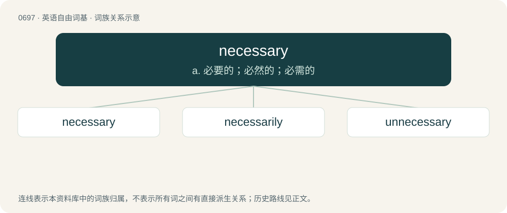

# 0767 · necessary — a. 必要的；必然的；必需的

[总目录](../00_总目录_按常用程度.md)

**类型**：英语自由词基　｜　**来源语言**：见词源记录

## 核心含义与来源

- 核心含义：a. 必要的；必然的；必需的
- 英文含义：Required, essential, whether logically inescapable or needed in order to achieve a desired result or avoid some penalty.
- 词形：necessary

**来源记录 1**（形容词；Required, essential, whether logically inescapable or needed in order to achieve a desired result or avoid some penalty.）

From Middle English necessarye, from Old French necessaire, from Latin necessārius (“unavoidable, inevitable, required”), variant of necesse (“unavoidable, inevitable”), probably from ne or non cessum, from the perfect passive participle of cēdō (“yield; avoid, withdraw”); see cede. Older use as a noun in reference to an outhouse or lavatory under the influence of English and Latin necessārium, a medieval term for the place for monks’ “unavoidable” business, usually located behind or attached to monastic dormitories.

## 词族图

## 单词速览（常用到不常用）

| 单词 | 音标 | 释义 |
|---|---|---|
| [necessary](#w-1) | 英 /ˈnɛs.ə.sɹi/；美 /ˈnɛs.əˌsɛ.ɹi/ | a. 必要的；必然的；必需的 |
| [necessarily](#w-2) | 英 /ˈnɛs.ə.sə.ɹɪ.li/；美 /ˌnɛs.əˈsɛɹ.ə.li/ | adv. 必然地, 必须地, 必要地 |
| [unnecessary](#w-3) | 英 /ʌnˈnɛs.ə.s(ə)ɹɪ/；美 /ʌnˈnɛs.əˌsɛɹ.i/ | a. 不必要的 |

## 逐词详解

### 1. necessary

**词性**：形容词　｜　**音标**：英 /ˈnɛs.ə.sɹi/；美 /ˈnɛs.əˌsɛ.ɹi/

**中文释义**：a. 必要的；必然的；必需的

**英文义项**：Required, essential, whether logically inescapable or needed in order to achieve a desired result or avoid some penalty. / Unavoidable, inevitable.

**词源与演化**：

From Middle English necessarye, from Old French necessaire, from Latin necessārius (“unavoidable, inevitable, required”), variant of necesse (“unavoidable, inevitable”), probably from ne or non cessum, from the perfect passive participle of cēdō (“yield; avoid, withdraw”); see cede. Older use as a noun in reference to an outhouse or lavatory under the influence of English and Latin necessārium, a medieval term for the place for monks’ “unavoidable” business, usually located behind or attached to monastic dormitories.

**例句**：

> It is absolutely necessary that you call and confirm your appointment.

该用例对应义项：Required, essential, whether logically inescapable or needed in order to achieve a desired result or avoid some penalty.

### 2. necessarily

**词性**：副词　｜　**音标**：英 /ˈnɛs.ə.sə.ɹɪ.li/；美 /ˌnɛs.əˈsɛɹ.ə.li/

**中文释义**：adv. 必然地, 必须地, 必要地

**英文义项**：Inevitably; of necessity.

**构词拆分**：necessary + -ly

**词源与演化**：

From necessary + -ly.

**例句**：

> It is not necessarily true that children get their morals from their parents.

该用例对应义项：Inevitably; of necessity.

### 3. unnecessary

**词性**：形容词　｜　**音标**：英 /ʌnˈnɛs.ə.s(ə)ɹɪ/；美 /ʌnˈnɛs.əˌsɛɹ.i/

**中文释义**：a. 不必要的

**英文义项**：Not needed or necessary. / Done in addition to requirements; unrequired.

**构词拆分**：un- + necessary

**词源与演化**：

From un- + necessary.

**例句**：

> The automatic child-frightener made clowns unnecessary.

该用例对应义项：Not needed or necessary.
