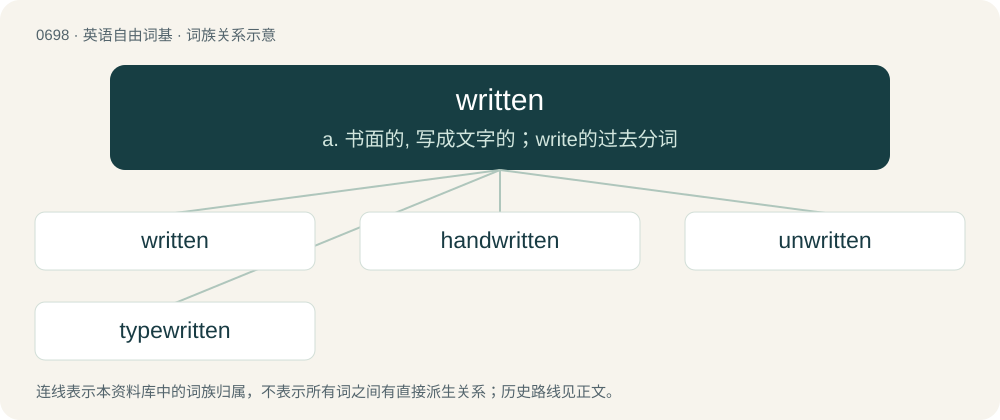

# 0768 · written — a. 书面的, 写成文字的；write的过去分词

[总目录](../00_总目录_按常用程度.md)

**类型**：英语自由词基　｜　**来源语言**：见词源记录

## 核心含义与来源

- 核心含义：a. 书面的, 写成文字的；write的过去分词
- 英文含义：Of, relating, or characteristic of writing (i.e., of that which has been written).
- 词形：written

**来源记录 1**（形容词；Of, relating, or characteristic of writing (i.e., of that which has been written).）

Morphologically write + -en.

## 词族图

## 单词速览（常用到不常用）

| 单词 | 音标 | 释义 |
|---|---|---|
| [written](#w-1) | /ˈɹɪ.tn̩/ | a. 书面的, 写成文字的；write的过去分词 |
| [handwritten](#w-2) | /ˈhænd.ritən/ | a. 手写的 |
| [unwritten](#w-3) | /.ʌnˈritn/ | a. 非书面的, 没有写的, 没有记录的, 口头的；\[法\] 习惯, 不成文的, 未记诸文字的 |
| [typewritten](#w-4) | /ˈtaipritn/ | a. 用打字机打出的 |

## 逐词详解

### 1. written

**词性**：形容词　｜　**音标**：/ˈɹɪ.tn̩/

**中文释义**：a. 书面的, 写成文字的；write的过去分词

**英文义项**：Of, relating, or characteristic of writing (i.e., of that which has been written). / Having been written.

**构词拆分**：write + -en

**词源与演化**：

Morphologically write + -en.

**例句**：

> I can speak Japanese fairly well, but I have no understanding whatsoever of written Japanese.

该用例对应义项：Having been written.

### 2. handwritten

**词性**：形容词　｜　**音标**：/ˈhænd.ritən/

**中文释义**：a. 手写的

**英文义项**：Written with a person's hand, as opposed to typed.

**构词拆分**：hand + written

**词源与演化**：

From hand + written.

**例句**：

> Even small gestures, like a handwritten note, can touch my heart deeply.

### 3. unwritten

**词性**：形容词　｜　**音标**：/.ʌnˈritn/

**中文释义**：a. 非书面的, 没有写的, 没有记录的, 口头的；\[法\] 习惯, 不成文的, 未记诸文字的

**英文义项**：Not written. / Oral or otherwise communicated without writing.

**构词拆分**：un- + written

**词源与演化**：

From Middle English unwriten, from Old English unwriten, unġewriten (“unwritten”), equivalent to un- + written.

**例句**：

> It's an unwritten rule that you lock the gate when you leave the swimming pool.

该用例对应义项：Implicit or understood but not formally articulated.

### 4. typewritten

**词性**：形容词　｜　**音标**：/ˈtaipritn/

**中文释义**：a. 用打字机打出的

**英文义项**：written using a typewriter

**构词拆分**：type + written

**词源与演化**：

From type + written.
