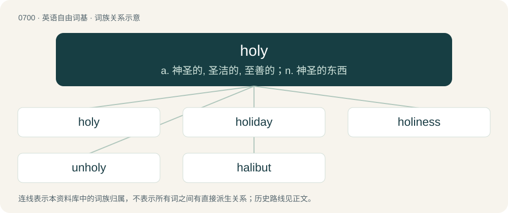

# 0769 · holy — a. 神圣的, 圣洁的, 至善的；n. 神圣的东西

[总目录](../00_总目录_按常用程度.md)

**类型**：英语自由词基　｜　**来源语言**：见词源记录

## 核心含义与来源

- 核心含义：a. 神圣的, 圣洁的, 至善的；n. 神圣的东西
- 英文含义：Dedicated to a religious purpose or a god.
- 词形：holy

**来源记录 1**（形容词；Dedicated to a religious purpose or a god.）

From Middle English ali, aly, hale, halege, hali, halȝe, hayly, holi, holia, holie, holiȝ, holy, hooly, oli, oly, wholy, woly, from Old English hāleġ, hāliġ (“holy, sacred; healthy, sound”), from Proto-West Germanic \*hailag, from Proto-Germanic \*hailagaz (“holy, sacred”), from Proto-Germanic \*hailaz (“healthy; whole”), from Proto-Indo-European \*kéh₂ilos (“intact, whole; complete; hale, healthy, sound”), equivalent to whole + -y and a doublet of later wholly. Cognates Cognate with Scots halie, haly (“holy”), Yola holly, holy (“holy”), Saterland Frisian helig (“holy”), Alemannic German, Dutch, and German heilig (“holy, sacred”), Cimbrian hòolig (“holy”), Luxembourgish helleg (“holy”), Vilamovian haeliḱ, haliky, hȧlikjy, hǡliḱ (“holy”), Yiddish הייליק (heylik, “holy”), Danish and Norwegian Bokmål hellig (“holy”), Faroese heilagur (“holy”), Icelandic heilagur, helgur (“holy”), Norwegian Nynorsk heilag, heilag’u (“holy”), Swedish helig (“holy”), Gothic 𐌷𐌰𐌹𐌻𐌰𐌲𐍃 (hailags, “holy”); also Latin cael, caelus, caelum, coelus, coelum (“heaven; sky; climate, weather”), Belarusian цэ́лы (cély, “entire, whole”), Bulgarian цял (cjal, “entire, full, intact, whole; real, regular, veritable”), Czech and Slovak celý (“whole”), Macedonian цел (cel, “entire, whole”), Polish cały (“entire, whole”), Russian це́лый (célyj, “entire, whole”), Serbo-Croatian це̏о, ци̏јел, ци̏о, cȅo, cȉjel, cȉo (“entire, whole”), Slovene cel (“whole”), Ukrainian ці́лий (cílyj, “entire, whole”). More at whole.

## 词族图

## 单词速览（常用到不常用）

| 单词 | 音标 | 释义 |
|---|---|---|
| [holy](#w-1) | 英 /ˈhəʊli/；美 /ˈhoʊli/ | a. 神圣的, 圣洁的, 至善的；n. 神圣的东西 |
| [holiday](#w-2) | 英 /ˈhɒlɪˌdeɪ/；美 /ˈhɑləˌdeɪ/ | n. 假日, 假期, 节日；vi. 度假 |
| [holiness](#w-3) | 英 /ˈhəʊlinəs/；美 /ˈhoʊlinəs/ | n. 神圣；圣座（大写, 对教宗等的尊称） |
| [unholy](#w-4) | /ʌnˈhəʊli/ | a. 不神圣的, 不虔诚的, 邪恶的 |
| [halibut](#w-5) | /ˈhæ.lɪ.bət/ | n. 大比目鱼 |

## 逐词详解

### 1. holy

**词性**：形容词　｜　**音标**：英 /ˈhəʊli/；美 /ˈhoʊli/

**中文释义**：a. 神圣的, 圣洁的, 至善的；n. 神圣的东西

**英文义项**：Dedicated to a religious purpose or a god. / Revered in a religion.

**构词拆分**：whole + -y

**词源与演化**：

From Middle English ali, aly, hale, halege, hali, halȝe, hayly, holi, holia, holie, holiȝ, holy, hooly, oli, oly, wholy, woly, from Old English hāleġ, hāliġ (“holy, sacred; healthy, sound”), from Proto-West Germanic \*hailag, from Proto-Germanic \*hailagaz (“holy, sacred”), from Proto-Germanic \*hailaz (“healthy; whole”), from Proto-Indo-European \*kéh₂ilos (“intact, whole; complete; hale, healthy, sound”), equivalent to whole + -y and a doublet of later wholly. Cognates Cognate with Scots halie, haly (“holy”), Yola holly, holy (“holy”), Saterland Frisian helig (“holy”), Alemannic German, Dutch, and German heilig (“holy, sacred”), Cimbrian hòolig (“holy”), Luxembourgish helleg (“holy”), Vilamovian haeliḱ, haliky, hȧlikjy, hǡliḱ (“holy”), Yiddish הייליק (heylik, “holy”), Danish and Norwegian Bokmål hellig (“holy”), Faroese heilagur (“holy”), Icelandic heilagur, helgur (“holy”), Norwegian Nynorsk heilag, heilag’u (“holy”), Swedish helig (“holy”), Gothic 𐌷𐌰𐌹𐌻𐌰𐌲𐍃 (hailags, “holy”); also Latin cael, caelus, caelum, coelus, coelum (“heaven; sky; climate, weather”), Belarusian цэ́лы (cély, “entire, whole”), Bulgarian цял (cjal, “entire, full, intact, whole; real, regular, veritable”), Czech and Slovak celý (“whole”), Macedonian цел (cel, “entire, whole”), Polish cały (“entire, whole”), Russian це́лый (célyj, “entire, whole”), Serbo-Croatian це̏о, ци̏јел, ци̏о, cȅo, cȉjel, cȉo (“entire, whole”), Slovene cel (“whole”), Ukrainian ці́лий (cílyj, “entire, whole”). More at whole.

**例句**：

> I'm planning to visit the holy city of Jerusalem this Christmas.

该用例对应义项：Dedicated to a religious purpose or a god.

### 2. holiday

**词性**：名词　｜　**音标**：英 /ˈhɒlɪˌdeɪ/；美 /ˈhɑləˌdeɪ/

**中文释义**：n. 假日, 假期, 节日；vi. 度假

**英文义项**：A day on which a religious event or secular celebration is traditionally observed. / A day declared free from work by the state or government.

**构词拆分**：holy + day

**词源与演化**：

From Middle English halyday, holyday, halidei, haliȝdei, from Old English hāliġdæġ (“holy day, Sabbath”), equivalent to holy + day. Compare West Frisian hjeldei (“holiday”), Danish helligdag (“holiday”), Norwegian helligdag (“holiday”), Swedish helgdag (“holiday, feast”).

**例句**：

> I want to take a French course this summer holiday.

该用例对应义项：A period during which pupils do not attend their school; often plural; rarely used for students at university (usually: vacation).

### 3. holiness

**词性**：名词　｜　**音标**：英 /ˈhəʊlinəs/；美 /ˈhoʊlinəs/

**中文释义**：n. 神圣；圣座（大写, 对教宗等的尊称）

**英文义项**：The state or condition of being holy.

**构词拆分**：holy + -ness

**词源与演化**：

From Middle English holynesse, holinesse, halinesse, from Old English hāliġnes (“holiness, a holy thing, rites”), from Proto-West Germanic \*hailagnassī, equivalent to holy + -ness. Cognate with West Frisian hilligens (“holiness”), Old High German heilagnissi, heilīgnissi (“holiness”), whence Middle High German heilignis (“halidom”).

**例句**：

> She felt something akin to holiness; well, she wasn't sure if it was that, but it felt like something stronger than goodness.

### 4. unholy

**词性**：形容词　｜　**音标**：/ʌnˈhəʊli/

**中文释义**：a. 不神圣的, 不虔诚的, 邪恶的

**英文义项**：Not holy; (by extension) evil, impure, or otherwise perverted. / Dreadful, terrible, excessive, or otherwise atrocious.

**构词拆分**：un- + holy

**词源与演化**：

From Middle English unholi, unhaliȝ, from Old English unhāliġ, from Proto-Germanic \*unhailagaz, equivalent to un- + holy. Cognate with Scots unhaly, Dutch onheilig, German Low German unhillig, German unheilig, Danish uhellig, Swedish ohelig.

**例句**：

> I've been spending an unholy amount of time trying to write a novel!

该用例对应义项：Dreadful, terrible, excessive, or otherwise atrocious.

### 5. halibut

**词性**：名词　｜　**音标**：/ˈhæ.lɪ.bət/

**中文释义**：n. 大比目鱼

**英文义项**：A large flatfish of the genus Hippoglossus, which sometimes leaves the ocean floor and swims vertically.

**构词拆分**：holy + butt (“flatfish”)

**词源与演化**：

From Middle English halibut, equivalent to holy + butt (“flatfish”), since the fish was often eaten on holy days. Cognate with Dutch heilbot, German Heiligbutt, Heilbutt, Heilbutte, Danish helleflynder, Swedish helgeflundra, and Norwegian Nynorsk hellefisk.

**例句**：

> They eat half of the world's halibut.
