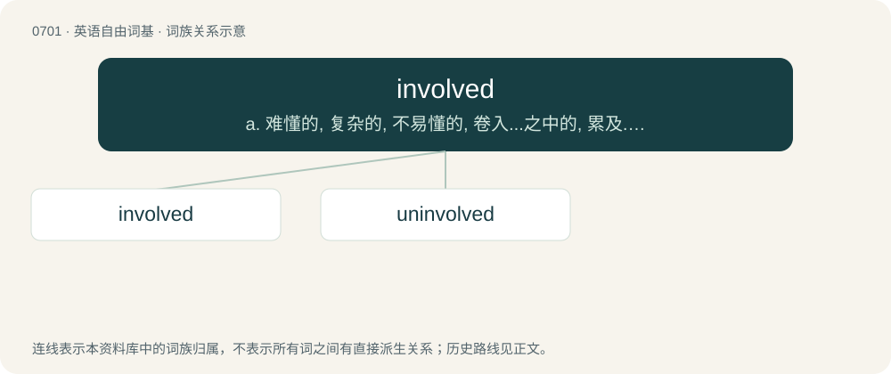

# 0770 · involved — a. 难懂的, 复杂的, 不易懂的, 卷入...之中的, 累及..., 与...有关, 被纠缠的；\[计\] 包含, 涉及

[总目录](../00_总目录_按常用程度.md)

**类型**：英语自由词基　｜　**来源语言**：见词源记录

## 核心含义与来源

- 核心含义：a. 难懂的, 复杂的, 不易懂的, 卷入...之中的, 累及..., 与...有关, 被纠缠的；\[计\] 包含, 涉及
- 英文含义：Complicated.
- 词形：involved

**来源记录 1**（形容词；Complicated.）

From involve + -ed.

## 词族图

## 单词速览（常用到不常用）

| 单词 | 音标 | 释义 |
|---|---|---|
| [involved](#w-1) | 英 /ɪnˈvɒlvd/；美 /ɪnˈvɑlvd/ | a. 难懂的, 复杂的, 不易懂的, 卷入...之中的, 累及..., 与...有关, 被纠缠的；\[计\] 包含, 涉及 |
| [uninvolved](#w-2) | /ˌʌnɪnˈvɒlvd/ | \[医\]未受累的; 壁上观 |

## 逐词详解

### 1. involved

**词性**：形容词　｜　**音标**：英 /ɪnˈvɒlvd/；美 /ɪnˈvɑlvd/

**中文释义**：a. 难懂的, 复杂的, 不易懂的, 卷入...之中的, 累及..., 与...有关, 被纠缠的；\[计\] 包含, 涉及

**英文义项**：Complicated. / Associated with others, be a participant or make someone be a participant (in a crime, process, etc.)

**构词拆分**：From involve + -ed.

**词源与演化**：

From involve + -ed.

**例句**：

> When the family wrapped up my father's will, no one tried to make me feel involved.

该用例对应义项：Associated with others, be a participant or make someone be a participant (in a crime, process, etc.)

### 2. uninvolved

**词性**：形容词　｜　**音标**：/ˌʌnɪnˈvɒlvd/

**中文释义**：\[医\]未受累的; 壁上观

**英文义项**：Not involved. / Emotionally distant.

**构词拆分**：un- + involved

**词源与演化**：

From un- + involved.

**例句**：

> Being uninvolved he remained objective.

该用例对应义项：not involved
