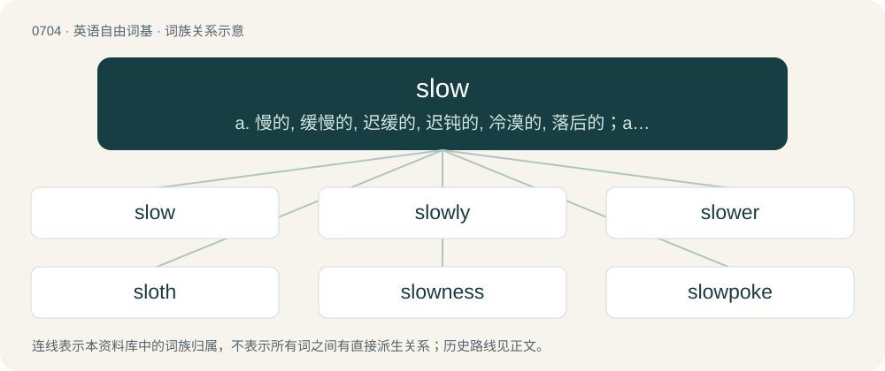

# 0775 · slow — a. 慢的, 缓慢的, 迟缓的, 迟钝的, 冷漠的, 落后的；adv. 慢地, 迟缓地；v. (使)慢下来

[总目录](../00_总目录_按常用程度.md)

**类型**：英语自由词基　｜　**来源语言**：见词源记录

## 核心含义与来源

- 核心含义：a. 慢的, 缓慢的, 迟缓的, 迟钝的, 冷漠的, 落后的；adv. 慢地, 迟缓地；v. (使)慢下来
- 英文含义：Taking a long time to move or go a short distance, or to perform an action; not quick in motion; proceeding at a low speed.
- 词形：slow

**来源记录 1**（形容词；Taking a long time to move or go a short distance, or to perform an action; not quick in motion; proceeding at a low speed.）

From Middle English slaw, slow, from Old English slāw (“lazy; inert, slow”), from Proto-West Germanic \*slaiw, from Proto-Germanic \*slaiwaz (“blunt; dull; exhausted, faint, sluggish, weak, weary; listless, torpid; dim-witted, slow; lazy, slack”), possibly from Proto-Indo-European \*sleyH-u- (“bad”). Cognates Cognate with Dutch slee, sleeuw (“cramped, stiff; blunt; sour”), Danish sløv (“blunt; dull; apathetic, lethargic, listless, sluggish, torpid; drowsy”), Icelandic sljór (“dim-witted; blunt; jaded”), Norwegian Nynorsk sljo, slø, sløv (“blunt; weak; lazy”), Swedish slö (“dull; lazy, lethargic, slow, sluggish”).

## 词族图

## 单词速览（常用到不常用）

| 单词 | 音标 | 释义 |
|---|---|---|
| [slow](#w-1) | 英 /sləʊ/；美 /sloʊ/ | a. 慢的, 缓慢的, 迟缓的, 迟钝的, 冷漠的, 落后的；adv. 慢地, 迟缓地；v. (使)慢下来 |
| [slowly](#w-2) | 英 /ˈsləʊli/；美 /ˈsloʊli/ | adv. 慢慢地, 迟缓地 |
| [slower](#w-3) | 英 /ˈsləʊə/；美 /ˈsloʊɚ/ | \[计\] 减慢 |
| [sloth](#w-4) | 英 /sləʊθ/；美 /slɔθ/ | n. 怠惰, 懒惰 |
| [slowness](#w-5) | /ˈsləunis/ | n. 缓慢, 迟钝 |
| [slowpoke](#w-6) | 美 /ˈsloʊˌpoʊk/ | n. 行动迟缓的人 |

## 逐词详解

### 1. slow

**词性**：形容词　｜　**音标**：英 /sləʊ/；美 /sloʊ/

**中文释义**：a. 慢的, 缓慢的, 迟缓的, 迟钝的, 冷漠的, 落后的；adv. 慢地, 迟缓地；v. (使)慢下来

**英文义项**：Taking a long time to move or go a short distance, or to perform an action; not quick in motion; proceeding at a low speed. / Not happening in a short time; spread over a comparatively long time.

**词源与演化**：

From Middle English slaw, slow, from Old English slāw (“lazy; inert, slow”), from Proto-West Germanic \*slaiw, from Proto-Germanic \*slaiwaz (“blunt; dull; exhausted, faint, sluggish, weak, weary; listless, torpid; dim-witted, slow; lazy, slack”), possibly from Proto-Indo-European \*sleyH-u- (“bad”). Cognates Cognate with Dutch slee, sleeuw (“cramped, stiff; blunt; sour”), Danish sløv (“blunt; dull; apathetic, lethargic, listless, sluggish, torpid; drowsy”), Icelandic sljór (“dim-witted; blunt; jaded”), Norwegian Nynorsk sljo, slø, sløv (“blunt; weak; lazy”), Swedish slö (“dull; lazy, lethargic, slow, sluggish”).

**例句**：

> It was a slow news day, so the editor asked us to make our articles wordier.

该用例对应义项：Not busy; lacking activity.

### 2. slowly

**词性**：副词　｜　**音标**：英 /ˈsləʊli/；美 /ˈsloʊli/

**中文释义**：adv. 慢慢地, 迟缓地

**英文义项**：At a slow pace.

**构词拆分**：slow + -ly

**词源与演化**：

From Middle English slowly, slowli, slouli, slowliche, from Old English slāwlīċe (“slowly; sluggishly”), equivalent to slow + -ly. Compare Old Norse slæliga, sljóliga.

**例句**：

> ALS slowly destroys the nerves and muscles needed for moving your body.

### 3. slower

**词性**：名词　｜　**音标**：英 /ˈsləʊə/；美 /ˈsloʊɚ/

**中文释义**：\[计\] 减慢

**英文义项**：That which slows.

**构词拆分**：slow + -er

**词源与演化**：

From slow + -er.

**例句**：

> I can't keep up with you. Could you dictate a bit slower?

### 4. sloth

**词性**：名词　｜　**音标**：英 /sləʊθ/；美 /slɔθ/

**中文释义**：n. 怠惰, 懒惰

**英文义项**：Laziness; slowness of mind; disinclination to action or labour; a feeling combining indifference and lethargy; a dragging idleness. / Any member of species of the families Choloepodidae and Bradypodidae of herbivorous, arboreal South American mammals, noted for its slowness and inactivity.

**构词拆分**：slow + -th (abstract nominal suffix)

**词源与演化**：

From Middle English slouthe, slewthe (“laziness”), from Old English slǣwþ (“sloth, indolence, laziness, inertness, torpor”), from Proto-West Germanic \*slaiwiþu, from Proto-Germanic \*slaiwiþō (“slowness, lateness”), equivalent to slow + -th (abstract nominal suffix). Cognate with Scots sleuth (“sloth, slowness”).

**例句**：

> Hot summer days inspire a sense of sloth in me.

该用例对应义项：Laziness; slowness of mind; disinclination to action or labour; a feeling combining indifference and lethargy; a dragging idleness.

### 5. slowness

**词性**：名词　｜　**音标**：/ˈsləunis/

**中文释义**：n. 缓慢, 迟钝

**英文义项**：The quality or state of being slow. / A unit, the reciprocal of velocity, that delineates the amount of time required for an object to travel a given distance.

**构词拆分**：slow + -ness

**词源与演化**：

From slow + -ness.

**例句**：

> The railroad isn't to blame for the slowness of the mail.

### 6. slowpoke

**词性**：名词　｜　**音标**：美 /ˈsloʊˌpoʊk/

**中文释义**：n. 行动迟缓的人

**英文义项**：A person who moves slowly or takes a long time to do something.

**构词拆分**：slow + poke

**词源与演化**：

From slow + poke.

**例句**：

> Hey, you slowpokes in the back! Get a move on!

该用例对应义项：A person who moves slowly or takes a long time to do something.
