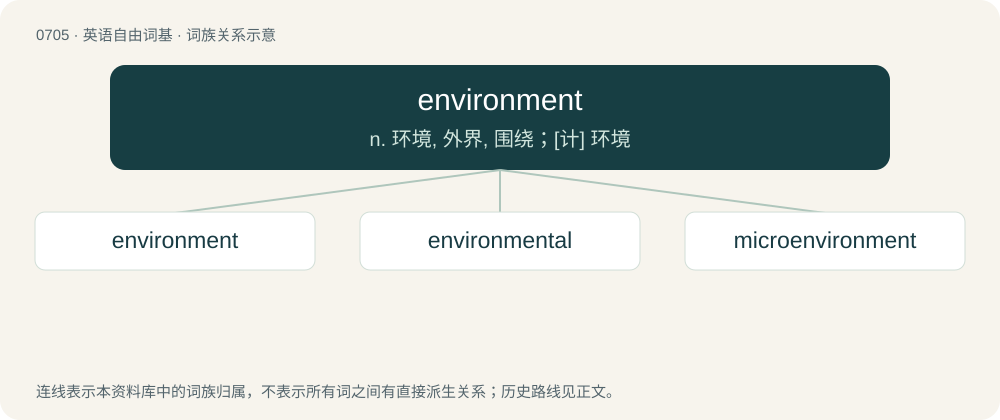

# 0776 · environment — n. 环境, 外界, 围绕；\[计\] 环境

[总目录](../00_总目录_按常用程度.md)

**类型**：英语自由词基　｜　**来源语言**：见词源记录

## 核心含义与来源

- 核心含义：n. 环境, 外界, 围绕；\[计\] 环境
- 英文含义：The surroundings of, and influences on, a particular item of interest.
- 词形：environment

**来源记录 1**（名词；The surroundings of, and influences on, a particular item of interest.）

From Middle French environnement. Compare French environnement. By surface analysis, environ + -ment.

## 词族图

## 单词速览（常用到不常用）

| 单词 | 音标 | 释义 |
|---|---|---|
| [environment](#w-1) | 英 /ɪnˈvaɪ.ɹə.mənt/；美 /ɪnˈvaɪ.ɚn.mənt/ | n. 环境, 外界, 围绕；\[计\] 环境 |
| [environmental](#w-2) | 英 /ɪnˌvaɪ.ɹə(n)ˈmɛn.təl/；美 /ənˌvaɪ.ɚnˈmɛn.təl/ | a. 周围的, 环境的；\[经\] 环境的, 环保的 |
| [microenvironment](#w-3) | /,maikrəjinˈvaiərənmənt, -enˈvaiə-/ | n. 小环境；\[化\] 微环境 |

## 逐词详解

### 1. environment

**词性**：名词　｜　**音标**：英 /ɪnˈvaɪ.ɹə.mənt/；美 /ɪnˈvaɪ.ɚn.mənt/

**中文释义**：n. 环境, 外界, 围绕；\[计\] 环境

**英文义项**：The surroundings of, and influences on, a particular item of interest. / The natural world or ecosystem.

**构词拆分**：By surface analysis, environ + -ment

**词源与演化**：

From Middle French environnement. Compare French environnement. By surface analysis, environ + -ment.

**例句**：

> That program uses the Microsoft Windows environment.

该用例对应义项：The software or hardware existing on any particular computer system.

### 2. environmental

**词性**：形容词　｜　**音标**：英 /ɪnˌvaɪ.ɹə(n)ˈmɛn.təl/；美 /ənˌvaɪ.ɚnˈmɛn.təl/

**中文释义**：a. 周围的, 环境的；\[经\] 环境的, 环保的

**英文义项**：Pertaining to the environment. / Environmentally friendly.

**构词拆分**：environment + -al

**词源与演化**：

From environment + -al.

**例句**：

> Not a day goes by without our hearing of an environmental problem.

### 3. microenvironment

**词性**：名词　｜　**音标**：/,maikrəjinˈvaiərənmənt, -enˈvaiə-/

**中文释义**：n. 小环境；\[化\] 微环境

**英文义项**：A very small area that has different characteristics than its surroundings; the milieu (set of conditions) within this area. / Synonym of microhabitat.

**构词拆分**：micro- + environment

**词源与演化**：

From micro- + environment.
