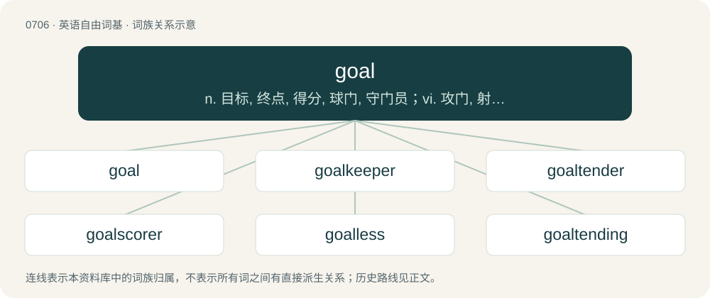

# 0777 · goal — n. 目标, 终点, 得分, 球门, 守门员；vi. 攻门, 射门得分

[总目录](../00_总目录_按常用程度.md)

**类型**：英语自由词基　｜　**来源语言**：见词源记录

## 核心含义与来源

- 核心含义：n. 目标, 终点, 得分, 球门, 守门员；vi. 攻门, 射门得分
- 英文含义：A result that one is attempting to achieve.
- 词形：goal

**来源记录 1**（名词；A result that one is attempting to achieve.）

From Middle English gol (“boundary, limit”), from Old English \*gāl (“obstacle, barrier, marker”), from Proto-West Germanic \*gailu, from Proto-Germanic \*gailō (“crevice, gap”); compare the Old English's derivatives Old English gǣlan (“to hinder, delay”), and hyġegǣls (“hesitating, slow, sluggish”), hyġegǣlsa (“slow one, sluggish one”). Possibly cognate with Lithuanian gãlas (“end”), Latvian gals (“end”), Old Prussian gallan (“death”), Albanian ngalem (“to be limping, lame, paralyzed”), ngel (“to remain, linger, hesitate, get stuck”).

## 词族图

## 单词速览（常用到不常用）

| 单词 | 音标 | 释义 |
|---|---|---|
| [goal](#w-1) | 英 /ɡəʊl/；美 /ɡoʊl/ | n. 目标, 终点, 得分, 球门, 守门员；vi. 攻门, 射门得分 |
| [goalkeeper](#w-2) | 英 /ˈɡəʊlˌkiː.pə/；美 /ˈɡoʊl.kiːpɚ/ | n. 守门员 |
| [goaltender](#w-3) | /ˈ^əjl,tendə(r)/ | n. (=goalkeeper)(足球等运动的)守门员 |
| [goalscorer](#w-4) | /ˈgəʊlskɔːrə(r)/ | \[体\]得分者 |
| [goalless](#w-5) | /ˈgəʊlləs/ | a. （比赛结果）零比零的 |
| [goaltending](#w-6) | /ɡəʊlˈtendɪŋ/ | n. \[体\]干扰投篮得分 |
| [goalscoring](#w-7) |  | 【英文】The scoring of goals. |
| [goalpost](#w-8) | 英 /ˈɡəʊlpəʊst/；美 /ˈɡoʊlpoʊst/ | n. 球门柱 |

## 逐词详解

### 1. goal

**词性**：名词　｜　**音标**：英 /ɡəʊl/；美 /ɡoʊl/

**中文释义**：n. 目标, 终点, 得分, 球门, 守门员；vi. 攻门, 射门得分

**英文义项**：A result that one is attempting to achieve. / In many sports, an area into which the players attempt to put an object.

**词源与演化**：

From Middle English gol (“boundary, limit”), from Old English \*gāl (“obstacle, barrier, marker”), from Proto-West Germanic \*gailu, from Proto-Germanic \*gailō (“crevice, gap”); compare the Old English's derivatives Old English gǣlan (“to hinder, delay”), and hyġegǣls (“hesitating, slow, sluggish”), hyġegǣlsa (“slow one, sluggish one”). Possibly cognate with Lithuanian gãlas (“end”), Latvian gals (“end”), Old Prussian gallan (“death”), Albanian ngalem (“to be limping, lame, paralyzed”), ngel (“to remain, linger, hesitate, get stuck”).

**例句**：

> She failed in her goal to become captain of the team.

该用例对应义项：A result that one is attempting to achieve.

### 2. goalkeeper

**词性**：名词　｜　**音标**：英 /ˈɡəʊlˌkiː.pə/；美 /ˈɡoʊl.kiːpɚ/

**中文释义**：n. 守门员

**英文义项**：A designated player that attempts to prevent the opposing team from scoring by protecting a goal.

**构词拆分**：From goal + keeper.

**词源与演化**：

From goal + keeper.

**例句**：

> The goalkeeper for France dived to the ground and saved Ronaldo’s shot.

### 3. goaltender

**词性**：名词　｜　**音标**：/ˈ^əjl,tendə(r)/

**中文释义**：n. (=goalkeeper)(足球等运动的)守门员

**英文义项**：a designated player that attempts to prevent the opposing team from scoring by protecting a goal.

**构词拆分**：goal + tender

**词源与演化**：

From goal + tender.

### 4. goalscorer

**词性**：名词　｜　**音标**：/ˈgəʊlskɔːrə(r)/

**中文释义**：\[体\]得分者

**英文义项**：A person who scores a goal, or scores goals.

**构词拆分**：goal + scorer

**词源与演化**：

From goal + scorer.

**用法示例／搭配（非完整句）**：

> the top goalscorer

该用例对应义项：A person who scores a goal, or scores goals.

### 5. goalless

**词性**：形容词　｜　**音标**：/ˈgəʊlləs/

**中文释义**：a. （比赛结果）零比零的

**英文义项**：Devoid of goals; ambitionless. / Without goals; in which no goals have been scored; having scored no goals.

**构词拆分**：goal + -less

**词源与演化**：

From goal + -less.

**例句**：

> As in 1872, so in 2021: England and Scotland played out a goalless draw.

### 6. goaltending

**词性**：名词　｜　**音标**：/ɡəʊlˈtendɪŋ/

**中文释义**：n. \[体\]干扰投篮得分

**英文义项**：A violation which occurs when a player interferes with the movement of the ball that is on its downward path toward the basket or on or within the rim of the basket, or after the ball touched the backboard. / The activity of a goaltender.

**构词拆分**：goal + tending

**词源与演化**：

From goal + tending.

### 7. goalscoring

**词性**：名词

**英文义项**：The scoring of goals.

**构词拆分**：goal + scoring

**词源与演化**：

From goal + scoring.

### 8. goalpost

**词性**：名词　｜　**音标**：英 /ˈɡəʊlpəʊst/；美 /ˈɡoʊlpoʊst/

**中文释义**：n. 球门柱

**英文义项**：One of the two vertical side poles of a goal. / The tall Y-shaped upright, now usually of fiberglass, at either end of the playing field, through which a football must go in order for a field goal to be scored. (They were originally H-shaped, with one wooden post on either side.)

**构词拆分**：goal + post

**词源与演化**：

From goal + post.

**例句**：

> The ball ricocheted off the goalpost and went in.
