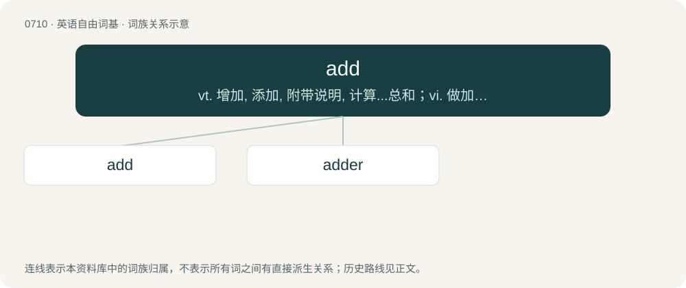

# 0780 · add — vt. 增加, 添加, 附带说明, 计算...总和；vi. 做加法, 积累而成, 增添；\[计\] 加法

[总目录](../00_总目录_按常用程度.md)

**类型**：英语自由词基　｜　**来源语言**：见词源记录

## 核心含义与来源

- 核心含义：vt. 增加, 添加, 附带说明, 计算...总和；vi. 做加法, 积累而成, 增添；\[计\] 加法
- 英文含义：To join or unite (e.g. one thing to another, or as several particulars) so as to increase the number, augment the quantity, or enlarge the magnitude, or so as to form into one aggregate.
- 词形：add

**来源记录 1**（动词；To join or unite (e.g. one thing to another, or as several particulars) so as to increase the number, augment the quantity, or enlarge the magnitude, or so as to form into one aggregate.）

From Middle English adden, from Latin addō (“add, give unto”).

## 词族图

## 单词速览（常用到不常用）

| 单词 | 音标 | 释义 |
|---|---|---|
| [add](#w-1) | /æd/ | vt. 增加, 添加, 附带说明, 计算...总和；vi. 做加法, 积累而成, 增添；\[计\] 加法 |
| [adder](#w-2) | 美 /ˈædɚ/ | 【英文】Someone who or something which performs arithmetic addition; a machine for adding numbers. |

## 逐词详解

### 1. add

**词性**：动词　｜　**音标**：/æd/

**中文释义**：vt. 增加, 添加, 附带说明, 计算...总和；vi. 做加法, 积累而成, 增添；\[计\] 加法

**英文义项**：To join or unite (e.g. one thing to another, or as several particulars) so as to increase the number, augment the quantity, or enlarge the magnitude, or so as to form into one aggregate. / To sum up; to put together mentally; to add up.

**词源与演化**：

From Middle English adden, from Latin addō (“add, give unto”).

**例句**：

> Typically, a hostile mob will add whenever it's within the aggro radius of a player.

该用例对应义项：To summon minions or reinforcements.

### 2. adder

**词性**：名词　｜　**音标**：美 /ˈædɚ/

**英文义项**：Someone who or something which performs arithmetic addition; a machine for adding numbers. / An electronic device that adds voltages, currents or frequencies.

**构词拆分**：add + -er

**词源与演化**：

From add + -er.

**例句**：

> They sought out cost adders with an eye toward eliminating them.

该用例对应义项：Something which adds or increases.
