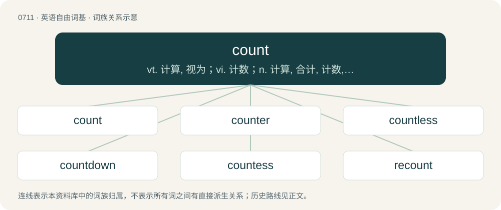

# 0781 · count — vt. 计算, 视为；vi. 计数；n. 计算, 合计, 计数, 伯爵

[总目录](../00_总目录_按常用程度.md)

**类型**：英语自由词基　｜　**来源语言**：见词源记录

## 核心含义与来源

- 核心含义：vt. 计算, 视为；vi. 计数；n. 计算, 合计, 计数, 伯爵
- 英文含义：To recite numbers in sequence.
- 词形：count

**多个词源／构词路径**：同一拼写可能有不同来源；以下按词性和含义分别列出。

**来源记录 1**（动词；To recite numbers in sequence.）

From Middle English counten, borrowed from Anglo-Norman conter, from Old French conter (“add up; tell a story”), from Latin computō (“to compute”). In this sense, displaced native Old English tellan, whence Modern English tell. Doublet of compute. Compare typologically reckon, Russian счита́ть (sčitátʹ), счита́ться (sčitátʹsja); the semantic evolution to Mongolian санах (sanax).

**来源记录 2**（名词；The male ruler of a county.）

From Middle English counte, from Anglo-Norman conte and Old French comte (“count”), from Latin comes (“companion”) (more specifically derived from its accusative form comitem) in the sense of "noble fighting alongside the king". Doublet of comes, comte, and conte.

## 词族图

## 单词速览（常用到不常用）

| 单词 | 音标 | 释义 |
|---|---|---|
| [count](#w-1) | 英 /kaʊnt/ | vt. 计算, 视为；vi. 计数；n. 计算, 合计, 计数, 伯爵 |
| [counter](#w-2) | 英 /ˈkaʊn.tə/；美 /ˈkaʊn.tɚ/ | n. 计算器, 计算者, 柜台, 筹码；a. 反方向的, 相反的；adv. 反方向地, 相反地 |
| [countless](#w-3) | /ˈkaʊntləs/ | a. 数不尽的, 无数的 |
| [countdown](#w-4) | /ˈkaʊntˌdaʊn/ | n. 倒计数；\[电\] 指示串联中的操作数固定的记录减少 |
| [countess](#w-5) | /ˈkaʊntɪs/ | n. 伯爵夫人, 女伯爵 |
| [recount](#w-6) | /ˈɹiːkaʊnt/ | 【英文】A counting again, as of votes. |
| [countable](#w-7) | 美 /ˈkaʊn.tə.bəl/；/ˈkaʊn.tə.bəl/ | a. 能算的, 可计算的；n. 可数的东西, 可数名词 |
| [headcount](#w-8) | /ˈhɛdˌkaʊnt/ | n. 点人头数总人数, 职员总数 |

## 逐词详解

### 1. count

**词性**：动词　｜　**音标**：英 /kaʊnt/

**中文释义**：vt. 计算, 视为；vi. 计数；n. 计算, 合计, 计数, 伯爵

**英文义项**：To recite numbers in sequence. / To determine the number of (objects in a group).

**词源与演化**：

From Middle English counten, borrowed from Anglo-Norman conter, from Old French conter (“add up; tell a story”), from Latin computō (“to compute”). In this sense, displaced native Old English tellan, whence Modern English tell. Doublet of compute. Compare typologically reckon, Russian счита́ть (sčitátʹ), счита́ться (sčitátʹsja); the semantic evolution to Mongolian санах (sanax).

**例句**：

> Count the number of apples in the bag and write down the number on the spreadsheet.

该用例对应义项：To determine the number of (objects in a group).

### 2. counter

**词性**：名词　｜　**音标**：英 /ˈkaʊn.tə/；美 /ˈkaʊn.tɚ/

**中文释义**：n. 计算器, 计算者, 柜台, 筹码；a. 反方向的, 相反的；adv. 反方向地, 相反地

**英文义项**：One who counts. / A reckoner; someone who collects data by counting; an enumerator.

**构词拆分**：count + -er

**词源与演化**：

Inherited from Middle English countour, from Old French conteor (French comptoir), from Medieval Latin computātōrium, from Latin computō, equivalent to count + -er. Doublet of cantore, computer, and kontor.

**例句**：

> He's only 16 months, but is already a good counter – he can count to 100.

该用例对应义项：One who counts.

### 3. countless

**词性**：形容词　｜　**音标**：/ˈkaʊntləs/

**中文释义**：a. 数不尽的, 无数的

**英文义项**：Synonym of uncountable. / Too large to be counted to.

**构词拆分**：count + -less

**词源与演化**：

From count + -less.

**例句**：

> The stars in the sky are countless.

该用例对应义项：Synonym of uncountable.

### 4. countdown

**词性**：名词　｜　**音标**：/ˈkaʊntˌdaʊn/

**中文释义**：n. 倒计数；\[电\] 指示串联中的操作数固定的记录减少

**英文义项**：A count backward in fixed units to the time of some event, especially the launch of a space vehicle. / The acts of preparation carried out during this period.

**构词拆分**：count + down

**词源与演化**：

From count + down.

**例句**：

> Sami and Layla celebrated the New Year's countdown at a bar.

### 5. countess

**词性**：名词　｜　**音标**：/ˈkaʊntɪs/

**中文释义**：n. 伯爵夫人, 女伯爵

**英文义项**：The wife of a count or earl. / A woman holding the rank of count or earl in her own right; a female holder of an earldom.

**构词拆分**：count + -ess

**词源与演化**：

From Anglo-Norman cuntesse, Old French contesse, from Latin comitissa; equivalent to count + -ess. Doublet of contessa.

**例句**：

> Elizabeth Millicent Leveson-Gower is 24th Countess of Sutherland; her son will be the 25th Earl.

该用例对应义项：A woman holding the rank of count or earl in her own right; a female holder of an earldom.

### 6. recount

**词性**：名词　｜　**音标**：/ˈɹiːkaʊnt/

**英文义项**：A counting again, as of votes.

**构词拆分**：re- + count

**词源与演化**：

From re- + count.

### 7. countable

**词性**：形容词　｜　**音标**：美 /ˈkaʊn.tə.bəl/；/ˈkaʊn.tə.bəl/

**中文释义**：a. 能算的, 可计算的；n. 可数的东西, 可数名词

**英文义项**：Capable of being counted; having a quantity. / Finite or countably infinite; having a one-to-one correspondence (bijection) with a subset of the natural numbers.

**构词拆分**：count (“to enumerate”) + -able

**词源与演化**：

From Middle English countable, equivalent to count (“to enumerate”) + -able.

**例句**：

> "Apple" is a countable noun, so it makes grammatical sense to have five apples.

### 8. headcount

**词性**：名词　｜　**音标**：/ˈhɛdˌkaʊnt/

**中文释义**：n. 点人头数总人数, 职员总数

**英文义项**：The act of counting how many people are present in a group. / The number of people present in a group or employed by a company.

**构词拆分**：head + count

**词源与演化**：

From head + count.

**例句**：

> I've convinced management to give us one more headcount, to take some work off the rest of us.

该用例对应义项：One slot in a workgroup, filled or to be filled by one person.
