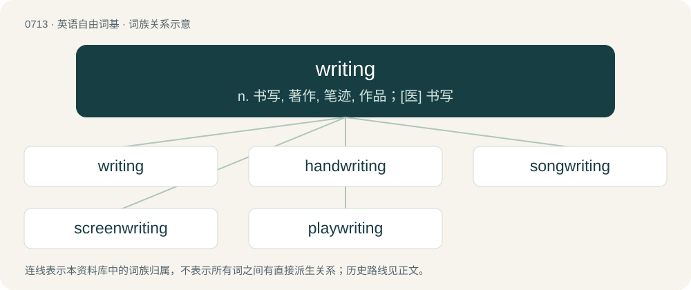

# 0783 · writing — n. 书写, 著作, 笔迹, 作品；\[医\] 书写

[总目录](../00_总目录_按常用程度.md)

**类型**：英语自由词基　｜　**来源语言**：见词源记录

## 核心含义与来源

- 核心含义：n. 书写, 著作, 笔迹, 作品；\[医\] 书写
- 英文含义：Graphism of symbols such as letters that express some meaning.
- 词形：writing

**来源记录 1**（名词；Graphism of symbols such as letters that express some meaning.）

From Middle English writing, writyng, wryting, wrytyng, from Old English wrīting (“writing”), equivalent to write + -ing.

## 词族图

## 单词速览（常用到不常用）

| 单词 | 音标 | 释义 |
|---|---|---|
| [writing](#w-1) | /ˈɹaɪtɪŋ/ | n. 书写, 著作, 笔迹, 作品；\[医\] 书写 |
| [handwriting](#w-2) | /ˈhændɹaɪtɪŋ/ | n. 笔迹 |
| [songwriting](#w-3) |  | 歌曲创作 |
| [screenwriting](#w-4) | /ˈskriːn,raitiŋ/ | n. & adj.电影剧本创作(的) |
| [playwriting](#w-5) | /ˈplei,raitiŋ/ | n. 剧本创作 |

## 逐词详解

### 1. writing

**词性**：名词　｜　**音标**：/ˈɹaɪtɪŋ/

**中文释义**：n. 书写, 著作, 笔迹, 作品；\[医\] 书写

**英文义项**：Graphism of symbols such as letters that express some meaning. / Something written, such as a document, article or book.

**构词拆分**：write + -ing

**词源与演化**：

From Middle English writing, writyng, wryting, wrytyng, from Old English wrīting (“writing”), equivalent to write + -ing.

**例句**：

> Congrats, you did an interesting piece of writing.

该用例对应义项：A work of an author.

### 2. handwriting

**词性**：名词　｜　**音标**：/ˈhændɹaɪtɪŋ/

**中文释义**：n. 笔迹

**英文义项**：The act or process of writing done with the hand, rather than typed or word-processed. / Text that was written by hand.

**构词拆分**：hand + writing；handwrite + -ing

**词源与演化**：

From hand + writing, equal to handwrite + -ing.

**例句**：

> Handwriting can be slow and painful for one with arthritis.

该用例对应义项：the activity of writing by hand

### 3. songwriting

**词性**：名词

**中文释义**：歌曲创作

**英文义项**：The work of a songwriter.

**构词拆分**：song + writing

**词源与演化**：

From song + writing.

**例句**：

> Matoub was so prolific in his songwriting.

### 4. screenwriting

**词性**：名词　｜　**音标**：/ˈskriːn,raitiŋ/

**中文释义**：n. & adj.电影剧本创作(的)

**英文义项**：The art of writing screenplays. / A screenplay.

**构词拆分**：screen + writing

**词源与演化**：

From screen + writing.

### 5. playwriting

**词性**：名词　｜　**音标**：/ˈplei,raitiŋ/

**中文释义**：n. 剧本创作

**英文义项**：The writing of plays.

**构词拆分**：play + writing

**词源与演化**：

From play + writing.
