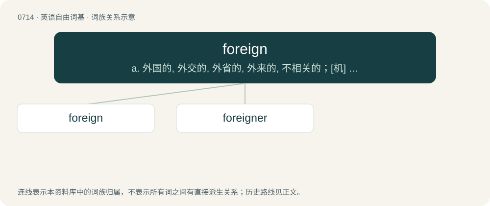

# 0784 · foreign — a. 外国的, 外交的, 外省的, 外来的, 不相关的；\[机\] 外来的

[总目录](../00_总目录_按常用程度.md)

**类型**：英语自由词基　｜　**来源语言**：见词源记录

## 核心含义与来源

- 核心含义：a. 外国的, 外交的, 外省的, 外来的, 不相关的；\[机\] 外来的
- 英文含义：Located outside a country or place, especially one's own.
- 词形：foreign

**来源记录 1**（形容词；Located outside a country or place, especially one's own.）

From Middle English foreyn, forein, from Old French forain, from Vulgar Latin \*forānus (“outsider, outlander”), from Latin forās (“outside, outdoors”) or forīs (“outside, outdoors”). Displaced native Old English elþēodiġ (“foreign”) and now-dialectal English fremd, from Old English fremde (“strange, foreign”). The silent -g- added perhaps by analogy with reign (compare also sovereign which was similarly altered).

## 词族图

## 单词速览（常用到不常用）

| 单词 | 音标 | 释义 |
|---|---|---|
| [foreign](#w-1) | 英 /ˈfɒɹɪn/；美 /ˈfɔɹɪn/ | a. 外国的, 外交的, 外省的, 外来的, 不相关的；\[机\] 外来的 |
| [foreigner](#w-2) | 英 /ˈfɒɹ.ɪ.nə(ɹ)/；美 /ˈfɔɹ.ɪ.nɚ/ | n. 外国人, 外地人；\[法\] 外国人, 进口货, 外国货 |

## 逐词详解

### 1. foreign

**词性**：形容词　｜　**音标**：英 /ˈfɒɹɪn/；美 /ˈfɔɹɪn/

**中文释义**：a. 外国的, 外交的, 外省的, 外来的, 不相关的；\[机\] 外来的

**英文义项**：Located outside a country or place, especially one's own. / Originating from, characteristic of, belonging to, or being a citizen of a country or place other than the one under discussion.

**词源与演化**：

From Middle English foreyn, forein, from Old French forain, from Vulgar Latin \*forānus (“outsider, outlander”), from Latin forās (“outside, outdoors”) or forīs (“outside, outdoors”). Displaced native Old English elþēodiġ (“foreign”) and now-dialectal English fremd, from Old English fremde (“strange, foreign”). The silent -g- added perhaps by analogy with reign (compare also sovereign which was similarly altered).

**例句**：

> There are many more foreign students in Europe since the Erasmus scheme started.

该用例对应义项：Originating from, characteristic of, belonging to, or being a citizen of a country or place other than the one under discussion.

### 2. foreigner

**词性**：名词　｜　**音标**：英 /ˈfɒɹ.ɪ.nə(ɹ)/；美 /ˈfɔɹ.ɪ.nɚ/

**中文释义**：n. 外国人, 外地人；\[法\] 外国人, 进口货, 外国货

**英文义项**：A person from a foreign country. / A private job run by an employee at a trade factory rather than going through the business.

**构词拆分**：foreign + -er

**词源与演化**：

From Middle English forner, foreyner, foroner, forenere, augmentation of earlier forein (“foreigner”), from the adjective. Equivalent to foreign + -er. Use of the -er suffix may be due to analogy with Middle English straunger (“stranger”). Displaced native Old English elþēodiġ.

**例句**：

> To look at him, you would take him to be a foreigner.
