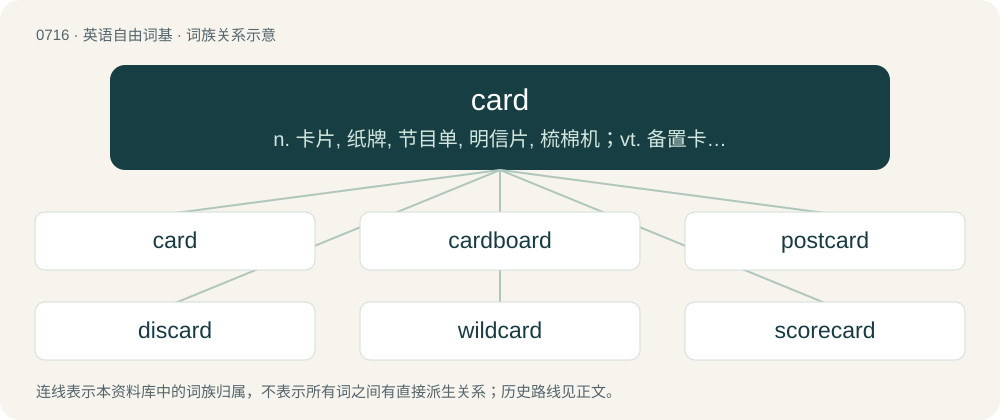

# 0785 · card — n. 卡片, 纸牌, 节目单, 明信片, 梳棉机；vt. 备置卡片, 记于卡片上, 梳理；\[计\] 卡片, 卡

[总目录](../00_总目录_按常用程度.md)

**类型**：英语自由词基　｜　**来源语言**：见词源记录

## 核心含义与来源

- 核心含义：n. 卡片, 纸牌, 节目单, 明信片, 梳棉机；vt. 备置卡片, 记于卡片上, 梳理；\[计\] 卡片, 卡
- 英文含义：A playing card.
- 词形：card

**多个词源／构词路径**：同一拼写可能有不同来源；以下按词性和含义分别列出。

**来源记录 1**（名词；A playing card.）

From Middle English carde (“playing card”), from Old French carte, from Latin charta, from Ancient Greek χάρτης (khártēs, “paper, papyrus”). Doublet of carte and chart.

**来源记录 2**（名词；Material with embedded short wire bristles.）

From Middle English carde, Old French carde, from Old Occitan carda, deverbal from cardar, from Late Latin \*carito, from Latin carō (“to comb with a card”), from Proto-Indo-European \*(s)ker- (“to cut”).

**来源记录 3**（动词；To use a carding device to disentangle the fibres of wool prior to spinning.）

From Middle English carden, from Old French carder, from carde (“cotton card”); see Etymology 2 for more.

## 词族图

## 单词速览（常用到不常用）

| 单词 | 音标 | 释义 |
|---|---|---|
| [card](#w-1) | 美 /kɑɹd/ | n. 卡片, 纸牌, 节目单, 明信片, 梳棉机；vt. 备置卡片, 记于卡片上, 梳理；\[计\] 卡片, 卡 |
| [cardboard](#w-2) | 英 /ˈkɑːdbɔːd/；美 /ˈkɑɹdˌbɔɹd/ | n. 薄纸板；\[化\] 咭纸; 特等纸板; 卡纸板; 卡片纸板 |
| [postcard](#w-3) | 美 /ˈpoʊstˌkɑɹd/ | n. 明信片 |
| [discard](#w-4) | 英 /dɪsˈkɑːd/；美 /dɪsˈkɑɹd/ | vt. 丢弃, 抛弃；vi. 垫牌；n. 垫牌, 抛弃 |
| [wildcard](#w-5) | /ˈwildkɑːd/ | n. 通配符, 百搭牌；\[计\] 通配符 |
| [scorecard](#w-6) | /ˈskɒːkɑːd/ | n. 记分卡 |
| [carded](#w-7) | /ˈkɑːdɪd/ | a. 经过梳毛机梳过的 |
| [undercard](#w-8) |  | 【英文】A list of minor or supporting contests printed on the same bill as the main event (primarily fighting or racing, such as the main fight at a boxing match or wrestling, horse or car racing, etc.), occurring before or  |
| [cardholder](#w-9) | /ˈkɑːd,həjldə(r)/ | n. 持有信用卡的人,持有正式成员证的人,(持卡可获得某种权利的)持卡人 |
| [flashcard](#w-10) | 美 /ˈflæʃˌkɑɹd/ | n. 教学用的抽认卡 |
| [carder](#w-11) | 美 /ˈkɑɹ.dɚ/ | n. 梳刷的人, 起毛工人 |

## 逐词详解

### 1. card

**词性**：名词　｜　**音标**：美 /kɑɹd/

**中文释义**：n. 卡片, 纸牌, 节目单, 明信片, 梳棉机；vt. 备置卡片, 记于卡片上, 梳理；\[计\] 卡片, 卡

**英文义项**：A playing card. / Any game using playing cards; a card game.

**词源与演化**：

From Middle English carde (“playing card”), from Old French carte, from Latin charta, from Ancient Greek χάρτης (khártēs, “paper, papyrus”). Doublet of carte and chart.

**例句**：

> The realtor gave me her card so I could call if I had any questions about buying a house.

该用例对应义项：A business card.

### 2. cardboard

**词性**：名词　｜　**音标**：英 /ˈkɑːdbɔːd/；美 /ˈkɑɹdˌbɔɹd/

**中文释义**：n. 薄纸板；\[化\] 咭纸; 特等纸板; 卡纸板; 卡片纸板

**英文义项**：A wood-based material resembling heavy paper, used in the manufacture of boxes, cartons and signs. / Something flat or insubstantial.

**构词拆分**：From card + board.

**词源与演化**：

From card + board.

**例句**：

> Tom reached into the cardboard box and pulled out a photo album.

### 3. postcard

**词性**：动词　｜　**音标**：美 /ˈpoʊstˌkɑɹd/

**中文释义**：n. 明信片

**英文义项**：To send a postcard to someone. / To send by means of a postcard.

**构词拆分**：From post + card.

**词源与演化**：

From post + card.

**用法示例／搭配（非完整句）**：

> to postcard one's friends

该用例对应义项：To send a postcard to someone.

### 4. discard

**词性**：动词　｜　**音标**：英 /dɪsˈkɑːd/；美 /dɪsˈkɑɹd/

**中文释义**：vt. 丢弃, 抛弃；vi. 垫牌；n. 垫牌, 抛弃

**英文义项**：To throw away, to reject. / To make a discard; to throw out a card.

**构词拆分**：dis- + card

**词源与演化**：

From dis- + card. Compare Spanish descartar.

**例句**：

> We do not want to discard the article but reshape it.

### 5. wildcard

**词性**：名词　｜　**音标**：/ˈwildkɑːd/

**中文释义**：n. 通配符, 百搭牌；\[计\] 通配符

**英文义项**：A character that takes the place of any other character or string that is not known or specified. / An uncontrolled or unpredictable element.

**构词拆分**：wild + card

**词源与演化**：

From wild + card.

**例句**：

> If the character \* is acting as a wildcard, then the pattern a\*m matches each of the words amalgam, atom and alum.

该用例对应义项：A character that takes the place of any other character or string that is not known or specified.

### 6. scorecard

**词性**：名词　｜　**音标**：/ˈskɒːkɑːd/

**中文释义**：n. 记分卡

**英文义项**：A printed card allowing spectators of a game to identify players and record progress. / A tabular representation of the most important statistics of an innings or match.

**构词拆分**：score + card

**词源与演化**：

From score + card.

**例句**：

> What we need is some kind of scorecard by which we can make objective comparisons between these products.

该用例对应义项：A system of ratings.

### 7. carded

**词性**：形容词　｜　**音标**：/ˈkɑːdɪd/

**中文释义**：a. 经过梳毛机梳过的

**英文义项**：Involving the disentangling of fibers with a carding device. / Combed.

**构词拆分**：card + -ed

**词源与演化**：

From card + -ed. Piecewise doublet of charted.

**例句**：

> I still get carded at the liquor store.

### 8. undercard

**词性**：名词

**英文义项**：A list of minor or supporting contests printed on the same bill as the main event (primarily fighting or racing, such as the main fight at a boxing match or wrestling, horse or car racing, etc.), occurring before or after the main event. / The events so listed.

**构词拆分**：under- + card

**词源与演化**：

From under- + card.

**用法示例／搭配（非完整句）**：

> The eight on the turn was another undercard to her pair of nines

该用例对应义项：A card lower than another given card or pair.

### 9. cardholder

**词性**：名词　｜　**音标**：/ˈkɑːd,həjldə(r)/

**中文释义**：n. 持有信用卡的人,持有正式成员证的人,(持卡可获得某种权利的)持卡人

**英文义项**：A case for holding cards, as credit cards, bankcards, or business cards. / An authorized user of a card that is used for financial transactions, etc.

**构词拆分**：card + holder

**词源与演化**：

From card + holder.

### 10. flashcard

**词性**：名词　｜　**音标**：美 /ˈflæʃˌkɑɹd/

**中文释义**：n. 教学用的抽认卡

**英文义项**：A card used to aid rote memorization. One side of the card contains data of one kind, or a question, and the other side contains the associated response which one wants to memorize. For example, one side could contain an English word, and the other side the Spanish translation. / A solid-state digital memory storage format, commonly found on computers, digital cameras and cellphones.

**构词拆分**：flash + card

**词源与演化**：

From flash + card.

**例句**：

> Many people use flashcards to learn languages.

该用例对应义项：A card used to aid rote memorization. One side of the card contains data of one kind, or a question, and the other side contains the associated response which one wants to memorize. For example, one side could contain an English word, and the other side the Spanish translation.

### 11. carder

**词性**：名词　｜　**音标**：美 /ˈkɑɹ.dɚ/

**中文释义**：n. 梳刷的人, 起毛工人

**英文义项**：A person employed to card wool. / A carding machine.

**构词拆分**：card + -er

**词源与演化**：

From card + -er.
