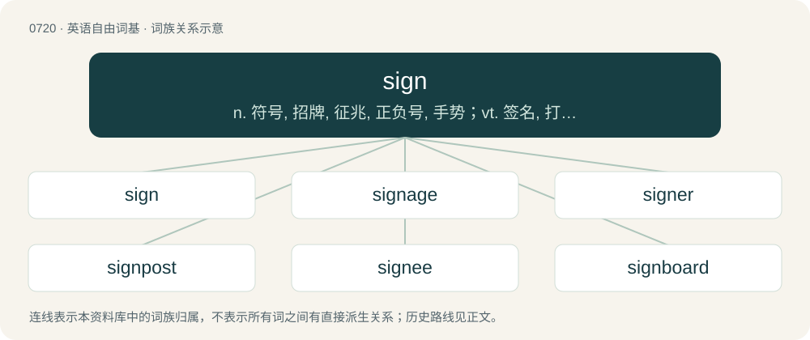

# 0786 · sign — n. 符号, 招牌, 征兆, 正负号, 手势；vt. 签名, 打手势表达；vi. 签名

[总目录](../00_总目录_按常用程度.md)

**类型**：英语自由词基　｜　**来源语言**：见词源记录

## 核心含义与来源

- 核心含义：n. 符号, 招牌, 征兆, 正负号, 手势；vt. 签名, 打手势表达；vi. 签名
- 英文含义：A visible fact that shows that something exists or may happen.
- 词形：sign

**多个词源／构词路径**：同一拼写可能有不同来源；以下按词性和含义分别列出。

**来源记录 1**（名词；A visible fact that shows that something exists or may happen.）

From Middle English signe, sygne, syng, seine, sine, syne, from Old English seġn (“sign; mark; token”) and Old French signe, seing (“sign; mark; signature”); both from Latin signum (“a mark; sign; token”); root uncertain. Doublet of signum and signal. Partially displaced native token.

**来源记录 2**（动词；To mark, to put or leave a mark on.）

From Middle English signen, seinen, seinien, partly from Old English seġnian (“to mark; sign”) and partly from Anglo-Norman seigner, seiner et al., Old French signer et al., and their source Latin signāre (“to mark, seal, indicate, signify”); all from Latin signum (“a mark, sign”); see Etymology 1, above. Compare sain.

## 词族图

## 单词速览（常用到不常用）

| 单词 | 音标 | 释义 |
|---|---|---|
| [sign](#w-1) | 英 /saɪn/ | n. 符号, 招牌, 征兆, 正负号, 手势；vt. 签名, 打手势表达；vi. 签名 |
| [signage](#w-2) | 英 /ˈsaɪnɪd͡ʒ/ | n. 标记； 标识系统 |
| [signer](#w-3) | /ˈsainə/ | n. 签名者, 使用手势语者 |
| [signpost](#w-4) | 美 /ˈsaɪnˌpoʊst/ | n. 招牌柱, 广告柱, 路标 |
| [signee](#w-5) | /saiˈniː, ˈsainiː/ | n. (尤指请愿书、合同等的)签名者,签字者 |
| [signboard](#w-6) | 美 /ˈsaɪnˌbɔɹd/ | n. 招牌, 布告板 |
| [cosign](#w-7) | 英 /ˈkəʊ.saɪn/；美 /ˈkoʊ.saɪn/ | v. 联合署名, 连署保证 |

## 逐词详解

### 1. sign

**词性**：名词　｜　**音标**：英 /saɪn/

**中文释义**：n. 符号, 招牌, 征兆, 正负号, 手势；vt. 签名, 打手势表达；vi. 签名

**英文义项**：A visible fact that shows that something exists or may happen. / An omen.

**词源与演化**：

From Middle English signe, sygne, syng, seine, sine, syne, from Old English seġn (“sign; mark; token”) and Old French signe, seing (“sign; mark; signature”); both from Latin signum (“a mark; sign; token”); root uncertain. Doublet of signum and signal. Partially displaced native token.

**例句**：

> The sharp sign indicates that the pitch of the note is raised a half step.

该用例对应义项：A mark or another symbol used to represent something.

### 2. signage

**词性**：名词　｜　**音标**：英 /ˈsaɪnɪd͡ʒ/

**中文释义**：n. 标记； 标识系统

**英文义项**：Signs, particularly those imparting commercial, directional, or road traffic information, taken collectively. / A sign, a signboard.

**构词拆分**：sign + -age

**词源与演化**：

From sign + -age.

**例句**：

> The signage at the airport is designed to point the way clearly to important locations.

该用例对应义项：Signs, particularly those imparting commercial, directional, or road traffic information, taken collectively.

### 3. signer

**词性**：名词　｜　**音标**：/ˈsainə/

**中文释义**：n. 签名者, 使用手势语者

**英文义项**：One who signs their name (applies their signature to something). / One who uses sign language.

**构词拆分**：From sign + -er.

**词源与演化**：

From sign + -er.

**例句**：

> The most prolific signers were to be amply rewarded by the sales-bonus structure.

该用例对应义项：One who signs up another.

### 4. signpost

**词性**：动词　｜　**音标**：美 /ˈsaɪnˌpoʊst/

**中文释义**：n. 招牌柱, 广告柱, 路标

**英文义项**：To install signposts on. / To direct (somebody) to services, resources, etc.

**构词拆分**：sign + post

**词源与演化**：

From sign + post.

**例句**：

> The route wasn't signposted, and we got lost on the way.

该用例对应义项：To install signposts on.

### 5. signee

**词性**：名词　｜　**音标**：/saiˈniː, ˈsainiː/

**中文释义**：n. (尤指请愿书、合同等的)签名者,签字者

**英文义项**：One who is signed (signed up, enlisted) by someone else; thus, one who signs a contract, especially in athletic contexts.

**构词拆分**：From sign + -ee.

**词源与演化**：

From sign + -ee.

**例句**：

> Our team has landed some great signees in this draft.

该用例对应义项：One who is signed (signed up, enlisted) by someone else; thus, one who signs a contract, especially in athletic contexts.

### 6. signboard

**词性**：名词　｜　**音标**：美 /ˈsaɪnˌbɔɹd/

**中文释义**：n. 招牌, 布告板

**英文义项**：A board carrying a sign, or on which signs may be posted.

**构词拆分**：sign + board

**词源与演化**：

From sign + board.

**例句**：

> I'm near-sighted, so I can't make out what is written on that signboard.

### 7. cosign

**词性**：动词　｜　**音标**：英 /ˈkəʊ.saɪn/；美 /ˈkoʊ.saɪn/

**中文释义**：v. 联合署名, 连署保证

**英文义项**：To sign a document jointly with another person, sometimes as an endorsement. / To agree with or endorse.

**构词拆分**：co- + sign

**词源与演化**：

From co- + sign.

**例句**：

> All Jacob ever does is cosign your bullshit.
