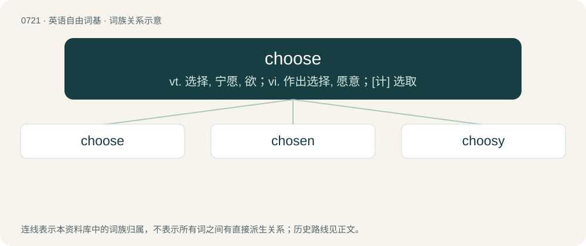

# 0787 · choose — vt. 选择, 宁愿, 欲；vi. 作出选择, 愿意；\[计\] 选取

[总目录](../00_总目录_按常用程度.md)

**类型**：英语自由词基　｜　**来源语言**：见词源记录

## 核心含义与来源

- 核心含义：vt. 选择, 宁愿, 欲；vi. 作出选择, 愿意；\[计\] 选取
- 英文含义：To pick; to make the choice of; to select.
- 词形：choose

**来源记录 1**（动词；To pick; to make the choice of; to select.）

From Middle English chesen, from Old English ċēosan (“to choose, seek out, select, elect, decide, test, accept, settle for, approve”), from Proto-West Germanic \*keusan, from Proto-Germanic \*keusaną (“to test; to choose”), from Proto-Indo-European \*ǵéwseti (“to choose, taste”), from \*ǵews- (“to taste, try”). Cognates Cognate with Saterland Frisian kjoze (“to choose”), West Frisian kieze (“to choose”), Dutch kiezen (“to choose”), Low German kesen (“to choose”), German kiesen (“to choose”), Danish kyse (“to frighten”), Faroese and Icelandic kjósa (“to vote; to elect; to choose; to prefer”), Norwegian Nynorsk kjosa, kjose (“to choose”), Swedish tjusa (“to charm; to bewitch”), Gothic 𐌺𐌹𐌿𐍃𐌰𐌽 (kiusan, “to test”), French choisir (“to choose”); also Breton diuz (“to choose”), Cornish and Welsh dewis (“to choose”), Latin gustō (“to taste, sample”), Ancient Greek γεύω (geúō, “to feed; to taste; to eat; to try; to enjoy”), Czech zkoušet (“to taste; to examine; to rehearse”), Polish kuszać (“to eat”), Russian кушать (kušatʹ, “to have a meal, to eat”), Serbo-Croatian ку̏шати, kȕšati (“to taste; to test”), Ukrainian ку́шати (kúšaty, “to taste; to eat”), куштува́ти (kuštuváty, “to taste”), Avestan 𐬰𐬀𐬊𐬱𐬀 (zaoša, “pleasure”), Baluchi and Pashto دوست (dost, “friend”), Northern Kurdish and Zazaki dost (“friend”), Persian دوسْت (dōst / dust, “friend; boyfriend or girlfriend; loved”), Sanskrit जुषते (juṣate, “to enjoy”).

## 词族图

## 单词速览（常用到不常用）

| 单词 | 音标 | 释义 |
|---|---|---|
| [choose](#w-1) | 英 /t͡ʃuːz/；美 /t͡ʃuz/ | vt. 选择, 宁愿, 欲；vi. 作出选择, 愿意；\[计\] 选取 |
| [chosen](#w-2) | 英 /ˈt͡ʃəʊ.zən/；美 /ˈt͡ʃoʊ.zən/ | choose的过去分词 |
| [choosy](#w-3) | /ˈt͡ʃuːzi/ | a. 慎重选择的, 好挑剔的 |

## 逐词详解

### 1. choose

**词性**：动词　｜　**音标**：英 /t͡ʃuːz/；美 /t͡ʃuz/

**中文释义**：vt. 选择, 宁愿, 欲；vi. 作出选择, 愿意；\[计\] 选取

**英文义项**：To pick; to make the choice of; to select. / To elect.

**词源与演化**：

From Middle English chesen, from Old English ċēosan (“to choose, seek out, select, elect, decide, test, accept, settle for, approve”), from Proto-West Germanic \*keusan, from Proto-Germanic \*keusaną (“to test; to choose”), from Proto-Indo-European \*ǵéwseti (“to choose, taste”), from \*ǵews- (“to taste, try”). Cognates Cognate with Saterland Frisian kjoze (“to choose”), West Frisian kieze (“to choose”), Dutch kiezen (“to choose”), Low German kesen (“to choose”), German kiesen (“to choose”), Danish kyse (“to frighten”), Faroese and Icelandic kjósa (“to vote; to elect; to choose; to prefer”), Norwegian Nynorsk kjosa, kjose (“to choose”), Swedish tjusa (“to charm; to bewitch”), Gothic 𐌺𐌹𐌿𐍃𐌰𐌽 (kiusan, “to test”), French choisir (“to choose”); also Breton diuz (“to choose”), Cornish and Welsh dewis (“to choose”), Latin gustō (“to taste, sample”), Ancient Greek γεύω (geúō, “to feed; to taste; to eat; to try; to enjoy”), Czech zkoušet (“to taste; to examine; to rehearse”), Polish kuszać (“to eat”), Russian кушать (kušatʹ, “to have a meal, to eat”), Serbo-Croatian ку̏шати, kȕšati (“to taste; to test”), Ukrainian ку́шати (kúšaty, “to taste; to eat”), куштува́ти (kuštuváty, “to taste”), Avestan 𐬰𐬀𐬊𐬱𐬀 (zaoša, “pleasure”), Baluchi and Pashto دوست (dost, “friend”), Northern Kurdish and Zazaki dost (“friend”), Persian دوسْت (dōst / dust, “friend; boyfriend or girlfriend; loved”), Sanskrit जुषते (juṣate, “to enjoy”).

**例句**：

> Choose a good husband for your daughter.

该用例对应义项：pick out, select, or choose from a number of alternatives

### 2. chosen

**词性**：形容词　｜　**音标**：英 /ˈt͡ʃəʊ.zən/；美 /ˈt͡ʃoʊ.zən/

**中文释义**：choose的过去分词

**英文义项**：picked; selected / elected

**构词拆分**：choose + -en (past participle ending)

**词源与演化**：

From Middle English chosen, ychosen, ichosen, re-analysed variant of coren, icoren, ȝecoren (“chosen”), from Old English coren, ġecoren (“chosen”), past participle of Old English ċēosan (“to choose”). Morphologically equivalent to choose + -en (past participle ending).

**例句**：

> The chosen candidate accepted the award with pride.

该用例对应义项：picked; selected

### 3. choosy

**词性**：形容词　｜　**音标**：/ˈt͡ʃuːzi/

**中文释义**：a. 慎重选择的, 好挑剔的

**英文义项**：Taking care when choosing that what is chosen best suits one's tastes, desires or requirements.

**构词拆分**：choose + -y

**词源与演化**：

From choose + -y.

**例句**：

> You have to be choosy about the people you discuss issues like this with.
