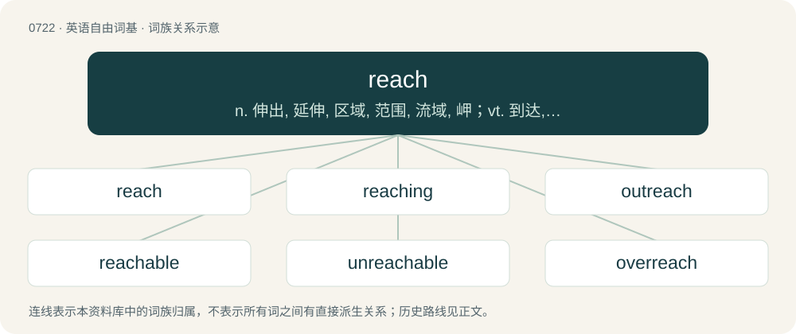

# 0788 · reach — n. 伸出, 延伸, 区域, 范围, 流域, 岬；vt. 到达, 达到, 伸出, 延伸, 影响；vi. 达到, 延伸, 伸出手, 传到

[总目录](../00_总目录_按常用程度.md)

**类型**：英语自由词基　｜　**来源语言**：见词源记录

## 核心含义与来源

- 核心含义：n. 伸出, 延伸, 区域, 范围, 流域, 岬；vt. 到达, 达到, 伸出, 延伸, 影响；vi. 达到, 延伸, 伸出手, 传到
- 英文含义：To extend, stretch, or thrust out (for example a limb or object held in the hand).
- 词形：reach

**来源记录 1**（动词；To extend, stretch, or thrust out (for example a limb or object held in the hand).）

From Middle English rechen, from Old English rǣċan (“to reach”), from Proto-West Germanic \*raikijan, from Proto-Germanic \*raikijaną, from the Proto-Indo-European \*Hreyǵ- (“to bind, reach”). Cognate with Dutch reiken, German reichen.

## 词族图

## 单词速览（常用到不常用）

| 单词 | 音标 | 释义 |
|---|---|---|
| [reach](#w-1) | /ɹiːt͡ʃ/ | n. 伸出, 延伸, 区域, 范围, 流域, 岬；vt. 到达, 达到, 伸出, 延伸, 影响；vi. 达到, 延伸, 伸出手, 传到 |
| [reaching](#w-2) | /ˈɹiːt͡ʃɪŋ/ | v. 到达( reach的现在分词 ); 联络; 伸出手臂, 延伸 |
| [outreach](#w-3) | /ˈaʊtɹiːtʃ/ | vt. 超出...的范围, 作超出能力所及的事而害及自己, 占...的上风, 胜过；vi. 走得太远, 伸出, 展开 |
| [reachable](#w-4) | /ˈɹiːtʃəbəl/ | \[计\] 可达的 |
| [unreachable](#w-5) | /ʌnˈriːtʃəbl/ | a. 不能到达的, 不能得到的；\[计\] 执行不到的 |
| [overreach](#w-6) | 英 /ˌəʊvəˈɹiːt͡ʃ/；美 /ˌoʊvə(ɹ)ˈɹit͡ʃ/ | vt. 扩展...以上, 过度伸张, 走过头；vi. 伸得过远, 过分, 过火 |
| [reacher](#w-7) |  | \[人名\] 雷彻 |

## 逐词详解

### 1. reach

**词性**：动词　｜　**音标**：/ɹiːt͡ʃ/

**中文释义**：n. 伸出, 延伸, 区域, 范围, 流域, 岬；vt. 到达, 达到, 伸出, 延伸, 影响；vi. 达到, 延伸, 伸出手, 传到

**英文义项**：To extend, stretch, or thrust out (for example a limb or object held in the hand). / To give to someone by stretching out a limb, especially the hand; to give with the hand; to pass to another person; to hand over.

**词源与演化**：

From Middle English rechen, from Old English rǣċan (“to reach”), from Proto-West Germanic \*raikijan, from Proto-Germanic \*raikijaną, from the Proto-Indo-European \*Hreyǵ- (“to bind, reach”). Cognate with Dutch reiken, German reichen.

**例句**：

> The climbers reached the top of the mountain after a gruelling ten-day hike.

该用例对应义项：To arrive at (a place) by effort of any kind.

### 2. reaching

**词性**：名词　｜　**音标**：/ˈɹiːt͡ʃɪŋ/

**中文释义**：v. 到达( reach的现在分词 ); 联络; 伸出手臂, 延伸

**英文义项**：The action of one who reaches; an attempt to grasp something by stretching. / Sailing on a reach, i.e. having the wind on either side and coming from an angle that is larger with respect to the bow than when sailing close-hauled.

**构词拆分**：reach + -ing

**词源与演化**：

From Middle English rechynge, recchinge, from Old English rǣċing (“reaching, extending”), equivalent to reach + -ing.

**例句**：

> We must prevent the fire from reaching the gunpowder at any cost.

### 3. outreach

**词性**：名词　｜　**音标**：/ˈaʊtɹiːtʃ/

**中文释义**：vt. 超出...的范围, 作超出能力所及的事而害及自己, 占...的上风, 胜过；vi. 走得太远, 伸出, 展开

**英文义项**：The act of reaching out. / The act of raising awareness.

**构词拆分**：out- + reach

**词源与演化**：

From out- + reach.

**例句**：

> He is involved in social outreach, education and environmental initiatives.

该用例对应义项：The act or practice of visiting and providing services (of a charity, church, or other organization) to people who might not otherwise have access to those services.

### 4. reachable

**词性**：形容词　｜　**音标**：/ˈɹiːtʃəbəl/

**中文释义**：\[计\] 可达的

**英文义项**：Within easy reach; accessible / That may be reached from another node in a graph by passing along one or more lines

**构词拆分**：reach + -able

**词源与演化**：

From reach + -able.

**例句**：

> The transmitter on Voyager was not reachable due to solar winds.

### 5. unreachable

**词性**：形容词　｜　**音标**：/ʌnˈriːtʃəbl/

**中文释义**：a. 不能到达的, 不能得到的；\[计\] 执行不到的

**英文义项**：Unable to be reached; impossible to attain.

**构词拆分**：un- + reach + -able

**词源与演化**：

From un- + reach + -able.

**例句**：

> There's not a single goal that is unreachable by my own terms.

### 6. overreach

**词性**：动词　｜　**音标**：英 /ˌəʊvəˈɹiːt͡ʃ/；美 /ˌoʊvə(ɹ)ˈɹit͡ʃ/

**中文释义**：vt. 扩展...以上, 过度伸张, 走过头；vi. 伸得过远, 过分, 过火

**英文义项**：To reach above or beyond, especially to an excessive degree. / To defeat or override a person's interest in property; (UK, specifically) of a holder of the legal title of real property: by mortgaging or selling the legal title to a third party, to cause another person's equitable right in the property to be dissolved and to be replaced by an equitable right in the money received from the third party.

**构词拆分**：over- + reach

**词源与演化**：

The verb is from Middle English overrechen (“to rise above; to extend beyond or over; to encroach; to catch, overtake; to reach; to obtain wrongfully (?); to take up (a book) to revise it”) \[and other forms\], equivalent to over- + reach; the noun is derived from the verb or from the phrase to reach over.

### 7. reacher

**词性**：名词

**中文释义**：\[人名\] 雷彻

**英文义项**：A person who reaches. / A device used to reach something.

**构词拆分**：reach + -er

**词源与演化**：

From reach + -er.
