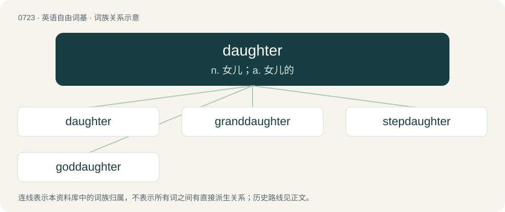

# 0789 · daughter — n. 女儿；a. 女儿的

[总目录](../00_总目录_按常用程度.md)

**类型**：英语自由词基　｜　**来源语言**：见词源记录

## 核心含义与来源

- 核心含义：n. 女儿；a. 女儿的
- 英文含义：One’s female offspring.
- 词形：daughter

**来源记录 1**（名词；One’s female offspring.）

From Middle English doghter, doughter, from Old English dohtor (“daughter”), from Proto-West Germanic \*dohter, from Proto-Germanic \*duhtēr, from Proto-Indo-European \*dʰugh₂tḗr.

## 词族图

## 单词速览（常用到不常用）

| 单词 | 音标 | 释义 |
|---|---|---|
| [daughter](#w-1) | 英 /ˈdɔːtə/；美 /ˈdɔ.tɚ/ | n. 女儿；a. 女儿的 |
| [granddaughter](#w-2) | /ˈ^rændɔːtə(r)/ | n. 孙女, 外孙女 |
| [stepdaughter](#w-3) | /ˈstep,dɔːtə/ | n. 妻与前夫所生的女儿, 夫与前妻所生的女儿 |
| [goddaughter](#w-4) | 英 /ˈɡɒdˌdɔːtə(ɹ)/；美 /ˈɡɑdˌdɔ.tɚ/ | n. 教女 |

## 逐词详解

### 1. daughter

**词性**：名词　｜　**音标**：英 /ˈdɔːtə/；美 /ˈdɔ.tɚ/

**中文释义**：n. 女儿；a. 女儿的

**英文义项**：One’s female offspring. / A female descendant.

**词源与演化**：

From Middle English doghter, doughter, from Old English dohtor (“daughter”), from Proto-West Germanic \*dohter, from Proto-Germanic \*duhtēr, from Proto-Indo-European \*dʰugh₂tḗr.

**例句**：

> I already have a son, so I would like to have a daughter.

该用例对应义项：One’s female offspring.

### 2. granddaughter

**词性**：名词　｜　**音标**：/ˈ^rændɔːtə(r)/

**中文释义**：n. 孙女, 外孙女

**英文义项**：The daughter of someone's child.

**构词拆分**：From grand- + daughter.

**词源与演化**：

From grand- + daughter.

**例句**：

> My granddaughter just had a baby, so now I'm a great-grandfather.

### 3. stepdaughter

**词性**：名词　｜　**音标**：/ˈstep,dɔːtə/

**中文释义**：n. 妻与前夫所生的女儿, 夫与前妻所生的女儿

**英文义项**：The daughter of one's spouse from a previous relationship.

**构词拆分**：step- + daughter

**词源与演化**：

From Middle English stepdoughter, stepdoghter, steopdohter, from Old English stēopdohtor (“stepdaughter”), from Proto-Germanic \*steupaduhtēr (“stepdaughter”), equivalent to step- + daughter. Cognate with Saterland Frisian Stäifdochter (“stepdaughter”), West Frisian styfdochter (“stepdaughter”), Dutch stiefdochter (“stepdaughter”), German Low German Steevdochter (“stepdaughter”), German Stieftochter (“stepdaughter”), Danish steddatter (“stepdaughter”), Swedish styvdotter (“stepdaughter”), Icelandic stjúpdóttir (“stepdaughter”).

**例句**：

> Ziri never got the time to build an actual bond with his stepdaughter.

### 4. goddaughter

**词性**：名词　｜　**音标**：英 /ˈɡɒdˌdɔːtə(ɹ)/；美 /ˈɡɑdˌdɔ.tɚ/

**中文释义**：n. 教女

**英文义项**：A female child whose baptism is sponsored by a godparent.

**构词拆分**：god- + daughter

**词源与演化**：

From Middle English goddoghter, goddoȝter, from Old English goddohtor (“goddaughter”), equivalent to god- + daughter. Cognate with Danish guddatter (“goddaughter”), Swedish guddotter (“goddaughter”), Icelandic guðdóttir (“goddaughter”).
