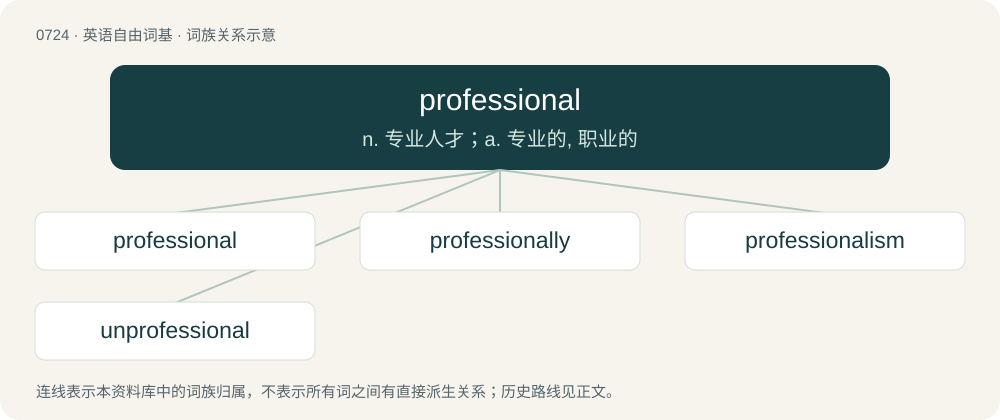

# 0790 · professional — n. 专业人才；a. 专业的, 职业的

[总目录](../00_总目录_按常用程度.md)

**类型**：英语自由词基　｜　**来源语言**：见词源记录

## 核心含义与来源

- 核心含义：n. 专业人才；a. 专业的, 职业的
- 英文含义：A person who belongs to a profession.
- 词形：professional

**来源记录 1**（名词；A person who belongs to a profession.）

From Middle English professhennalle, professhynalle; equivalent to profession + -al.

## 词族图

## 单词速览（常用到不常用）

| 单词 | 音标 | 释义 |
|---|---|---|
| [professional](#w-1) | 英 /pɹəˈfɛʃ.ə.nəl/ | n. 专业人才；a. 专业的, 职业的 |
| [professionally](#w-2) |  | adv. 专业地；内行地 |
| [professionalism](#w-3) | /pɹəˈfɛʃənəˌlɪzəm/ | n. 职业特性, 专业技巧, 职业行为, 职业作风, (褒)专业人员的特质, 职业化；\[经\] 职业特性, 职业作风, 职业化 |
| [unprofessional](#w-4) | /ˈʌnprəˈfeʃənl/ | a. 违反行业习惯的, 违反行业道德的, 不合行规的, 非职业性的, 外行的 |

## 逐词详解

### 1. professional

**词性**：名词　｜　**音标**：英 /pɹəˈfɛʃ.ə.nəl/

**中文释义**：n. 专业人才；a. 专业的, 职业的

**英文义项**：A person who belongs to a profession. / A white-collar worker, especially one with a specialized, high-earning job such as a doctor or engineer.

**构词拆分**：profession + -al

**词源与演化**：

From Middle English professhennalle, professhynalle; equivalent to profession + -al.

**例句**：

> There was this nice lady who flirted with me at the bar, but it turned out that she was a professional.

该用例对应义项：A prostitute.

### 2. professionally

**词性**：副词

**中文释义**：adv. 专业地；内行地

**英文义项**：As a professional; for one's paid career. / In a professional manner.

**构词拆分**：professional + -ly

**词源与演化**：

From professional + -ly.

**例句**：

> You handled that customer's complaint very professionally.

该用例对应义项：In a professional manner.

### 3. professionalism

**词性**：名词　｜　**音标**：/pɹəˈfɛʃənəˌlɪzəm/

**中文释义**：n. 职业特性, 专业技巧, 职业行为, 职业作风, (褒)专业人员的特质, 职业化；\[经\] 职业特性, 职业作风, 职业化

**英文义项**：The status, methods, character or standards expected of a professional or of a professional organization, such as reliability, discretion, evenhandedness, and fair play. / The use of professionals rather than amateurs in any sport etc.

**构词拆分**：professional + -ism

**词源与演化**：

From professional + -ism.

**例句**：

> There is only one ideology at our company and it's professionalism.

### 4. unprofessional

**词性**：形容词　｜　**音标**：/ˈʌnprəˈfeʃənl/

**中文释义**：a. 违反行业习惯的, 违反行业道德的, 不合行规的, 非职业性的, 外行的

**英文义项**：Unbecoming of a professional; hence inappropriate in the workplace. / Lacking a profession.

**构词拆分**：un- + professional

**词源与演化**：

From un- + professional.

**用法示例／搭配（非完整句）**：

> unprofessional behavior

该用例对应义项：Unbecoming of a professional; hence inappropriate in the workplace.
