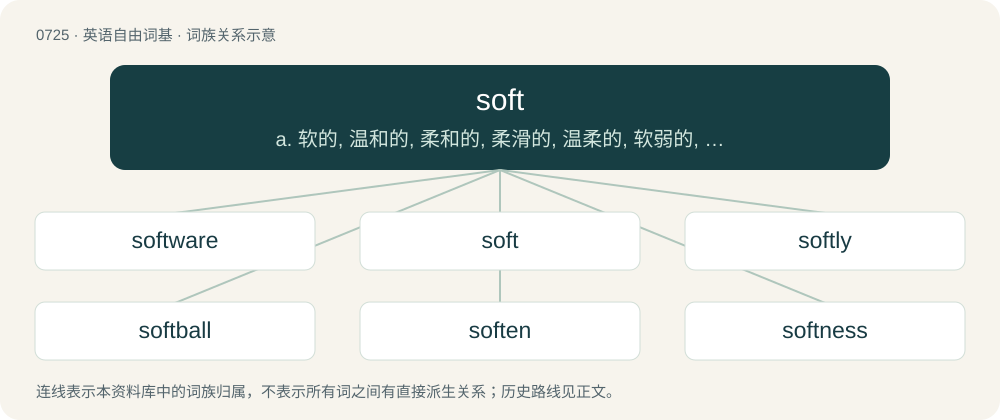

# 0791 · soft — a. 软的, 温和的, 柔和的, 柔滑的, 温柔的, 软弱的, 坡度小的, 笨的, 纸币的；n. 柔软的东西, 笨人, 纸币；adv. 柔软地, 温和地

[总目录](../00_总目录_按常用程度.md)

**类型**：英语自由词基　｜　**来源语言**：见词源记录

## 核心含义与来源

- 核心含义：a. 软的, 温和的, 柔和的, 柔滑的, 温柔的, 软弱的, 坡度小的, 笨的, 纸币的；n. 柔软的东西, 笨人, 纸币；adv. 柔软地, 温和地
- 英文含义：Easily giving way under pressure.
- 词形：soft

**来源记录 1**（形容词；Easily giving way under pressure.）

From Middle English softe, from Old English sōfte, alteration of earlier sēfte (“soft”), from Proto-West Germanic \*samft(ī) (“level, even, smooth, soft, gentle”) (compare \*sōmiz (“agreeable, fitting”)), from Proto-Indo-European \*semptio-, \*semtio-, from \*sem- (“one, whole”). Cognate with West Frisian sêft (“gentle; soft”), Dutch zacht (“soft”), German Low German sacht (“soft”), German sanft (“soft, yielding”), Old Norse sœmr (“agreeable, fitting”), samr (“same”). More at seem, same.

## 词族图

## 单词速览（常用到不常用）

| 单词 | 音标 | 释义 |
|---|---|---|
| [software](#w-1) | 英 /ˈsɒf(t)ˌwɛə/；美 /ˈsɔf(t)ˌwɛɹ/ | n. 软件；\[计\] 软设备 |
| [soft](#w-2) | 英 /sɒft/；美 /sɔft/ | a. 软的, 温和的, 柔和的, 柔滑的, 温柔的, 软弱的, 坡度小的, 笨的, 纸币的；n. 柔软的东西, 笨人, 纸币；adv. 柔软地, 温和地 |
| [softly](#w-3) | 英 /ˈsɒftli/；美 /ˈsɔftli/ | adv. 柔和地, 静静地, 温柔地 |
| [softball](#w-4) | /ˈsɒftbɒːl/ | n. 垒球运动, 垒球 |
| [soften](#w-5) | 英 /ˈsɒfən/；美 /ˈsɔfən/ | v. (使)变柔软, (使)变柔和 |
| [softness](#w-6) | 英 /ˈsɒftnəs/；美 /ˈsɔftnəs/ | n. 柔和, 温柔 |
| [airsoft](#w-7) |  | 【英文】A modern combat sport in which participants eliminate their opponents by hitting them with spherical non-metallic pellets launched from a type of air gun running compressed air or similar compressed gas (e.g., carbon |
| [softcore](#w-8) |  | 【英文】Pornography that does not contain depictions of explicit sexual penetration. |
| [softcover](#w-9) | /sɒftˈkʌvər/ | n. 软封面; 平装（书） |
| [softie](#w-10) | /ˈsɔ(ː)fti/ | n. 1.柔弱的人 2.笨人 |
| [softwood](#w-11) | /ˈsɒftwud/ | n. 软木材 |
| [softy](#w-12) | /ˈsɒfti/ | n. 傻子, 多愁善感的人 |
| [softshell](#w-13) |  | 【英文】Having a relatively soft shell. |

## 逐词详解

### 1. software

**词性**：名词　｜　**音标**：英 /ˈsɒf(t)ˌwɛə/；美 /ˈsɔf(t)ˌwɛɹ/

**中文释义**：n. 软件；\[计\] 软设备

**英文义项**：Encoded computer instructions, usually modifiable (unless stored in some form of unalterable memory such as ROM). / The human beings involved in warfare, as opposed to hardware such as weapons and vehicles.

**构词拆分**：soft + -ware

**例句**：

> Some software will only run on a particular platform.

该用例对应义项：Encoded computer instructions, usually modifiable (unless stored in some form of unalterable memory such as ROM).

### 2. soft

**词性**：形容词　｜　**音标**：英 /sɒft/；美 /sɔft/

**中文释义**：a. 软的, 温和的, 柔和的, 柔滑的, 温柔的, 软弱的, 坡度小的, 笨的, 纸币的；n. 柔软的东西, 笨人, 纸币；adv. 柔软地, 温和地

**英文义项**：Easily giving way under pressure. / Smooth and flexible; not rough, rugged, or harsh.

**词源与演化**：

From Middle English softe, from Old English sōfte, alteration of earlier sēfte (“soft”), from Proto-West Germanic \*samft(ī) (“level, even, smooth, soft, gentle”) (compare \*sōmiz (“agreeable, fitting”)), from Proto-Indo-European \*semptio-, \*semtio-, from \*sem- (“one, whole”). Cognate with West Frisian sêft (“gentle; soft”), Dutch zacht (“soft”), German Low German sacht (“soft”), German sanft (“soft, yielding”), Old Norse sœmr (“agreeable, fitting”), samr (“same”). More at seem, same.

**例句**：

> At the intersection with two roads going left, take the soft left.

该用例对应义项：Having a slight angle from straight.

### 3. softly

**词性**：副词　｜　**音标**：英 /ˈsɒftli/；美 /ˈsɔftli/

**中文释义**：adv. 柔和地, 静静地, 温柔地

**英文义项**：In a soft manner; gently. / Not loudly; nearly inaudibly.

**构词拆分**：soft + -ly

**词源与演化**：

From Middle English softely, softeliche, equivalent to soft + -ly.

**例句**：

> The masseuse was rubbing my back too softly for my liking, so I asked her to go harder.

该用例对应义项：In a soft manner; gently.

### 4. softball

**词性**：名词　｜　**音标**：/ˈsɒftbɒːl/

**中文释义**：n. 垒球运动, 垒球

**英文义项**：A game similar to baseball but played with a larger and softer ball which can be thrown overhand or underhand. / The ball used to play the sport.

**构词拆分**：soft + ball

**词源与演化**：

1926: soft + ball. Compare hardball.

**用法示例／搭配（非完整句）**：

> a softball interview

该用例对应义项：A question designed to be easy to answer.

### 5. soften

**词性**：动词　｜　**音标**：英 /ˈsɒfən/；美 /ˈsɔfən/

**中文释义**：v. (使)变柔软, (使)变柔和

**英文义项**：To make something soft or softer. / To undermine the morale of someone (often soften up).

**构词拆分**：soft + -en

**词源与演化**：

From Middle English softenen, softnen, equivalent to soft + -en.

**例句**：

> Before the invasion, we softened up the enemy with the artillery.

该用例对应义项：To undermine the morale of someone (often soften up).

### 6. softness

**词性**：名词　｜　**音标**：英 /ˈsɒftnəs/；美 /ˈsɔftnəs/

**中文释义**：n. 柔和, 温柔

**英文义项**：The quality of being soft.

**构词拆分**：soft + -ness

**词源与演化**：

From Middle English softnesse, from Old English sōftnes, alteration of earlier sēftnes. Equivalent to soft + -ness.

**例句**：

> He was shocked by the softness of the atmosphere surrounding the young prince, arising from the superfluity of the femininity that guided him.

该用例对应义项：the trait of being effeminate (derogatory of a man)

### 7. airsoft

**词性**：名词

**英文义项**：A modern combat sport in which participants eliminate their opponents by hitting them with spherical non-metallic pellets launched from a type of air gun running compressed air or similar compressed gas (e.g., carbon dioxide).

**构词拆分**：air + soft

**词源与演化**：

From air + soft.

### 8. softcore

**词性**：名词

**英文义项**：Pornography that does not contain depictions of explicit sexual penetration.

**构词拆分**：soft + core

**词源与演化**：

From soft + core, by analogy with hardcore.

**例句**：

> Tom prefers softcore porn, while Mary prefers hardcore.

### 9. softcover

**词性**：形容词　｜　**音标**：/sɒftˈkʌvər/

**中文释义**：n. 软封面; 平装（书）

**英文义项**：Having covers made of paper or thin cardboard; paperback.

**构词拆分**：soft + cover

**词源与演化**：

From soft + cover.

### 10. softie

**词性**：名词　｜　**音标**：/ˈsɔ(ː)fti/

**中文释义**：n. 1.柔弱的人 2.笨人

**英文义项**：Synonym of soft girl. / Soft serve; a cone of soft serve

**构词拆分**：soft + -ie

**词源与演化**：

From soft + -ie.

### 11. softwood

**词性**：名词　｜　**音标**：/ˈsɒftwud/

**中文释义**：n. 软木材

**英文义项**：The wood from any gymnosperm, without regard to its softness. / Wood of this kind, but limited to those that are commercial timbers.

**构词拆分**：soft + wood

**词源与演化**：

From soft + wood. The term refers to the seed coat, or absence thereof, of the tree's seeds; it does not refer to the degree of softness or hardness of the tree's wood, but it seems to do so and is usually assumed to do so by speakers not well informed about trees and timber.

**例句**：

> You should have used softwood for the frame of this shed, instead of overbuilding it like this.

该用例对应义项：Any commercial timber.

### 12. softy

**词性**：名词　｜　**音标**：/ˈsɒfti/

**中文释义**：n. 傻子, 多愁善感的人

**英文义项**：A weak or sentimental person. / Somebody who finds it difficult to scold or punish.

**构词拆分**：soft + -y

**词源与演化**：

From soft + -y.

**例句**：

> You will make a softy of him with your always babying.

### 13. softshell

**词性**：形容词

**英文义项**：Having a relatively soft shell.

**构词拆分**：soft + shell

**词源与演化**：

From soft + shell.

**例句**：

> Taking care of Chinese softshell turtles is difficult.
