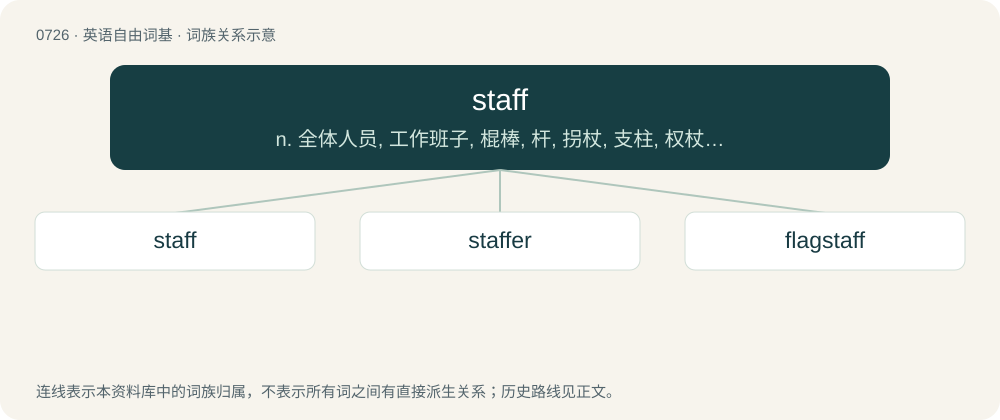

# 0792 · staff — n. 全体人员, 工作班子, 棍棒, 杆, 拐杖, 支柱, 权杖；a. 职员的, 雇员的, 参谋的；vt. 为...配备人员

[总目录](../00_总目录_按常用程度.md)

**类型**：英语自由词基　｜　**来源语言**：见词源记录

## 核心含义与来源

- 核心含义：n. 全体人员, 工作班子, 棍棒, 杆, 拐杖, 支柱, 权杖；a. 职员的, 雇员的, 参谋的；vt. 为...配备人员
- 英文含义：A long, straight, thick wooden rod or stick, especially one used to assist in walking.
- 词形：staff

**来源记录 1**（名词；A long, straight, thick wooden rod or stick, especially one used to assist in walking.）

From Middle English staf, from Old English stæf (“letter of the alphabet”), from Proto-West Germanic \*stab, from Proto-Germanic \*stabaz. Cognate with Dutch staf, German Stab, Danish stav, Swedish stav. Sense of "group of military officers that assists a commander" and similar meanings, attested from 1702, is influenced by or is even from German Stab.

## 词族图

## 单词速览（常用到不常用）

| 单词 | 音标 | 释义 |
|---|---|---|
| [staff](#w-1) | /stɑːf/ | n. 全体人员, 工作班子, 棍棒, 杆, 拐杖, 支柱, 权杖；a. 职员的, 雇员的, 参谋的；vt. 为...配备人员 |
| [staffer](#w-2) | /ˈstɑːfə/ | n. (一名)职员(尤指编辑或记者) |
| [flagstaff](#w-3) | 英 /ˈflæɡstɑːf/；美 /ˈflæɡstæf/ | n. 旗竿 |

## 逐词详解

### 1. staff

**词性**：名词　｜　**音标**：/stɑːf/

**中文释义**：n. 全体人员, 工作班子, 棍棒, 杆, 拐杖, 支柱, 权杖；a. 职员的, 雇员的, 参谋的；vt. 为...配备人员

**英文义项**：A long, straight, thick wooden rod or stick, especially one used to assist in walking. / A series of horizontal lines on which musical notes are written; a stave.

**词源与演化**：

From Middle English staf, from Old English stæf (“letter of the alphabet”), from Proto-West Germanic \*stab, from Proto-Germanic \*stabaz. Cognate with Dutch staf, German Stab, Danish stav, Swedish stav. Sense of "group of military officers that assists a commander" and similar meanings, attested from 1702, is influenced by or is even from German Stab.

**例句**：

> The company employed 10 new members of staff this month.

该用例对应义项：People employed by a business or other organisation.

### 2. staffer

**词性**：名词　｜　**音标**：/ˈstɑːfə/

**中文释义**：n. (一名)职员(尤指编辑或记者)

**英文义项**：A member of a staff; an employee.

**构词拆分**：From staff + -er.

**词源与演化**：

From staff + -er.

**例句**：

> The politician had a staffer send out the prepared statement.

该用例对应义项：A member of a staff; an employee.

### 3. flagstaff

**词性**：名词　｜　**音标**：英 /ˈflæɡstɑːf/；美 /ˈflæɡstæf/

**中文释义**：n. 旗竿

**英文义项**：A pole on which a flag is raised.

**构词拆分**：flag + staff

**词源与演化**：

From flag + staff.
