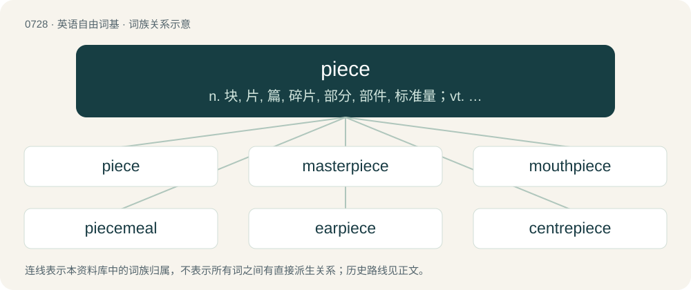

# 0795 · piece — n. 块, 片, 篇, 碎片, 部分, 部件, 标准量；vt. 修补, 修理, 拼合, 接线头；vi. 吃零食

[总目录](../00_总目录_按常用程度.md)

**类型**：英语自由词基　｜　**来源语言**：见词源记录

## 核心含义与来源

- 核心含义：n. 块, 片, 篇, 碎片, 部分, 部件, 标准量；vt. 修补, 修理, 拼合, 接线头；vi. 吃零食
- 英文含义：A part of a larger whole, usually in such a form that it is able to be separated from other parts.
- 词形：piece

**来源记录 1**（名词；A part of a larger whole, usually in such a form that it is able to be separated from other parts.）

From Middle English pece, peece, peice, from Old French piece, from Late Latin pecia, petia (“broken piece, fragment; parcel of land”), of uncertain origin. Possibly ultimately from Gaulish \*pettyā, from Proto-Celtic \*kʷezdis (“piece, portion, quota”). Compare Welsh peth (“thing, stuff, junk”), Breton pez (“thing”), Irish cuid (“part, portion”). Compare French pièce, Portuguese peça, Spanish pieza, Italian pezza, Italian pezzo. Displaced native Middle English sticche, stucche (“piece, fragment”) from Old English styċċe (“piece, portion”), whence also English styca.

## 词族图

## 单词速览（常用到不常用）

| 单词 | 音标 | 释义 |
|---|---|---|
| [piece](#w-1) | /piːs/ | n. 块, 片, 篇, 碎片, 部分, 部件, 标准量；vt. 修补, 修理, 拼合, 接线头；vi. 吃零食 |
| [masterpiece](#w-2) | 英 /ˈmɑːstəˌpiːs/；美 /ˈmæstɚˌpis/ | n. 杰作, 名著 |
| [mouthpiece](#w-3) | /ˈmaʊθˌpiːs/ | n. 发话筒, 代言人, (电话)送话口；\[机\] 钳口垫片 |
| [piecemeal](#w-4) | 英 /ˈpiːs.miːl/ | adv. 一件一件地, 逐个地, 零碎地；a. 一片一片的, 逐渐的, 零碎的；n. 断片 |
| [earpiece](#w-5) | 英 /ˈɪəpiːs/；美 /ˈɪɹpiːs/ | n. 耳机, 护耳片, 眼镜脚, 头戴式耳机；\[电\] 听筒 |
| [centrepiece](#w-6) | /ˈsentəpiːs/ | n. 中心装饰品 |
| [workpiece](#w-7) | 英 /ˈwɜːkpiːs/；美 /ˈwɜɹkˌpis/ | n. 工件 |
| [timepiece](#w-8) | /ˈtaɪmpiːs/ | n. 时钟, 钟 |
| [headpiece](#w-9) | 美 /ˈhɛdˌpis/ | n. 头巾, 耳机, 盔, 帽子, (书的)扉页, 头脑, 才智 |
| [mantelpiece](#w-10) | /ˈmæntlpiːs/ | n. 壁炉台, 壁炉架 |
| [eyepiece](#w-11) | /ˈaipiːs/ | n. (接)目镜；\[化\] 目镜 |
| [showpiece](#w-12) | /ˈʃəupiːs/ | n. 展出品, 样品 |
| [altarpiece](#w-13) | 美 /ˈɑl.təɹˌpis/ | n. 组塑,祭坛装饰 |
| [piecewise](#w-14) | /ˈpiːswaiz/ | adv. \[数\]分段地 |
| [hairpiece](#w-15) | /ˈhєəpiːs/ | n. 假发 |

## 逐词详解

### 1. piece

**词性**：名词　｜　**音标**：/piːs/

**中文释义**：n. 块, 片, 篇, 碎片, 部分, 部件, 标准量；vt. 修补, 修理, 拼合, 接线头；vi. 吃零食

**英文义项**：A part of a larger whole, usually in such a form that it is able to be separated from other parts. / A single item belonging to a class of similar items.

**词源与演化**：

From Middle English pece, peece, peice, from Old French piece, from Late Latin pecia, petia (“broken piece, fragment; parcel of land”), of uncertain origin. Possibly ultimately from Gaulish \*pettyā, from Proto-Celtic \*kʷezdis (“piece, portion, quota”). Compare Welsh peth (“thing, stuff, junk”), Breton pez (“thing”), Irish cuid (“part, portion”). Compare French pièce, Portuguese peça, Spanish pieza, Italian pezza, Italian pezzo. Displaced native Middle English sticche, stucche (“piece, fragment”) from Old English styċċe (“piece, portion”), whence also English styca.

**例句**：

> Ugh, my new computer is such a piece. I'm taking it back to the store tomorrow.

该用例对应义项：A shoddy or worthless object (usually applied to consumer products like vehicles or appliances).

### 2. masterpiece

**词性**：名词　｜　**音标**：英 /ˈmɑːstəˌpiːs/；美 /ˈmæstɚˌpis/

**中文释义**：n. 杰作, 名著

**英文义项**：A piece of work that has been given much critical praise, especially one that is considered the greatest work of a person's career. / A work of outstanding creativity, skill or workmanship.

**构词拆分**：master + piece

**词源与演化**：

From master + piece, a calque of Dutch meesterstuk or German Meisterstück (“masterpiece”). Piecewise doublet of maestropiece and masterstick. Compare also journeyman's piece.

**例句**：

> Masterpieces are not completed, they are abandoned.

该用例对应义项：A work of outstanding creativity, skill or workmanship.

### 3. mouthpiece

**词性**：名词　｜　**音标**：/ˈmaʊθˌpiːs/

**中文释义**：n. 发话筒, 代言人, (电话)送话口；\[机\] 钳口垫片

**英文义项**：The part of a telephone that is held close to the mouth. / The part of a wind instrument that is held in or against the mouth.

**构词拆分**：mouth + piece

**词源与演化**：

From mouth + piece.

**例句**：

> The novel's protagonist serves as a mouthpiece for the author's political views.

该用例对应义项：A spokesman; one who speaks on behalf of someone else.

### 4. piecemeal

**词性**：形容词　｜　**音标**：英 /ˈpiːs.miːl/

**中文释义**：adv. 一件一件地, 逐个地, 零碎地；a. 一片一片的, 逐渐的, 零碎的；n. 断片

**英文义项**：Made or done in pieces or one stage at a time.

**构词拆分**：piece + -meal

**词源与演化**：

From Middle English pecemele, from pece (“piece”) + mele (from Old English mǣlum (“at a time”), dative plural form of mǣl (“time, measure”), taking the place of Old English styċċemǣlum (“in pieces, bit by bit, piecemeal; to pieces, to bits; here and there, in different places; little by little, by degrees, gradually”); equivalent to piece + -meal.

**用法示例／搭配（非完整句）**：

> a piecemeal approach

该用例对应义项：Made or done in pieces or one stage at a time.

### 5. earpiece

**词性**：名词　｜　**音标**：英 /ˈɪəpiːs/；美 /ˈɪɹpiːs/

**中文释义**：n. 耳机, 护耳片, 眼镜脚, 头戴式耳机；\[电\] 听筒

**英文义项**：A speaker placed inside or held near to the ear. / A receiver of a telephone to hold near to one's ear.

**构词拆分**：ear + piece

**词源与演化**：

From ear + piece.

**例句**：

> Holding the earpiece to my ear, I could hear him speaking clearly.

该用例对应义项：A speaker placed inside or held near to the ear.

### 6. centrepiece

**词性**：名词　｜　**音标**：/ˈsentəpiːs/

**中文释义**：n. 中心装饰品

**英文义项**：An ornament to be placed in the centre, as of a table, ceiling, etc. / A central article or figure.

**构词拆分**：From centre + piece.

**词源与演化**：

From centre + piece.

### 7. workpiece

**词性**：名词　｜　**音标**：英 /ˈwɜːkpiːs/；美 /ˈwɜɹkˌpis/

**中文释义**：n. 工件

**英文义项**：A partially finished object (often composed of a raw material) which is subjected to various operations, worked on with tools, etc.

**构词拆分**：work (noun) + piece (noun)

**词源与演化**：

From work (noun) + piece (noun), a calque of German Werkstück (“piece of work; object being worked on”).

**例句**：

> Make sure the workpiece is properly secured in the chuck before turning on the lathe.

该用例对应义项：A partially finished object (often composed of a raw material) which is subjected to various operations, worked on with tools, etc.

### 8. timepiece

**词性**：名词　｜　**音标**：/ˈtaɪmpiːs/

**中文释义**：n. 时钟, 钟

**英文义项**：A chronometer (any device used to tell the time of day), particularly a clock lacking a chime or similar sounding mechanism. / A watch (a small portable device used to tell the time of day), particularly one lacking a chime or similar sounding mechanism.

**构词拆分**：time + piece

**词源与演化**：

From time + piece.

**例句**：

> The only timepiece she allowed in the house was a sundial. She usually kept the curtains pulled.

该用例对应义项：A chronometer (any device used to tell the time of day), particularly a clock lacking a chime or similar sounding mechanism.

### 9. headpiece

**词性**：名词　｜　**音标**：美 /ˈhɛdˌpis/

**中文释义**：n. 头巾, 耳机, 盔, 帽子, (书的)扉页, 头脑, 才智

**英文义项**：The head; the brain; the head as the seat of intellect. / A person with great intelligence.

**构词拆分**：head + piece

**词源与演化**：

From head + piece.

**例句**：

> The beret is an iconic French headpiece.

### 10. mantelpiece

**词性**：名词　｜　**音标**：/ˈmæntlpiːs/

**中文释义**：n. 壁炉台, 壁炉架

**英文义项**：A shelf that is affixed to the wall above a fireplace.

**构词拆分**：mantel + piece

**词源与演化**：

From mantel + piece.

**例句**：

> I noticed that there was a picture of Tom on the mantelpiece.

### 11. eyepiece

**词性**：名词　｜　**音标**：/ˈaipiːs/

**中文释义**：n. (接)目镜；\[化\] 目镜

**英文义项**：The lens (or the component containing a combination of lenses) at the eye end of a microscope or telescope by which the image is viewed.

**构词拆分**：eye + piece

**词源与演化**：

From eye + piece.

### 12. showpiece

**词性**：名词　｜　**音标**：/ˈʃəupiːs/

**中文释义**：n. 展出品, 样品

**英文义项**：Something that exhibits exceptional quality, something worth being shown. / Something made specifically to be displayed.

**构词拆分**：show + piece

**词源与演化**：

From show + piece.

### 13. altarpiece

**词性**：名词　｜　**音标**：美 /ˈɑl.təɹˌpis/

**中文释义**：n. 组塑,祭坛装饰

**英文义项**：a work of art suspended above and behind an altar in a church

**构词拆分**：From altar + piece.

**词源与演化**：

From altar + piece.

### 14. piecewise

**词性**：形容词　｜　**音标**：/ˈpiːswaiz/

**中文释义**：adv. \[数\]分段地

**英文义项**：Defined by subfunctions and subdomains

**构词拆分**：piece + -wise

**词源与演化**：

From piece + -wise.

### 15. hairpiece

**词性**：名词　｜　**音标**：/ˈhєəpiːs/

**中文释义**：n. 假发

**英文义项**：A false substitute for a person's hair; a toupee or wig.

**构词拆分**：hair + piece

**词源与演化**：

From hair + piece.
