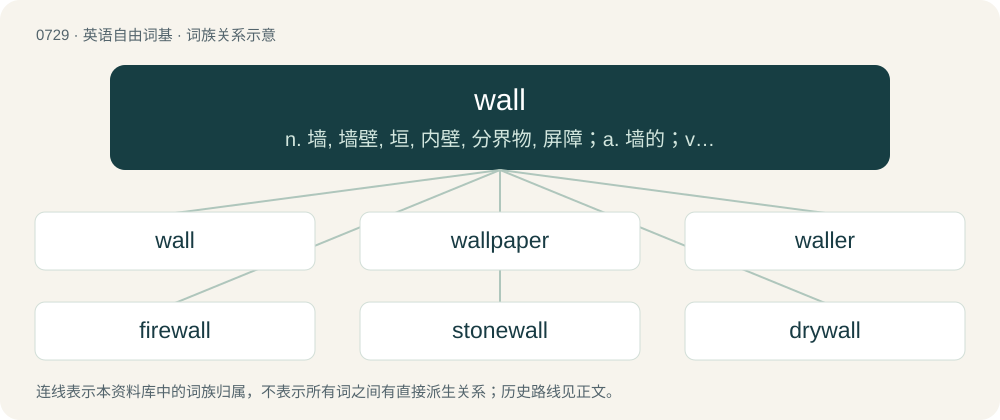

# 0796 · wall — n. 墙, 墙壁, 垣, 内壁, 分界物, 屏障；a. 墙的；vt. 给...建墙, 禁闭, 用墙围住

[总目录](../00_总目录_按常用程度.md)

**类型**：英语自由词基　｜　**来源语言**：见词源记录

## 核心含义与来源

- 核心含义：n. 墙, 墙壁, 垣, 内壁, 分界物, 屏障；a. 墙的；vt. 给...建墙, 禁闭, 用墙围住
- 英文含义：A rampart of earth, stones etc. built up for defensive purposes.
- 词形：wall

**多个词源／构词路径**：同一拼写可能有不同来源；以下按词性和含义分别列出。

**来源记录 1**（名词；A rampart of earth, stones etc. built up for defensive purposes.）

From Middle English wal, from Old English weall (“wall, dike, earthwork, rampart, dam, rocky shore, cliff”), from Proto-West Germanic \*wall (“wall, rampart, entrenchment”), from Latin vallum (“wall, rampart, entrenchment, palisade”), from Proto-Indo-European \*welH- (“to turn, wind, roll”). Perhaps conflated with waw (“a wall within a house or dwelling, a room partition”), from Middle English wawe, from Old English wāg, wāh (“an interior wall, divider”), see waw. Cognate with North Frisian wal (“wall”), Saterland Frisian Waal (“wall, rampart, mound”), Dutch wal (“wall, rampart, embankment”), German Wall (“rampart, mound, embankment”), Swedish vall (“mound, wall, bank”). More at wallow, walk.

**来源记录 2**（动词；To boil.）

From Middle English wallen, from Old English weallan (“to bubble, boil”), from Proto-West Germanic \*wallan, from Proto-Germanic \*wallaną (“to fount, stream, boil”), from Proto-Indo-European \*welH- (“wave”). Cognate with Middle Dutch wallen (“to boil, bubble”), Dutch wellen (“to weld”), German wellen (“to wave, warp”), Danish vælde (“to overwhelm”), Swedish välla (“to gush, weld”). See also well.

**来源记录 3**（名词；A spring of water.）

From Middle English walle, from Old English \*wealla, \*weall (“spring”), from Proto-Germanic \*wallô, \*wallaz (“well, spring”). See above. Cognate with Old Frisian walla (“spring”), Old English wiell (“well”).

## 词族图

## 单词速览（常用到不常用）

| 单词 | 音标 | 释义 |
|---|---|---|
| [wall](#w-1) | 英 /wɔːl/；/wɔl/ | n. 墙, 墙壁, 垣, 内壁, 分界物, 屏障；a. 墙的；vt. 给...建墙, 禁闭, 用墙围住 |
| [wallpaper](#w-2) | /ˈwɔːlˌpeɪpə/ | n. 壁纸, 墙纸；v. 贴墙纸；\[计\] 壁纸 |
| [waller](#w-3) | /ˈwɔlə/ | n. 石垛工；煤矿井下充填工 |
| [firewall](#w-4) | 英 /ˈfaɪə.wɔəl/；美 /ˈfaɪ(ə)ɹˌwɔl/ | \[计\] 放火墙, 隔离 |
| [stonewall](#w-5) | 英 /ˈstəʊnwɔːl/；美 /ˈstoʊnwɔl/ | vi. 防守挡击, 围以石墙, 妨碍或阻碍 |
| [drywall](#w-6) | 英 /ˈdraɪˌwɔːl/；美 /ˈdraɪˌwɔl/ | 干式墙 |
| [wallflower](#w-7) | 英 /ˈwɔːlˌflaʊ.ə/；美 /ˈwɔlˌflaʊ.ɚ/ | n. \[植\]桂足香,桂香香水, 局外人 |
| [seawall](#w-8) |  | n. 海塘；防波堤 |
| [sidewall](#w-9) |  | n. 边墙, 侧壁, 轮胎侧壁 |
| [paywall](#w-10) | 英 /ˈpeɪ.wɔːl/；美 /ˈpeɪ.wɔl/ | n. 网站的付费门槛 |
| [blackwall](#w-11) |  | 【英文】A tyre/tire with black sidewalls. |

## 逐词详解

### 1. wall

**词性**：名词　｜　**音标**：英 /wɔːl/；/wɔl/

**中文释义**：n. 墙, 墙壁, 垣, 内壁, 分界物, 屏障；a. 墙的；vt. 给...建墙, 禁闭, 用墙围住

**英文义项**：A rampart of earth, stones etc. built up for defensive purposes. / A structure built for defense surrounding a city, castle etc.

**词源与演化**：

From Middle English wal, from Old English weall (“wall, dike, earthwork, rampart, dam, rocky shore, cliff”), from Proto-West Germanic \*wall (“wall, rampart, entrenchment”), from Latin vallum (“wall, rampart, entrenchment, palisade”), from Proto-Indo-European \*welH- (“to turn, wind, roll”). Perhaps conflated with waw (“a wall within a house or dwelling, a room partition”), from Middle English wawe, from Old English wāg, wāh (“an interior wall, divider”), see waw. Cognate with North Frisian wal (“wall”), Saterland Frisian Waal (“wall, rampart, mound”), Dutch wal (“wall, rampart, embankment”), German Wall (“rampart, mound, embankment”), Swedish vall (“mound, wall, bank”). More at wallow, walk.

**例句**：

> A wall of police officers met the protesters before they reached the capitol steps.

该用例对应义项：An impediment to free movement.

### 2. wallpaper

**词性**：名词　｜　**音标**：/ˈwɔːlˌpeɪpə/

**中文释义**：n. 壁纸, 墙纸；v. 贴墙纸；\[计\] 壁纸

**英文义项**：Decorative paper-like material used to cover the inner walls of buildings. / A roll of such paper.

**构词拆分**：wall + paper

**词源与演化**：

From wall + paper.

**例句**：

> He is letting her select the wallpapers for the whole house.

该用例对应义项：A style or design of such material.

### 3. waller

**词性**：名词　｜　**音标**：/ˈwɔlə/

**中文释义**：n. 石垛工；煤矿井下充填工

**英文义项**：One who builds walls.

**构词拆分**：wall + -er

**词源与演化**：

From wall + -er.

**例句**：

> Jim Waller is a strong candidate for the post of sales manager.

### 4. firewall

**词性**：名词　｜　**音标**：英 /ˈfaɪə.wɔəl/；美 /ˈfaɪ(ə)ɹˌwɔl/

**中文释义**：\[计\] 放火墙, 隔离

**英文义项**：A fireproof barrier used to prevent the spread of fire between or through buildings, structures, electrical substation transformers, or within an aircraft or vehicle. / The software that monitors traffic in and out of a private network or a personal computer and allows or blocks such traffic depending on its perceived threat.

**构词拆分**：fire + wall

**词源与演化**：

From fire + wall. Compare West Frisian brânmuorre, Dutch brandmuur, German Brandmauer, Feuermauer, Swedish brandvägg, brandmur, Icelandic eldvegg. The verb sense for using maximum power or acceleration comes from the engine's firewall being the limit of forward movement of the throttle controls on many simpler vehicles; thus, to get the maximum engine output, one would push the throttle levers or pedal all the way to the firewall. The politics sense is a calque of German Brandmauer.

**例句**：

> I need to configure this server with an appropriate firewall system.

### 5. stonewall

**词性**：动词　｜　**音标**：英 /ˈstəʊnwɔːl/；美 /ˈstoʊnwɔl/

**中文释义**：vi. 防守挡击, 围以石墙, 妨碍或阻碍

**英文义项**：To obstruct. / To refuse to answer or cooperate, especially in supplying information.

**构词拆分**：stone + wall

**词源与演化**：

From Middle English stonwal, stone wall, stanewalle (“wall made of stone”), from Old English stānweall (“stonewall”), equivalent to stone + wall. The alcoholic drink (sense 3) was perhaps named thus because its effect was as potent as running into a stone wall.

**例句**：

> At the press conference, the Prime Minister appeared to be stonewalling when asked about tax increases.

该用例对应义项：To refuse to answer or cooperate, especially in supplying information.

### 6. drywall

**词性**：名词　｜　**音标**：英 /ˈdraɪˌwɔːl/；美 /ˈdraɪˌwɔl/

**中文释义**：干式墙

**英文义项**：A building material comprising a sheet of gypsum sandwiched between two pieces of heavy paper, used mainly for interior walls and ceilings. / A wall made of this.

**构词拆分**：dry + wall

**词源与演化**：

From dry + wall.

**例句**：

> Sledgehammers are often used in demolition work, for breaking through drywall or masonry walls.

### 7. wallflower

**词性**：名词　｜　**音标**：英 /ˈwɔːlˌflaʊ.ə/；美 /ˈwɔlˌflaʊ.ɚ/

**中文释义**：n. \[植\]桂足香,桂香香水, 局外人

**英文义项**：Any of several short-lived herbs or shrubs of the Erysimum genus with bright yellow to red flowers. / Gastrolobium grandiflorum, a poisonous bushy shrub, endemic to Australia.

**构词拆分**：wall + flower

**词源与演化**：

From wall + flower.

**例句**：

> It's just too pathetic that this henpecked husband ended up hooking up with a wallflower.

### 8. seawall

**词性**：名词

**中文释义**：n. 海塘；防波堤

**英文义项**：A coastal defence in the form of a wall or an embankment.

**构词拆分**：sea + wall

**词源与演化**：

From Middle English se-walle, from Old English sǣweall (“seawall”), equivalent to sea + wall.

### 9. sidewall

**词性**：名词

**中文释义**：n. 边墙, 侧壁, 轮胎侧壁

**英文义项**：The side of a tire. / The wall forming the side of a structure; a side wall.

**构词拆分**：side + wall

**词源与演化**：

From side + wall.

**例句**：

> If the puncture had been in the tread I could have had the tire patched, but it was in the sidewall and they can't fix that: they have to replace the whole tire.

该用例对应义项：The side of a tire.

### 10. paywall

**词性**：名词　｜　**音标**：英 /ˈpeɪ.wɔːl/；美 /ˈpeɪ.wɔl/

**中文释义**：n. 网站的付费门槛

**英文义项**：A system that restricts access to content with a purchase or a paid subscription.

**构词拆分**：pay + wall

**词源与演化**：

From pay + wall, by analogy with firewall.

**例句**：

> The premium content on this website is behind a paywall.

该用例对应义项：A system that restricts access to content with a purchase or a paid subscription.

### 11. blackwall

**词性**：名词

**英文义项**：A tyre/tire with black sidewalls.

**构词拆分**：black + wall

**词源与演化**：

From black + wall.
