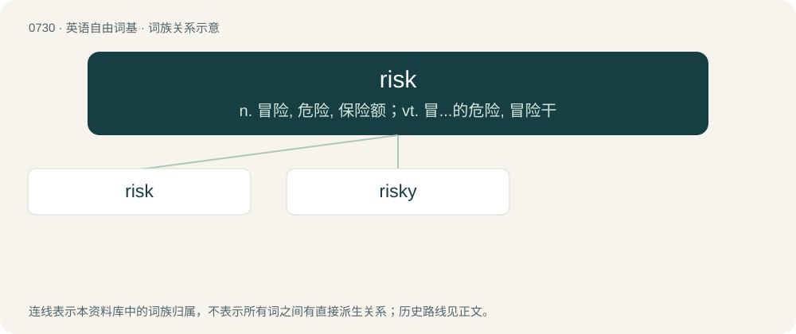

# 0798 · risk — n. 冒险, 危险, 保险额；vt. 冒...的危险, 冒险干

[总目录](../00_总目录_按常用程度.md)

**类型**：英语自由词基　｜　**来源语言**：见词源记录

## 核心含义与来源

- 核心含义：n. 冒险, 危险, 保险额；vt. 冒...的危险, 冒险干
- 英文含义：The probability of a negative outcome to a decision or event.
- 词形：risk

**来源记录 1**（名词；The probability of a negative outcome to a decision or event.）

From earlier risque, from Middle French risque, from Old Italian risco (“risk”) (modern Italian rischio) and rischiare (“to run into danger”). Displaced native Old English pleoh (“risk”) and plēon (“to risk”). Speculation on earlier roots Most dictionaries consider the etymology of these Italian terms uncertain, but some suggest they perhaps come from Vulgar Latin \*resecum (“that which cuts, rock, crag”) (&gt; Medieval Latin resicu), from Latin resecō (“cut off, loose, curtail”, verb), in the sense of that which is a danger to boating or shipping; or from Ancient Greek ῥιζικόν (rhizikón, “root, radical, hazard”). A few dictionaries express more certainty. Collins says the Italian risco comes from Ancient Greek ῥίζα (rhíza, “cliff”) due to the hazards of sailing along rocky coasts. The American Heritage says it probably comes from Byzantine Greek ῥιζικό, ριζικό (rhizikó, rizikó, “sustenance obtained by a soldier through his own initiative, fortune”), from Arabic رِزْق (rizq, “sustenance, that which God allots”), from Classical Syriac ܪܘܙܝܩܐ ,ܪܙܩܐ (rezqā, rōzīqā, “daily ration”), from Middle Persian \[script needed\] (rōzīg) (whence Classical Persian روزِی (rōzī)), from Middle Persian \[script needed\] (rōz, “day”) (whence Classical Persian روز (rōz)), from Old Persian 𐎼𐎢𐎨𐏃 (raučah) (cognate with Sanskrit रोचस् (rocas, “light, lustre”)), from Proto-Iranian \*ráwčah, from Proto-Indo-Iranian \*ráwčas, ultimately from Proto-Indo-European \*léwk-os, from \*lewk- (“bright; to shine”) + \*-os (noun suffix). Karla Mallette derives the word from Arabic رِزْق (rizq, “sustenance, that which God allots”) via Sabir. Cognate with Spanish riesgo, Portuguese risco

## 词族图

## 单词速览（常用到不常用）

| 单词 | 音标 | 释义 |
|---|---|---|
| [risk](#w-1) | /ɹɪsk/ | n. 冒险, 危险, 保险额；vt. 冒...的危险, 冒险干 |
| [risky](#w-2) | /ˈɹɪski/ | a. 危险的 |

## 逐词详解

### 1. risk

**词性**：名词　｜　**音标**：/ɹɪsk/

**中文释义**：n. 冒险, 危险, 保险额；vt. 冒...的危险, 冒险干

**英文义项**：The probability of a negative outcome to a decision or event. / The magnitude of possible loss consequent to a decision or event.

**词源与演化**：

From earlier risque, from Middle French risque, from Old Italian risco (“risk”) (modern Italian rischio) and rischiare (“to run into danger”). Displaced native Old English pleoh (“risk”) and plēon (“to risk”). Speculation on earlier roots Most dictionaries consider the etymology of these Italian terms uncertain, but some suggest they perhaps come from Vulgar Latin \*resecum (“that which cuts, rock, crag”) (&gt; Medieval Latin resicu), from Latin resecō (“cut off, loose, curtail”, verb), in the sense of that which is a danger to boating or shipping; or from Ancient Greek ῥιζικόν (rhizikón, “root, radical, hazard”). A few dictionaries express more certainty. Collins says the Italian risco comes from Ancient Greek ῥίζα (rhíza, “cliff”) due to the hazards of sailing along rocky coasts. The American Heritage says it probably comes from Byzantine Greek ῥιζικό, ριζικό (rhizikó, rizikó, “sustenance obtained by a soldier through his own initiative, fortune”), from Arabic رِزْق (rizq, “sustenance, that which God allots”), from Classical Syriac ܪܘܙܝܩܐ ,ܪܙܩܐ (rezqā, rōzīqā, “daily ration”), from Middle Persian \[script needed\] (rōzīg) (whence Classical Persian روزِی (rōzī)), from Middle Persian \[script needed\] (rōz, “day”) (whence Classical Persian روز (rōz)), from Old Persian 𐎼𐎢𐎨𐏃 (raučah) (cognate with Sanskrit रोचस् (rocas, “light, lustre”)), from Proto-Iranian \*ráwčah, from Proto-Indo-Iranian \*ráwčas, ultimately from Proto-Indo-European \*léwk-os, from \*lewk- (“bright; to shine”) + \*-os (noun suffix). Karla Mallette derives the word from Arabic رِزْق (rizq, “sustenance, that which God allots”) via Sabir. Cognate with Spanish riesgo, Portuguese risco

**例句**：

> Subprime mortgages are poor risks; especially for a pension scheme.

该用例对应义项：A financial product (typically an investment).

### 2. risky

**词性**：形容词　｜　**音标**：/ˈɹɪski/

**中文释义**：a. 危险的

**英文义项**：Dangerous; involving risks.

**构词拆分**：risk + -y

**词源与演化**：

From risk + -y.

**例句**：

> Jumping on the train from the bridge to catch the terrorist was a highly risky operation.

该用例对应义项：Dangerous; involving risks.
