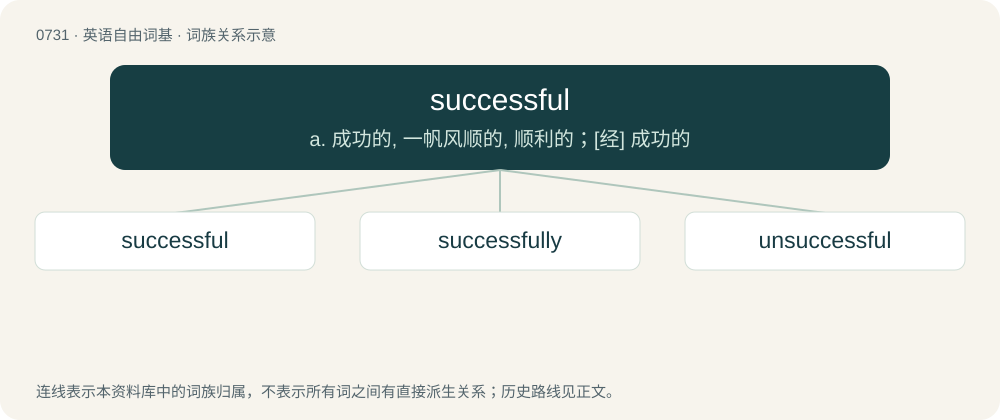

# 0799 · successful — a. 成功的, 一帆风顺的, 顺利的；\[经\] 成功的

[总目录](../00_总目录_按常用程度.md)

**类型**：英语自由词基　｜　**来源语言**：见词源记录

## 核心含义与来源

- 核心含义：a. 成功的, 一帆风顺的, 顺利的；\[经\] 成功的
- 英文含义：Resulting in success; assuring or promoting success; accomplishing what was proposed; having the desired effect.
- 词形：successful

**来源记录 1**（形容词；Resulting in success; assuring or promoting success; accomplishing what was proposed; having the desired effect.）

From success + -ful.

## 词族图

## 单词速览（常用到不常用）

| 单词 | 音标 | 释义 |
|---|---|---|
| [successful](#w-1) | 英 /səkˈsɛs.fəl/ | a. 成功的, 一帆风顺的, 顺利的；\[经\] 成功的 |
| [successfully](#w-2) | 英 /səkˈsɛs.fə.li/ | adv. 成功, 结果良好, 有成就 |
| [unsuccessful](#w-3) | /ˌʌnsəkˈsɛsfl̩/ | a. 不成功的 |

## 逐词详解

### 1. successful

**词性**：形容词　｜　**音标**：英 /səkˈsɛs.fəl/

**中文释义**：a. 成功的, 一帆风顺的, 顺利的；\[经\] 成功的

**英文义项**：Resulting in success; assuring or promoting success; accomplishing what was proposed; having the desired effect.

**构词拆分**：success + -ful

**词源与演化**：

From success + -ful.

**用法示例／搭配（非完整句）**：

> a successful use of medicine; a successful experiment; a successful enterprise

该用例对应义项：Resulting in success; assuring or promoting success; accomplishing what was proposed; having the desired effect.

### 2. successfully

**词性**：副词　｜　**音标**：英 /səkˈsɛs.fə.li/

**中文释义**：adv. 成功, 结果良好, 有成就

**英文义项**：In a successful manner; with success; without failing.

**构词拆分**：successful + -ly

**词源与演化**：

From successful + -ly.

**例句**：

> They successfully completed their project together.

该用例对应义项：In a successful manner; with success; without failing.

### 3. unsuccessful

**词性**：形容词　｜　**音标**：/ˌʌnsəkˈsɛsfl̩/

**中文释义**：a. 不成功的

**英文义项**：Failed, not successful.

**构词拆分**：un- + successful

**词源与演化**：

From un- + successful.

**例句**：

> His unsuccessful attempt earned him sympathy, condolences, and an occasional good-natured ribbing.

该用例对应义项：Failed, not successful.
