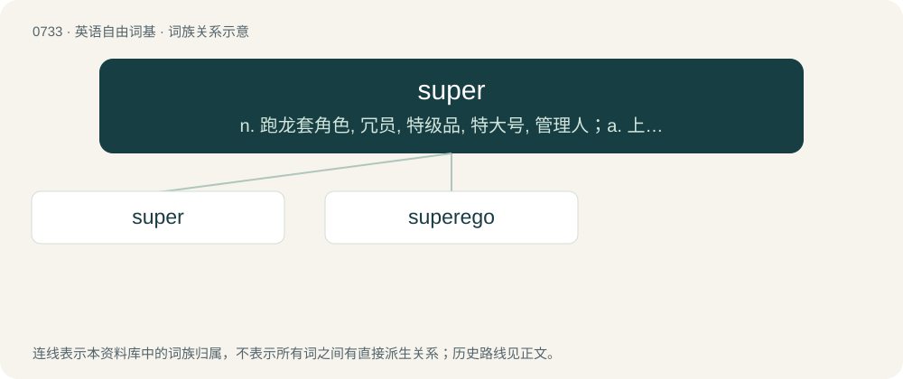

# 0801 · super — n. 跑龙套角色, 冗员, 特级品, 特大号, 管理人；a. 上等的, 特大的, 超级的, 极好的, 十分的, 过分的；adv. 非常

[总目录](../00_总目录_按常用程度.md)

**类型**：英语自由词基　｜　**来源语言**：见词源记录

## 核心含义与来源

- 核心含义：n. 跑龙套角色, 冗员, 特级品, 特大号, 管理人；a. 上等的, 特大的, 超级的, 极好的, 十分的, 过分的；adv. 非常
- 英文含义：Of excellent quality, superfine.
- 词形：super

**多个词源／构词路径**：同一拼写可能有不同来源；以下按词性和含义分别列出。

**来源记录 1**（形容词；Of excellent quality, superfine.）

From super- (prefix), from Middle English super-, from Latin super-, from super (“above”). Doublet of over and hyper.

**来源记录 2**（名词；A superimposed caption or image.）

Abbreviation by shortening.

## 词族图

## 单词速览（常用到不常用）

| 单词 | 音标 | 释义 |
|---|---|---|
| [super](#w-1) | 英 /ˈsuːpə/；美 /ˈsupɚ/ | n. 跑龙套角色, 冗员, 特级品, 特大号, 管理人；a. 上等的, 特大的, 超级的, 极好的, 十分的, 过分的；adv. 非常 |
| [superego](#w-2) | 美 /ˈsupɚˌiɡoʊ/ | n. 超自我 |

## 逐词详解

### 1. super

**词性**：形容词　｜　**音标**：英 /ˈsuːpə/；美 /ˈsupɚ/

**中文释义**：n. 跑龙套角色, 冗员, 特级品, 特大号, 管理人；a. 上等的, 特大的, 超级的, 极好的, 十分的, 过分的；adv. 非常

**英文义项**：Of excellent quality, superfine. / Better than average, better than usual; wonderful.

**词源与演化**：

From super- (prefix), from Middle English super-, from Latin super-, from super (“above”). Doublet of over and hyper.

**例句**：

> Super technology weapons from the ancients always end up out of control.

### 2. superego

**词性**：名词　｜　**音标**：美 /ˈsupɚˌiɡoʊ/

**中文释义**：n. 超自我

**英文义项**：The part of the mind that acts as a self-critical conscience, reflecting social standards that have been learnt.

**构词拆分**：super + ego

**词源与演化**：

From super + ego, from earlier form super-ego, calqued after German Über-Ich, from über- (“super-”) + Ich (“ego”), from the pronoun ich (“I”).

**例句**：

> In psychoanalysis, this voice is called the superego, which Freud conceived as the infantile internalizing of parental authority.
