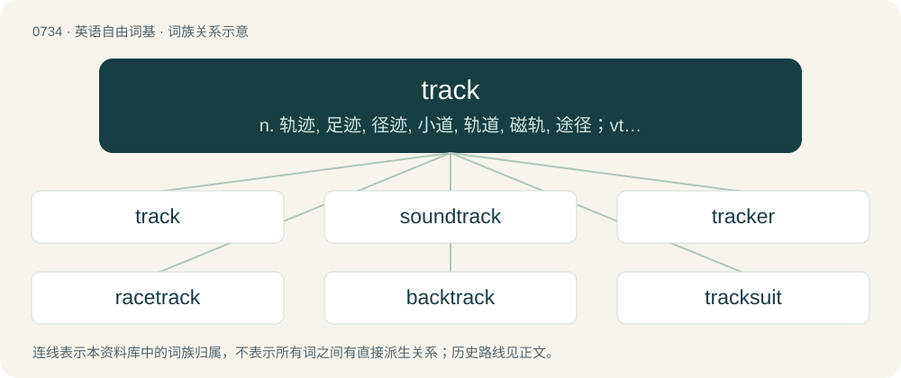

# 0802 · track — n. 轨迹, 足迹, 径迹, 小道, 轨道, 磁轨, 途径；vt. 循路而行, 追踪, 通过, 用纤拉；vi. 追踪, 留下足迹, 沿轨道运行

[总目录](../00_总目录_按常用程度.md)

**类型**：英语自由词基　｜　**来源语言**：见词源记录

## 核心含义与来源

- 核心含义：n. 轨迹, 足迹, 径迹, 小道, 轨道, 磁轨, 途径；vt. 循路而行, 追踪, 通过, 用纤拉；vi. 追踪, 留下足迹, 沿轨道运行
- 英文含义：A mark left by something that has passed along.
- 词形：track

**来源记录 1**（名词；A mark left by something that has passed along.）

From Middle English trak, tracke, from Old French trac (“track of horses, trail, trace”), of uncertain origin. Likely from a Germanic source, either Old Norse traðk ("a track; path; trodden spot"; &gt; Icelandic traðk (“a track; path; tread”), Faroese traðk (“track; tracks”), Norwegian tråkke (“to trample”)) or from Middle Dutch trec, \*trac, treck ("line, row, series"; &gt; Dutch trek (“a draft; feature; trait; groove; expedition”)), German Low German Treck (“a draught; movement; passage; flow”). See tread, trek.

## 词族图

## 单词速览（常用到不常用）

| 单词 | 音标 | 释义 |
|---|---|---|
| [track](#w-1) | /ˈtɹæk/ | n. 轨迹, 足迹, 径迹, 小道, 轨道, 磁轨, 途径；vt. 循路而行, 追踪, 通过, 用纤拉；vi. 追踪, 留下足迹, 沿轨道运行 |
| [soundtrack](#w-2) | 美 /ˈsaʊndˌtɹæk/ | n. 声迹, 声槽, 声带 |
| [tracker](#w-3) | /ˈtɹækə(ɹ)/ | n. 追踪者, 跟踪雷达, 拉纤者；\[法\] 追踪人, 探索者, 追踪空中移动物体的仪器 |
| [racetrack](#w-4) | /ˈɹeɪsˌtɹæk/ | n. 跑道 |
| [backtrack](#w-5) | /ˈbæk.tɹæk/ | vi. 返回, 退走, 撤退, 放弃；\[化\] 回溯 |
| [tracksuit](#w-6) | 美 /ˈtɹækˌsut/ | n. 运动服 |
| [tracklist](#w-7) |  | 【英文】A tracklisting; a list of tracks appearing on an album, EP, LP etc. |
| [trackpad](#w-8) | 美 /ˈtɹækˌpæd/ | n. （手指在其上滑动以移动光标的）触控板 |
| [trackage](#w-9) | 英 /ˈtɹæk.ɪdʒ/ | n. 轨道, 拉纤；\[法\] 铁路使用权, 轨道使用所交的费 |
| [trackside](#w-10) | /ˈtræksaid/ | \[铁\]n.轨道旁,线路旁 |
| [trackless](#w-11) | 英 /ˈtrækləs/ | a. 无足迹的, 无路的；\[法\] 无足迹的, 不留足迹的, 无路的 |

## 逐词详解

### 1. track

**词性**：名词　｜　**音标**：/ˈtɹæk/

**中文释义**：n. 轨迹, 足迹, 径迹, 小道, 轨道, 磁轨, 途径；vt. 循路而行, 追踪, 通过, 用纤拉；vi. 追踪, 留下足迹, 沿轨道运行

**英文义项**：A mark left by something that has passed along. / A mark or impression left by the foot, either of man or animal.

**词源与演化**：

From Middle English trak, tracke, from Old French trac (“track of horses, trail, trace”), of uncertain origin. Likely from a Germanic source, either Old Norse traðk ("a track; path; trodden spot"; &gt; Icelandic traðk (“a track; path; tread”), Faroese traðk (“track; tracks”), Norwegian tråkke (“to trample”)) or from Middle Dutch trec, \*trac, treck ("line, row, series"; &gt; Dutch trek (“a draft; feature; trait; groove; expedition”)), German Low German Treck (“a draught; movement; passage; flow”). See tread, trek.

**例句**：

> They briefly closed the railway to remove debris found on the track.

该用例对应义项：The way or rails along which a train moves.

### 2. soundtrack

**词性**：名词　｜　**音标**：美 /ˈsaʊndˌtɹæk/

**中文释义**：n. 声迹, 声槽, 声带

**英文义项**：A narrow strip running down a movie film that carries the recorded sound in synchronization with the pictures. / The sound (especially the music) component of a movie, video game, etc.

**构词拆分**：sound + track

**词源与演化**：

From sound + track.

**用法示例／搭配（非完整句）**：

> the soundtrack of our relationship

该用例对应义项：Popular music associated with a particular historical era or time of one's life, especially nostalgically.

### 3. tracker

**词性**：名词　｜　**音标**：/ˈtɹækə(ɹ)/

**中文释义**：n. 追踪者, 跟踪雷达, 拉纤者；\[法\] 追踪人, 探索者, 追踪空中移动物体的仪器

**英文义项**：A person employed to follow and monitor a political rival. / An Indigenous Australian employed by the law to track down fugitives and missing persons.

**构词拆分**：track + -er

**词源与演化**：

From track + -er.

**例句**：

> Sami is a fugitive tracker from the Toronto police department.

### 4. racetrack

**词性**：名词　｜　**音标**：/ˈɹeɪsˌtɹæk/

**中文释义**：n. 跑道

**英文义项**：A course over which any type of races are run. / A characteristic circular erosion pattern in deposition processes.

**构词拆分**：race + track

**词源与演化**：

From race + track.

**例句**：

> Do you think she'll still take me for a lap around the racetrack?

### 5. backtrack

**词性**：动词　｜　**音标**：/ˈbæk.tɹæk/

**中文释义**：vi. 返回, 退走, 撤退, 放弃；\[化\] 回溯

**英文义项**：To retrace one's steps. / To repeat or review work already done.

**构词拆分**：back + track

**词源与演化**：

From back + track.

**例句**：

> If we backtrack through this problem, maybe we can figure out where we went wrong.

该用例对应义项：To repeat or review work already done.

### 6. tracksuit

**词性**：名词　｜　**音标**：美 /ˈtɹækˌsut/

**中文释义**：n. 运动服

**英文义项**：A garment, usually consisting of a top and trousers (commonly known as tracksuit bottoms) worn as an outer layer by participants in sporting events such as athletics. The tracksuit is usually designed to be easily removed or replaced, before or after competing. Tracksuits have also been adopted in some cultures as leisurewear.

**构词拆分**：track + suit

**词源与演化**：

From track + suit.

**例句**：

> You look absolutely hot in this tracksuit.

### 7. tracklist

**词性**：名词

**英文义项**：A tracklisting; a list of tracks appearing on an album, EP, LP etc.

**构词拆分**：track + list

**词源与演化**：

From track + list.

**例句**：

> On the inlay card she had neatly printed the tracklist and drawn a heart.

### 8. trackpad

**词性**：名词　｜　**音标**：美 /ˈtɹækˌpæd/

**中文释义**：n. （手指在其上滑动以移动光标的）触控板

**英文义项**：touchpad

**构词拆分**：track + pad

**词源与演化**：

from track + pad, coined by Apple Inc.

### 9. trackage

**词性**：名词　｜　**音标**：英 /ˈtɹæk.ɪdʒ/

**中文释义**：n. 轨道, 拉纤；\[法\] 铁路使用权, 轨道使用所交的费

**英文义项**：railway tracks collectively / The right of a railway company to use the tracks belonging to another; the charge levied for this right

**构词拆分**：track + -age

**词源与演化**：

From track + -age.

### 10. trackside

**词性**：形容词　｜　**音标**：/ˈtræksaid/

**中文释义**：\[铁\]n.轨道旁,线路旁

**英文义项**：Located to the side of a track, especially a racetrack or set of railroad tracks.

**构词拆分**：track + -side

**词源与演化**：

From track + -side.

### 11. trackless

**词性**：形容词　｜　**音标**：英 /ˈtrækləs/

**中文释义**：a. 无足迹的, 无路的；\[法\] 无足迹的, 不留足迹的, 无路的

**英文义项**：Of a place: not having tracks or paths; pathless, untrodden; also, having had all tracks removed. / Leaving no track or trace when moving; also, not following any track or path.

**构词拆分**：track (noun) + -less (suffix meaning ‘lacking or without something’)

**词源与演化**：

From track (noun) + -less (suffix meaning ‘lacking or without something’).

**用法示例／搭配（非完整句）**：

> a trackless trolley

该用例对应义项：Of a train, tram, etc.: not running on tracks.
