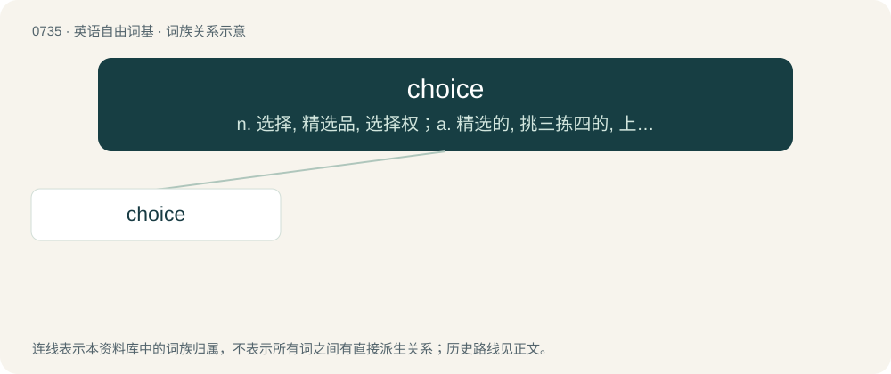

# 0803 · choice — n. 选择, 精选品, 选择权；a. 精选的, 挑三拣四的, 上等的；\[计\] DOS内部命令:在批处理文件中

[总目录](../00_总目录_按常用程度.md)

**类型**：英语自由词基　｜　**来源语言**：见词源记录

## 核心含义与来源

- 核心含义：n. 选择, 精选品, 选择权；a. 精选的, 挑三拣四的, 上等的；\[计\] DOS内部命令:在批处理文件中
- 英文含义：An option; a decision; an opportunity to choose or select something.
- 词形：choice

**多个词源／构词路径**：同一拼写可能有不同来源；以下按词性和含义分别列出。

**来源记录 1**（名词；An option; a decision; an opportunity to choose or select something.）

From Middle English chois, from Old French chois (“choice”), from choisir (“to choose, perceive”), possibly via assumed Vulgar Latin \*causīre (“to choose”), from Gothic 𐌺𐌰𐌿𐍃𐌾𐌰𐌽 (kausjan, “to make a choice, taste, test, choose”), from Proto-Germanic \*kauzijaną, from \*keusaną (“to choose”), from Proto-Indo-European \*ǵews- (“to choose”). Akin to Old High German kiosan (“to choose”), Old English ċēosan (“to choose”), Old Norse kjósa (“to choose”). More at choose.

**来源记录 2**（形容词；Especially good or preferred.）

From Middle English choys, from a merger of the noun above and Middle English chyse, chuse, chys, chis (“choice, excellent”), from Old English ċīes (“choice; dainty; nice”), related to Old English ċēosan (“to choose”).

## 词族图

## 单词速览（常用到不常用）

| 单词 | 音标 | 释义 |
|---|---|---|
| [choice](#w-1) | /tʃɔɪs/ | n. 选择, 精选品, 选择权；a. 精选的, 挑三拣四的, 上等的；\[计\] DOS内部命令:在批处理文件中 |

## 逐词详解

### 1. choice

**词性**：名词　｜　**音标**：/tʃɔɪs/

**中文释义**：n. 选择, 精选品, 选择权；a. 精选的, 挑三拣四的, 上等的；\[计\] DOS内部命令:在批处理文件中

**英文义项**：An option; a decision; an opportunity to choose or select something. / The power to choose.

**词源与演化**：

From Middle English chois, from Old French chois (“choice”), from choisir (“to choose, perceive”), possibly via assumed Vulgar Latin \*causīre (“to choose”), from Gothic 𐌺𐌰𐌿𐍃𐌾𐌰𐌽 (kausjan, “to make a choice, taste, test, choose”), from Proto-Germanic \*kauzijaną, from \*keusaną (“to choose”), from Proto-Indo-European \*ǵews- (“to choose”). Akin to Old High German kiosan (“to choose”), Old English ċēosan (“to choose”), Old Norse kjósa (“to choose”). More at choose.

**例句**：

> You have three choices: vanilla, strawberry or chocolate.

该用例对应义项：Anything that can be chosen.
