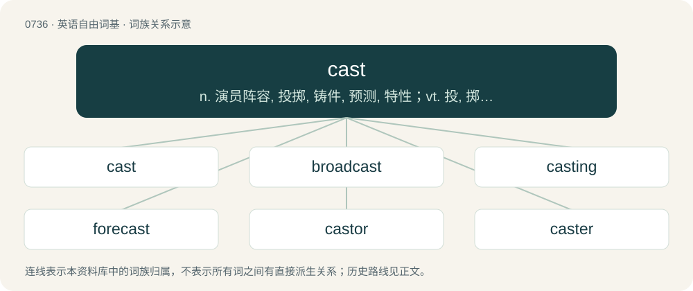

# 0804 · cast — n. 演员阵容, 投掷, 铸件, 预测, 特性；vt. 投, 掷, 抛, 脱落, 铸, 使弯曲, 计算；vi. 投, 计算, 浇铸成型

[总目录](../00_总目录_按常用程度.md)

**类型**：英语自由词基　｜　**来源语言**：见词源记录

## 核心含义与来源

- 核心含义：n. 演员阵容, 投掷, 铸件, 预测, 特性；vt. 投, 掷, 抛, 脱落, 铸, 使弯曲, 计算；vi. 投, 计算, 浇铸成型
- 英文含义：To move, or be moved, away.
- 词形：cast

**来源记录 1**（动词；To move, or be moved, away.）

From Middle English casten, from Old Norse kasta (“to throw, cast, overturn”), from Proto-Germanic \*kastōną (“to throw, cast”), of unknown origin. Cognate with Scots cast (“to cast, throw”), Danish kaste (“to throw”), Swedish kasta (“to throw, cast, fling, toss, discard”), Icelandic kasta (“to pitch, toss”). In the sense of "flinging", displaced native warp. The senses relating to broadcasting are based on that same term; compare -cast.

## 词族图

## 单词速览（常用到不常用）

| 单词 | 音标 | 释义 |
|---|---|---|
| [cast](#w-1) | 英 /kɑːst/；美 /kæst/ | n. 演员阵容, 投掷, 铸件, 预测, 特性；vt. 投, 掷, 抛, 脱落, 铸, 使弯曲, 计算；vi. 投, 计算, 浇铸成型 |
| [broadcast](#w-2) | 英 /ˈbɹɔːd(ˌ)kɑːst/；/ˈbɹɔd(ˌ)kæst/ | n. 广播, 传播；a. 广播的；v. 广播 |
| [casting](#w-3) | 英 /ˈkɑːstɪŋ/；美 /ˈkæstɪŋ/ | n. 投掷, 铸成品, 角色分配；\[化\] 浇铸; 铸品 |
| [forecast](#w-4) | 英 /ˈfɔːkɑːst/；美 /ˈfɔɹkæst/ | n. 预想, 预测, 预报；vt. 预想, 预测, 预报；\[计\] 趋势预测 |
| [castor](#w-5) | 英 /ˈkɑːs.tə/；美 /ˈkæs.tɚ/ | 【英文】A pivoting roller attached to the bottom of furniture to allow it to be moved. |
| [caster](#w-6) | 英 /ˈkɑːstə(ɹ)/；美 /ˈkæstɚ/ | n. 投手, (家具的)脚轮, 调味瓶；\[机\] 后倾角 |
| [outcast](#w-7) | 英 /ˈaʊtkɑːst/；美 /ˈaʊtkæst/ | a. 被逐出的, 被遗弃的, 无家可归的；n. 被驱逐的人, 流浪者 |
| [overcast](#w-8) | 英 /ˈəʊvəˌkɑːst/；美 /ˈoʊvɚ.kæst/ | a. 阴天的, 阴暗的, 愁闷的 |
| [recast](#w-9) | /ɹiːˈkɑːst/ | vt. 重铸, 重作, 改造；n. 重铸, 改换角色 |
| [casted](#w-10) | /ˈkæstɪd/ | 【英文】Set in a cast. |
| [precast](#w-11) | 英 /pɹiːˈkɑːst/；美 /pɹiˈkæst/ | vt. 预浇制；a. 预制的 |
| [downcast](#w-12) | 英 /ˈdaʊnkɑːst/；美 /ˈdaʊnˌkæst/ | a. 气馁的, 沮丧的 |
| [typecast](#w-13) | 英 /ˈtaɪp.kɑːst/；美 /ˈtaɪp.kæst/ | vt. (根据演员体形与性格)分配角色, 浇铸(铅字) |
| [opencast](#w-14) | /ˈəupənkɑːst/ | a. 露天开采的 |
| [miscast](#w-15) | /mɪsˈkæst/ | vt. 加错(帐目等), 指配不适当的角色, 分配不适当的工作 |

## 逐词详解

### 1. cast

**词性**：动词　｜　**音标**：英 /kɑːst/；美 /kæst/

**中文释义**：n. 演员阵容, 投掷, 铸件, 预测, 特性；vt. 投, 掷, 抛, 脱落, 铸, 使弯曲, 计算；vi. 投, 计算, 浇铸成型

**英文义项**：To move, or be moved, away. / To throw.

**词源与演化**：

From Middle English casten, from Old Norse kasta (“to throw, cast, overturn”), from Proto-Germanic \*kastōną (“to throw, cast”), of unknown origin. Cognate with Scots cast (“to cast, throw”), Danish kaste (“to throw”), Swedish kasta (“to throw, cast, fling, toss, discard”), Icelandic kasta (“to pitch, toss”). In the sense of "flinging", displaced native warp. The senses relating to broadcasting are based on that same term; compare -cast.

**例句**：

> King John cast his predecessor in a negative light to deflect criticism of his own questionable decisions.

该用例对应义项：To describe in an opinionated way. Mostly used with a metaphor involving light.

### 2. broadcast

**词性**：形容词　｜　**音标**：英 /ˈbɹɔːd(ˌ)kɑːst/；/ˈbɹɔd(ˌ)kæst/

**中文释义**：n. 广播, 传播；a. 广播的；v. 广播

**英文义项**：Cast or scattered widely in all directions; cast abroad. / Communicated, signalled, or transmitted to many people, through radio waves or electronic means.

**构词拆分**：broad + cast

**词源与演化**：

From broad + cast. First attested in the mid 18th century, in the agricultural use of spreading seeds.

**例句**：

> The seed was broadcast, not drilled.

该用例对应义项：Cast or scattered widely in all directions; cast abroad.

### 3. casting

**词性**：名词　｜　**音标**：英 /ˈkɑːstɪŋ/；美 /ˈkæstɪŋ/

**中文释义**：n. 投掷, 铸成品, 角色分配；\[化\] 浇铸; 铸品

**英文义项**：The act or process of selecting actors, singers, dancers, models, etc. / A manufacturing process using a mold.

**构词拆分**：cast + -ing

**词源与演化**：

From Middle English castyng, castinge, equivalent to cast + -ing.

**例句**：

> The full moon illuminated the night, casting eerie shadows on the ground.

### 4. forecast

**词性**：动词　｜　**音标**：英 /ˈfɔːkɑːst/；美 /ˈfɔɹkæst/

**中文释义**：n. 预想, 预测, 预报；vt. 预想, 预测, 预报；\[计\] 趋势预测

**英文义项**：To estimate how something will be in the future. / To foreshadow; to suggest something in advance.

**构词拆分**：fore- + cast

**词源与演化**：

From Middle English forecasten, forcasten, equivalent to fore- + cast. The noun is from Middle English forecast, forcast.

**用法示例／搭配（非完整句）**：

> to forecast the weather, or a storm

该用例对应义项：To estimate how something will be in the future.

### 5. castor

**词性**：名词　｜　**音标**：英 /ˈkɑːs.tə/；美 /ˈkæs.tɚ/

**英文义项**：A pivoting roller attached to the bottom of furniture to allow it to be moved. / A container with a perforated cap for sprinkling its contents, especially salt, pepper, etc.

**构词拆分**：cast + -or

**词源与演化**：

Alternative spelling of caster, via cast + -or (the Latinate varient of -er).

### 6. caster

**词性**：名词　｜　**音标**：英 /ˈkɑːstə(ɹ)/；美 /ˈkæstɚ/

**中文释义**：n. 投手, (家具的)脚轮, 调味瓶；\[机\] 后倾角

**英文义项**：Someone or something that casts. / A wheeled assembly attached to a larger object at its base to facilitate rolling. A caster usually consists of a wheel (which may be plastic, a hard elastomer, or metal), an axle, a mounting provision (usually a stem, flange, or plate), and sometimes a swivel (which allows the caster to rotate for steering).

**构词拆分**：cast + -er

**词源与演化**：

From cast + -er; the wheel sense comes from obsolete cast (“to turn”).

**例句**：

> Many office chairs roll on a set of casters.

该用例对应义项：A wheeled assembly attached to a larger object at its base to facilitate rolling. A caster usually consists of a wheel (which may be plastic, a hard elastomer, or metal), an axle, a mounting provision (usually a stem, flange, or plate), and sometimes a swivel (which allows the caster to rotate for steering).

### 7. outcast

**词性**：动词　｜　**音标**：英 /ˈaʊtkɑːst/；美 /ˈaʊtkæst/

**中文释义**：a. 被逐出的, 被遗弃的, 无家可归的；n. 被驱逐的人, 流浪者

**英文义项**：To cast out; to banish.

**构词拆分**：out- + cast

**词源与演化**：

From Middle English outcasten, equivalent to out- + cast.

**例句**：

> Boldi became an outcast and a laughing stock for everyone.

### 8. overcast

**词性**：名词　｜　**音标**：英 /ˈəʊvəˌkɑːst/；美 /ˈoʊvɚ.kæst/

**中文释义**：a. 阴天的, 阴暗的, 愁闷的

**英文义项**：A cloud covering all of the sky from horizon to horizon. / A place where one roadway crosses another, specifically where an airway was built across the top of another airway for ventilation purposes.

**构词拆分**：over- + cast

**词源与演化**：

From Middle English overcasten, equivalent to over- + cast. Compare Swedish överkast.

**例句**：

> Some people don't like overcast weather, but I find it comforting.

### 9. recast

**词性**：动词　｜　**音标**：/ɹiːˈkɑːst/

**中文释义**：vt. 重铸, 重作, 改造；n. 重铸, 改换角色

**英文义项**：To cast or throw again. / To mould again.

**构词拆分**：re- + cast

**词源与演化**：

From re- + cast.

**例句**：

> The whole bell had to be recast although it had only one tiny, hardly visible crack.

该用例对应义项：To mould again.

### 10. casted

**词性**：形容词　｜　**音标**：/ˈkæstɪd/

**英文义项**：Set in a cast.

**构词拆分**：cast + -ed

**词源与演化**：

From cast + -ed.

**例句**：

> Sami was told he was casted for the show.

### 11. precast

**词性**：形容词　｜　**音标**：英 /pɹiːˈkɑːst/；美 /pɹiˈkæst/

**中文释义**：vt. 预浇制；a. 预制的

**英文义项**：Cast previously in another location.

**构词拆分**：pre- + cast

**词源与演化**：

From pre- + cast.

**例句**：

> The bridge used precast concrete girders.

该用例对应义项：Cast previously in another location.

### 12. downcast

**词性**：形容词　｜　**音标**：英 /ˈdaʊnkɑːst/；美 /ˈdaʊnˌkæst/

**中文释义**：a. 气馁的, 沮丧的

**英文义项**：Of the eyes, a facial expression, etc.: looking downwards, usually as a sign of discouragement, sadness, etc., or sometimes modesty. / Of a person or thing: cast or thrown to the ground.

**构词拆分**：down- (prefix meaning ‘lower direction or position’) + cast (“that has been thrown”, adjective)

**词源与演化**：

The adjective is derived from Middle English doun-casten, \*adoun-casten (“(adjective) cast down, dejected; (verb) to break down (something); to overcome (someone); to overturn (something)”), from down (“in a downward direction; (figurative) to destruction”), adoun (“downward”) + casten (“to throw (something), fling, hurl; to overcome (someone), defeat, overpower; \[etc.\]”) (from Old Norse kasta (“to cast, throw”), from Proto-Germanic \*kastōną (“to throw”), from \*kas- (“to throw, toss; to bring up”); further etymology uncertain), modelled similarly to other constructions in Middle English such as adoun-throwen (“to throw down”) and adoun-werpen (“to throw down”)). The English word is analysable as down- (prefix meaning ‘lower direction or position’) + cast (“that has been thrown”, adjective). The noun is derived from the adjective.

**例句**：

> She went out of the room with downcast eyes.

### 13. typecast

**词性**：动词　｜　**音标**：英 /ˈtaɪp.kɑːst/；美 /ˈtaɪp.kæst/

**中文释义**：vt. (根据演员体形与性格)分配角色, 浇铸(铅字)

**英文义项**：To cast an actor in the same kind of role repeatedly. / To identify one as being of a specific type because of one's appearance, colour, religion etc.

**构词拆分**：type + cast

**词源与演化**：

From type + cast.

**例句**：

> Does anyone know how to typecast a String in Java into an int?

该用例对应义项：To cast (change of data type of a variable or object).

### 14. opencast

**词性**：形容词　｜　**音标**：/ˈəupənkɑːst/

**中文释义**：a. 露天开采的

**英文义项**：Of or pertaining to strip mining, in which material is removed from a surface that has been exposed

**构词拆分**：open + cast

**词源与演化**：

From open + cast.

**例句**：

> The opencast lignite mines in Germany cover tens of square kilometers.

### 15. miscast

**词性**：动词　｜　**音标**：/mɪsˈkæst/

**中文释义**：vt. 加错(帐目等), 指配不适当的角色, 分配不适当的工作

**英文义项**：To cast or reckon incorrectly. / To cast or direct erroneously or improperly.

**构词拆分**：mis- + cast

**词源与演化**：

From Middle English miscasten, equivalent to mis- + cast.
