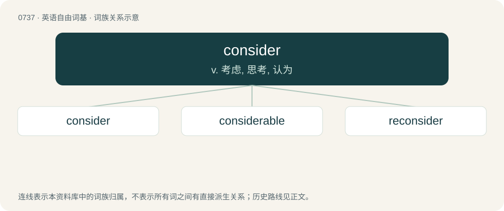

# 0805 · consider — v. 考虑, 思考, 认为

[总目录](../00_总目录_按常用程度.md)

**类型**：英语自由词基　｜　**来源语言**：见词源记录

## 核心含义与来源

- 核心含义：v. 考虑, 思考, 认为
- 英文含义：To think about seriously.
- 词形：consider

**来源记录 1**（动词；To think about seriously.）

From Middle English consideren, from Middle French considerer, from Latin considerare.

## 词族图

## 单词速览（常用到不常用）

| 单词 | 音标 | 释义 |
|---|---|---|
| [consider](#w-1) | 英 /kənˈsɪd.ə/；美 /kənˈsɪd.əɹ/ | v. 考虑, 思考, 认为 |
| [considerable](#w-2) | /kənˈsɪdəɹəbl̩/ | a. 相当的, 可观的, 重要的 |
| [reconsider](#w-3) | 英 /ˈɹiːkənˌsɪdə/；美 /ˈɹikənˌsɪdɚ/ | v. 再考虑, 重新考虑 |

## 逐词详解

### 1. consider

**词性**：动词　｜　**音标**：英 /kənˈsɪd.ə/；美 /kənˈsɪd.əɹ/

**中文释义**：v. 考虑, 思考, 认为

**英文义项**：To think about seriously. / To think about something seriously or carefully: to deliberate.

**词源与演化**：

From Middle English consideren, from Middle French considerer, from Latin considerare.

**例句**：

> This body will now consider the proposed amendments to Section 453 of the zoning code.

该用例对应义项：To debate (or dispose of) a motion.

### 2. considerable

**词性**：形容词　｜　**音标**：/kənˈsɪdəɹəbl̩/

**中文释义**：a. 相当的, 可观的, 重要的

**英文义项**：Significant; worth considering. / Large in amount.

**构词拆分**：consider + -able

**词源与演化**：

From consider + -able.

**例句**：

> Soon I became a considerable figure in the music industry.

该用例对应义项：Significant; worth considering.

### 3. reconsider

**词性**：动词　｜　**音标**：英 /ˈɹiːkənˌsɪdə/；美 /ˈɹikənˌsɪdɚ/

**中文释义**：v. 再考虑, 重新考虑

**英文义项**：To consider a matter again. / To change one's mind, with or without actually considering the matter again.

**构词拆分**：re- + consider

**词源与演化**：

From re- + consider.

**例句**：

> Is there any way I can get you to reconsider selling your car?

该用例对应义项：To consider a matter again.
