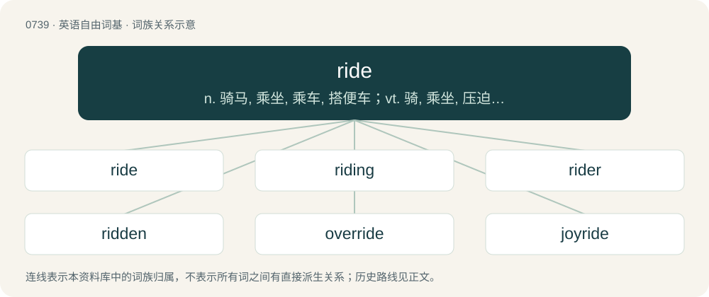

# 0806 · ride — n. 骑马, 乘坐, 乘车, 搭便车；vt. 骑, 乘坐, 压迫, 控制；vi. 骑马, 乘车, 漂游

[总目录](../00_总目录_按常用程度.md)

**类型**：英语自由词基　｜　**来源语言**：见词源记录

## 核心含义与来源

- 核心含义：n. 骑马, 乘坐, 乘车, 搭便车；vt. 骑, 乘坐, 压迫, 控制；vi. 骑马, 乘车, 漂游
- 英文含义：To transport oneself by sitting on and directing a horse, later also a bicycle etc.
- 词形：ride

**来源记录 1**（动词；To transport oneself by sitting on and directing a horse, later also a bicycle etc.）

From Middle English riden, from Old English rīdan, from Proto-West Germanic \*rīdan, from Proto-Germanic \*rīdaną (“to ride”), from Proto-Indo-European \*Hreydʰ- (“to ride”), from \*h₃reyH- (“to move”), from \*h₃er- (“to move, stir”). Cognates From Proto-Germanic: North Frisian ride, ridj, rir (“to ride”), West Frisian ride (“to ride”), Dutch rijden, ryden (“to ride; to drive”), German reiten, reuten (“to ride”), German Low German rieden (“to ride; to drive”), Limburgish rieje (“to ride; to drive”), Luxembourgish reiden (“to ride”), Vilamovian raeita, rajta (“to ride”), Danish ride (“to ride”), Faroese and Icelandic ríða (“to ride”), Norwegian Bokmål ri, ride (“to ride”), Norwegian Nynorsk ri, rida, ride (“to ride”), Swedish rida (“to ride”). From Indo-European: Cornish ardh (“height”), Irish arad, ard, árd (“high, tall”), Manx ard (“high, tall”), Scottish Gaelic àrd (“high”), Welsh ardd (“hill, upland”), Latin irrītō (“to excite, incite, stimulate; to exasperate”), Ancient Greek ὀρῑ́νω (orī́nō, “to move, stir”), Albanian rashë (“to have fallen; to have flopped”), Russian ре́ять (réjatʹ, “to fly, hover, soar”), Armenian հառնել (haṙnel, “to get up; to rise up”), Northern Kurdish rîtin (“to shit”), Persian ریدن (ridan, “to shit; to fuck up, to screw up”), Tocharian A ar- (“to evoke; to produce, yield”), Tocharian B er- (“to evoke; to produce, yield”), Hittite 𒅈𒉡𒊻𒍣 (ar-nu-uz-zi, “to address, send”), Sanskrit रीति (rīti, “course, motion; current, stream; line, row”).

## 词族图

## 单词速览（常用到不常用）

| 单词 | 音标 | 释义 |
|---|---|---|
| [ride](#w-1) | 英 /ɹaɪd/ | n. 骑马, 乘坐, 乘车, 搭便车；vt. 骑, 乘坐, 压迫, 控制；vi. 骑马, 乘车, 漂游 |
| [riding](#w-2) | /ˈɹaɪ.dɪŋ/ | n. 骑, 乘车, 乘, 骑术, 骑马 |
| [rider](#w-3) | 英 /ˈɹaɪ̯.dəː/；/ˈɹɑɪ̯.dəː/ | n. 骑手, (文件后的)附件, 扶手；\[化\] 游码 |
| [ridden](#w-4) | /ˈɹɪd.n̩/ | ride的过去分词；\[法\] 受折磨的, 受虐待的, 受支配的 |
| [override](#w-5) | 英 /əʊ.vəˈɹaɪd/；美 /oʊ.vɚˈɹaɪd/ | vt. 推翻, 无视, 对...有最后发言权, 制服, 践踏, 奔越过；\[经\] 代理佣金, 代销佣金 |
| [joyride](#w-6) | 英 /ˈd͡ʒɔɪˌɹaɪd/ | n. 驾车兜风, 偷车乱开, 乘汽车兜风, 追求享受的行动, 胡作非为 |
| [rideshare](#w-7) |  | 【英文】A ridesharing arrangement in which people travel together. |
| [hayride](#w-8) | /ˈheiraid/ | n. &lt;美&gt;(尤指夜间)乘坐装有干草的大车(或拖橇等)出游 |

## 逐词详解

### 1. ride

**词性**：动词　｜　**音标**：英 /ɹaɪd/

**中文释义**：n. 骑马, 乘坐, 乘车, 搭便车；vt. 骑, 乘坐, 压迫, 控制；vi. 骑马, 乘车, 漂游

**英文义项**：To transport oneself by sitting on and directing a horse, later also a bicycle etc. / To be transported in a vehicle; to travel as a passenger.

**词源与演化**：

From Middle English riden, from Old English rīdan, from Proto-West Germanic \*rīdan, from Proto-Germanic \*rīdaną (“to ride”), from Proto-Indo-European \*Hreydʰ- (“to ride”), from \*h₃reyH- (“to move”), from \*h₃er- (“to move, stir”). Cognates From Proto-Germanic: North Frisian ride, ridj, rir (“to ride”), West Frisian ride (“to ride”), Dutch rijden, ryden (“to ride; to drive”), German reiten, reuten (“to ride”), German Low German rieden (“to ride; to drive”), Limburgish rieje (“to ride; to drive”), Luxembourgish reiden (“to ride”), Vilamovian raeita, rajta (“to ride”), Danish ride (“to ride”), Faroese and Icelandic ríða (“to ride”), Norwegian Bokmål ri, ride (“to ride”), Norwegian Nynorsk ri, rida, ride (“to ride”), Swedish rida (“to ride”). From Indo-European: Cornish ardh (“height”), Irish arad, ard, árd (“high, tall”), Manx ard (“high, tall”), Scottish Gaelic àrd (“high”), Welsh ardd (“hill, upland”), Latin irrītō (“to excite, incite, stimulate; to exasperate”), Ancient Greek ὀρῑ́νω (orī́nō, “to move, stir”), Albanian rashë (“to have fallen; to have flopped”), Russian ре́ять (réjatʹ, “to fly, hover, soar”), Armenian հառնել (haṙnel, “to get up; to rise up”), Northern Kurdish rîtin (“to shit”), Persian ریدن (ridan, “to shit; to fuck up, to screw up”), Tocharian A ar- (“to evoke; to produce, yield”), Tocharian B er- (“to evoke; to produce, yield”), Hittite 𒅈𒉡𒊻𒍣 (ar-nu-uz-zi, “to address, send”), Sanskrit रीति (rīti, “course, motion; current, stream; line, row”).

**例句**：

> I ride to work every day and park the bike outside the office.

该用例对应义项：To transport oneself by sitting on and directing a horse, later also a bicycle etc.

### 2. riding

**词性**：名词　｜　**音标**：/ˈɹaɪ.dɪŋ/

**中文释义**：n. 骑, 乘车, 乘, 骑术, 骑马

**英文义项**：A path cut through woodland. / The act of one who rides; a mounted excursion.

**构词拆分**：ride + -ing

**词源与演化**：

From Middle English rydyng; equivalent to ride + -ing.

**例句**：

> Two people riding on a bicycle at the same time is dangerous.

### 3. rider

**词性**：名词　｜　**音标**：英 /ˈɹaɪ̯.dəː/；/ˈɹɑɪ̯.dəː/

**中文释义**：n. 骑手, (文件后的)附件, 扶手；\[化\] 游码

**英文义项**：An old Dutch gold coin with the figure of a man on horseback stamped upon it. / Someone who rides a horse or (later) a bicycle, motorcycle etc.

**构词拆分**：By surface analysis, ride + -er

**词源与演化**：

From Middle English ryder, ridere, from Late Old English rīdere (“rider, knight”). Compare Dutch rijder, German Reiter. By surface analysis, ride + -er.

**例句**：

> Dispatch a royal rider with this sealed letter from the king.

### 4. ridden

**词性**：形容词　｜　**音标**：/ˈɹɪd.n̩/

**中文释义**：ride的过去分词；\[法\] 受折磨的, 受虐待的, 受支配的

**英文义项**：Full of. / Oppressed, dominated or plagued by.

**构词拆分**：ride + -en

**词源与演化**：

Morphologically ride + -en. See ride (verb).

**例句**：

> The horse had to be broken in before it could be ridden.

### 5. override

**词性**：动词　｜　**音标**：英 /əʊ.vəˈɹaɪd/；美 /oʊ.vɚˈɹaɪd/

**中文释义**：vt. 推翻, 无视, 对...有最后发言权, 制服, 践踏, 奔越过；\[经\] 代理佣金, 代销佣金

**英文义项**：To ride across or beyond something. / To ride over the top of something, usually forcibly.

**构词拆分**：over- + ride

**词源与演化**：

From Middle English overriden, from Old English oferrīdan, equivalent to over- + ride. Cognate with Dutch overrijden, German überreiten, Danish override.

**例句**：

> In automotive design, safety should override lesser factors such as cosmetics and corner-cutting.

该用例对应义项：To counteract the normal operation of something; to countermand with orders of higher priority.

### 6. joyride

**词性**：名词　｜　**音标**：英 /ˈd͡ʒɔɪˌɹaɪd/

**中文释义**：n. 驾车兜风, 偷车乱开, 乘汽车兜风, 追求享受的行动, 胡作非为

**英文义项**：A ride in a vehicle taken solely for pleasure or enjoyment, especially a vehicle ride taken with no particular goal or purpose and just for the pleasure or enjoyment of a vehicle ride. / An instance of driving a motor vehicle in a carefree or reckless manner, especially a vehicle which has been taken without the permission of the owner.

**构词拆分**：joy + ride

**词源与演化**：

From joy + ride.

**例句**：

> Tom took his father's car for a joyride.

### 7. rideshare

**词性**：名词

**英文义项**：A ridesharing arrangement in which people travel together. / A taxi or minicab hired through a ridesharing app.

**构词拆分**：ride + share

**词源与演化**：

From ride + share.

**例句**：

> The neighbors decided on a rideshare to get their kids to school, so that they wouldn't each have to drive every day.

该用例对应义项：A ridesharing arrangement in which people travel together.

### 8. hayride

**词性**：名词　｜　**音标**：/ˈheiraid/

**中文释义**：n. &lt;美&gt;(尤指夜间)乘坐装有干草的大车(或拖橇等)出游

**英文义项**：A recreational ride in a vehicle full of hay.

**构词拆分**：hay + ride

**词源与演化**：

From hay + ride.
