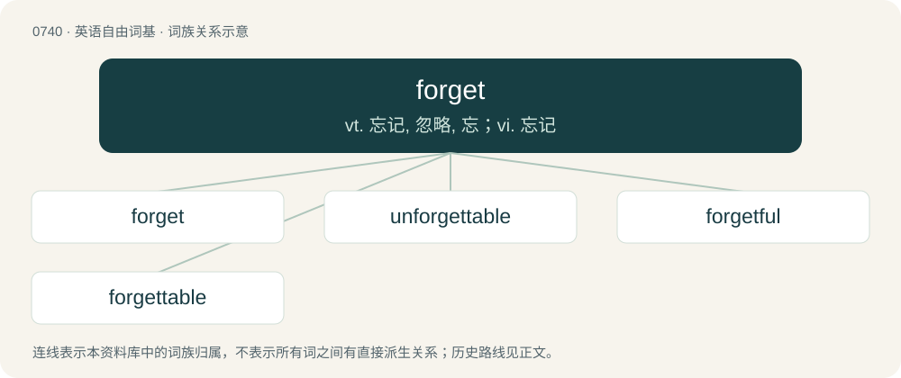

# 0807 · forget — vt. 忘记, 忽略, 忘；vi. 忘记

[总目录](../00_总目录_按常用程度.md)

**类型**：英语自由词基　｜　**来源语言**：见词源记录

## 核心含义与来源

- 核心含义：vt. 忘记, 忽略, 忘；vi. 忘记
- 英文含义：To lose remembrance of.
- 词形：forget

**来源记录 1**（动词；To lose remembrance of.）

From Middle English forgeten, forgiten, foryeten, forȝiten, from Old English forġietan (“to forget”) \[influenced by Old Norse geta ("to get, to guess")\], from Proto-West Germanic \*fragetan (“to give up, forget”). Equivalent to for- + get. Cognate with : \* Scots forget, forȝet (“to forget”), \* West Frisian fergette, ferjitte, forjitte (“to forget”), \* Dutch vergeten (“to forget”), \* German vergessen (“to forget”).

## 词族图

## 单词速览（常用到不常用）

| 单词 | 音标 | 释义 |
|---|---|---|
| [forget](#w-1) | 英 /fəˈɡɛt/；美 /fɚˈɡɛt/ | vt. 忘记, 忽略, 忘；vi. 忘记 |
| [unforgettable](#w-2) | /ˌʌnfə(ɹ)ˈɡɛtəbəl/ | a. 忘不了的, 令人难忘的 |
| [forgetful](#w-3) | /fərˈɡɛtfəl/ | a. 健忘的, 易忘的 |
| [forgettable](#w-4) | /fəˈgetəbl/ | a. 容易被忘的, 可忘记的 |

## 逐词详解

### 1. forget

**词性**：动词　｜　**音标**：英 /fəˈɡɛt/；美 /fɚˈɡɛt/

**中文释义**：vt. 忘记, 忽略, 忘；vi. 忘记

**英文义项**：To lose remembrance of. / To unintentionally not do, neglect.

**构词拆分**：for- + get

**词源与演化**：

From Middle English forgeten, forgiten, foryeten, forȝiten, from Old English forġietan (“to forget”) \[influenced by Old Norse geta ("to get, to guess")\], from Proto-West Germanic \*fragetan (“to give up, forget”). Equivalent to for- + get. Cognate with : \* Scots forget, forȝet (“to forget”), \* West Frisian fergette, ferjitte, forjitte (“to forget”), \* Dutch vergeten (“to forget”), \* German vergessen (“to forget”).

**例句**：

> Let's just forget I ever told you anything about it.

该用例对应义项：To cease remembering.

### 2. unforgettable

**词性**：形容词　｜　**音标**：/ˌʌnfə(ɹ)ˈɡɛtəbəl/

**中文释义**：a. 忘不了的, 令人难忘的

**英文义项**：Very difficult or impossible to forget.

**构词拆分**：un- + forget + -able；un- + forgettable

**词源与演化**：

From un- + forget + -able or un- + forgettable.

**例句**：

> The things he subjected me to were horrible and unforgettable.

该用例对应义项：Very difficult or impossible to forget.

### 3. forgetful

**词性**：形容词　｜　**音标**：/fərˈɡɛtfəl/

**中文释义**：a. 健忘的, 易忘的

**英文义项**：Unable to remember things well; liable to forget. / Dropping some of the input's structure or properties before producing an output.

**构词拆分**：forget + -ful

**词源与演化**：

From Middle English \*forgetful, \*forȝetful (suggested by derivative forgetfulnesse, forȝetfulnesse (“forgetfulness”)), equivalent to forget + -ful.

**用法示例／搭配（非完整句）**：

> a forgetful mapping; a forgetful functor

该用例对应义项：Dropping some of the input's structure or properties before producing an output.

### 4. forgettable

**词性**：形容词　｜　**音标**：/fəˈgetəbl/

**中文释义**：a. 容易被忘的, 可忘记的

**英文义项**：Possible to be forgotten. / Easily forgotten; not special or notable.

**构词拆分**：forget + -able

**词源与演化**：

From forget + -able.
