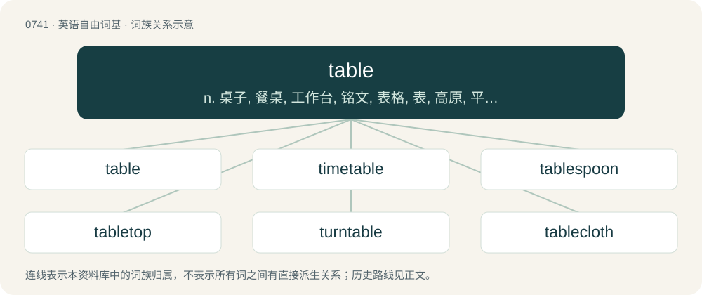

# 0808 · table — n. 桌子, 餐桌, 工作台, 铭文, 表格, 表, 高原, 平地层；vt. 搁置, 嵌合, 制表, 把...列入议事日程；\[计\] 表格, 模拟运算表

[总目录](../00_总目录_按常用程度.md)

**类型**：英语自由词基　｜　**来源语言**：见词源记录

## 核心含义与来源

- 核心含义：n. 桌子, 餐桌, 工作台, 铭文, 表格, 表, 高原, 平地层；vt. 搁置, 嵌合, 制表, 把...列入议事日程；\[计\] 表格, 模拟运算表
- 英文含义：An item of furniture with a flat top surface raised above the ground, usually on one or more legs.
- 词形：table

**来源记录 1**（名词；An item of furniture with a flat top surface raised above the ground, usually on one or more legs.）

Inherited from Middle English table, tabel, tabil, tabul, from Old English tabele, tabul, tablu, tabule, tabula (“board”); also as tæfl, tæfel, an early Germanic borrowing of Latin tabula (“tablet, board, plank, chart”). The sense of “piece of furniture” is from Old French table, of same Latin origin; Old English used bēod or bord instead for this meaning: see board. Doublet of tabula and tavla.

## 词族图

## 单词速览（常用到不常用）

| 单词 | 音标 | 释义 |
|---|---|---|
| [table](#w-1) | /ˈteɪbl̩/ | n. 桌子, 餐桌, 工作台, 铭文, 表格, 表, 高原, 平地层；vt. 搁置, 嵌合, 制表, 把...列入议事日程；\[计\] 表格, 模拟运算表 |
| [timetable](#w-2) | /ˈtaɪmˌteɪbəl/ | n. 时间表 |
| [tablespoon](#w-3) | 英 /ˈteɪbəlˌspuːn/；美 /ˈteɪbəlˌspun/ | n. 大汤匙；\[医\] 汤匙, 大匙(15毫升) |
| [tabletop](#w-4) | /ˈteibltɒp/ | n. 桌面 |
| [turntable](#w-5) | 英 /ˈtɜːnteɪb(ə)l/；美 /ˈtɝnˌteɪbəl/ | n. 转车台, 唱盘 |
| [tablecloth](#w-6) | /ˈteiblklɒθ/ | n. 台布 |
| [tableware](#w-7) | /ˈteiblwєə/ | n. 餐具 |

## 逐词详解

### 1. table

**词性**：名词　｜　**音标**：/ˈteɪbl̩/

**中文释义**：n. 桌子, 餐桌, 工作台, 铭文, 表格, 表, 高原, 平地层；vt. 搁置, 嵌合, 制表, 把...列入议事日程；\[计\] 表格, 模拟运算表

**英文义项**：An item of furniture with a flat top surface raised above the ground, usually on one or more legs. / A flat tray which can be used as a table.

**词源与演化**：

Inherited from Middle English table, tabel, tabil, tabul, from Old English tabele, tabul, tablu, tabule, tabula (“board”); also as tæfl, tæfel, an early Germanic borrowing of Latin tabula (“tablet, board, plank, chart”). The sense of “piece of furniture” is from Old French table, of same Latin origin; Old English used bēod or bord instead for this meaning: see board. Doublet of tabula and tavla.

**例句**：

> Some real breakthroughs were made at the summit, but only far from the official diplomatic table.

该用例对应义项：A session or sessions of negotiation or diplomacy; an opportunity or place for negotiations.

### 2. timetable

**词性**：名词　｜　**音标**：/ˈtaɪmˌteɪbəl/

**中文释义**：n. 时间表

**英文义项**：A tabular schedule of events with the times at which they occur, especially times of arrivals and departures. / A schedule of arrivals and departures published in book or booklet form, or as a pamphlet, and available to travellers, either free or for a charge.

**构词拆分**：time + table

**词源与演化**：

From time + table.

**例句**：

> The timetable has been changed several times since it was first announced.

该用例对应义项：A tabular schedule of events with the times at which they occur, especially times of arrivals and departures.

### 3. tablespoon

**词性**：名词　｜　**音标**：英 /ˈteɪbəlˌspuːn/；美 /ˈteɪbəlˌspun/

**中文释义**：n. 大汤匙；\[医\] 汤匙, 大匙(15毫升)

**英文义项**：A large spoon, used for eating food from a bowl. / A spoon too large for eating, usually used for cooking or serving.

**构词拆分**：table + spoon

**词源与演化**：

From table + spoon.

**例句**：

> Tom adds a tablespoon of ground flaxseeds to his oatmeal every morning.

### 4. tabletop

**词性**：名词　｜　**音标**：/ˈteibltɒp/

**中文释义**：n. 桌面

**英文义项**：The flat, horizontal upper surface of a table. / A fixed item resembling a table, used for performing skateboarding tricks.

**构词拆分**：table + top

**词源与演化**：

From table + top.

### 5. turntable

**词性**：名词　｜　**音标**：英 /ˈtɜːnteɪb(ə)l/；美 /ˈtɝnˌteɪbəl/

**中文释义**：n. 转车台, 唱盘

**英文义项**：A circular rotating platform. / The circular rotating platform of a record player or a disk jockey's console on which the record rests during play; (by extension), a record player.

**构词拆分**：turn + table

**词源与演化**：

From turn + table.

**例句**：

> Tom listened to an old vinyl record on his turntable.

### 6. tablecloth

**词性**：名词　｜　**音标**：/ˈteiblklɒθ/

**中文释义**：n. 台布

**英文义项**：A cloth used to cover and protect a table, especially for a dining table.

**构词拆分**：table + cloth

**词源与演化**：

From Middle English tabyllcloth, table cloth, tabylle clothe, a partial translation of earlier Middle English bord cloth, bordcloth (“tablecloth”), from Old English bordclāþ, equivalent to table + cloth.

**例句**：

> Tom put the new tablecloth he had just bought on the table.

### 7. tableware

**词性**：名词　｜　**音标**：/ˈteiblwєə/

**中文释义**：n. 餐具

**英文义项**：The cutlery, crockery and glassware used in setting a table for a meal.

**构词拆分**：table + -ware

**词源与演化**：

From table + -ware.

**例句**：

> While the rest of us toil, the robber barons eat from gilt tableware.
