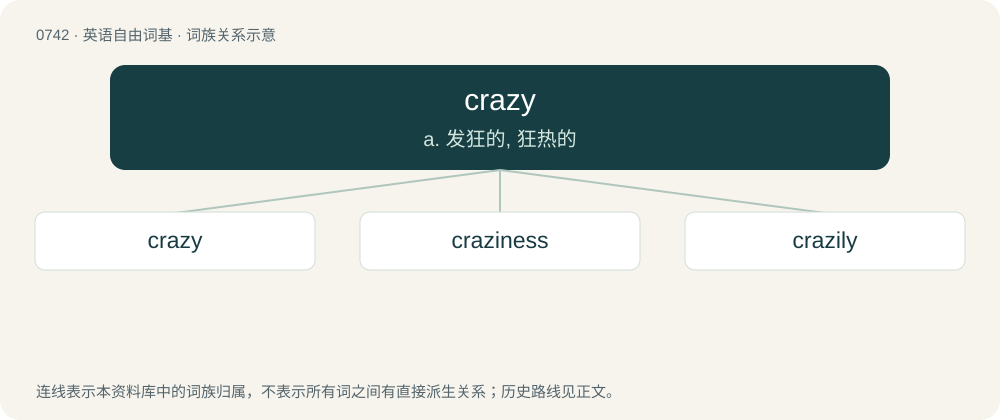

# 0809 · crazy — a. 发狂的, 狂热的

[总目录](../00_总目录_按常用程度.md)

**类型**：英语自由词基　｜　**来源语言**：见词源记录

## 核心含义与来源

- 核心含义：a. 发狂的, 狂热的
- 英文含义：Of unsound mind; insane; demented.
- 词形：crazy

**来源记录 1**（形容词；Of unsound mind; insane; demented.）

From craze (“to crush”) + -y, akin to being "crazed up". Compare cracked up (“suffered a mental breakdown; be insane”), crackpot. Compare typologically Russian чо́кнутый (čóknutyj).

## 词族图

## 单词速览（常用到不常用）

| 单词 | 音标 | 释义 |
|---|---|---|
| [crazy](#w-1) | 英 /ˈkɹeɪ.zi/ | a. 发狂的, 狂热的 |
| [craziness](#w-2) | /ˈkreizinis/ | n. 发狂, 狂热, 热中 |
| [crazily](#w-3) | /ˈkreizili/ | adv. 发狂地, 疯子似地, 摇摇晃晃地 |

## 逐词详解

### 1. crazy

**词性**：形容词　｜　**音标**：英 /ˈkɹeɪ.zi/

**中文释义**：a. 发狂的, 狂热的

**英文义项**：Of unsound mind; insane; demented. / Out of control.

**构词拆分**：craze (“to crush”) + -y

**词源与演化**：

From craze (“to crush”) + -y, akin to being "crazed up". Compare cracked up (“suffered a mental breakdown; be insane”), crackpot. Compare typologically Russian чо́кнутый (čóknutyj).

**例句**：

> When she gets on the motorcycle she goes crazy.

该用例对应义项：Out of control.

### 2. craziness

**词性**：名词　｜　**音标**：/ˈkreizinis/

**中文释义**：n. 发狂, 狂热, 热中

**英文义项**：The state of being crazy; madness; derangement / The result or product of being crazy.

**构词拆分**：crazy + -ness

**词源与演化**：

From crazy + -ness.

**例句**：

> You have to go on and be crazy. Craziness is like heaven.

### 3. crazily

**词性**：副词　｜　**音标**：/ˈkreizili/

**中文释义**：adv. 发狂地, 疯子似地, 摇摇晃晃地

**英文义项**：In a crazy manner. / Very, extremely.

**构词拆分**：crazy + -ly

**词源与演化**：

From crazy + -ly.

**例句**：

> He behaves crazily when he is off his medication.

该用例对应义项：in an insane manner
