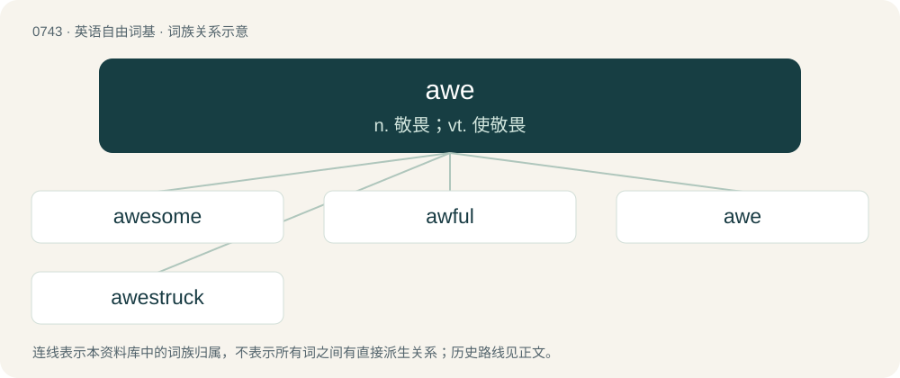

# 0810 · awe — n. 敬畏；vt. 使敬畏

[总目录](../00_总目录_按常用程度.md)

**类型**：英语自由词基　｜　**来源语言**：见词源记录

## 核心含义与来源

- 核心含义：n. 敬畏；vt. 使敬畏
- 英文含义：A feeling of fear and reverence.
- 词形：awe

**来源记录 1**（名词；A feeling of fear and reverence.）

From Middle English aw, awe, agh, awȝe, borrowed from Old Norse agi, from Proto-Germanic \*agaz (“terror, dread”), from Proto-Indo-European \*h₂egʰ- (“to be upset, afraid”). Displaced native Middle English eye, eyȝe, ayȝe, eȝȝe, from Old English ege, æge (“fear, terror, dread”), from the same Proto-Germanic root.

## 词族图

## 单词速览（常用到不常用）

| 单词 | 音标 | 释义 |
|---|---|---|
| [awesome](#w-1) | 英 /ˈɔːsəm/；/ˈɔ.səm/ | a. 引起敬畏的, 可怕的 |
| [awful](#w-2) | 英 /ˈɔːfʊl/；/ˈɔfəl/ | a. 可怕的, 庄严的, 虔敬的 |
| [awe](#w-3) | 英 /ɔː/；/ɔ/ | n. 敬畏；vt. 使敬畏 |
| [awestruck](#w-4) | /ˈɔːstrʌk/ | a. 敬畏的, 畏惧的 |

## 逐词详解

### 1. awesome

**词性**：形容词　｜　**音标**：英 /ˈɔːsəm/；/ˈɔ.səm/

**中文释义**：a. 引起敬畏的, 可怕的

**英文义项**：Causing awe or terror; inspiring wonder or excitement. / Excellent, exciting, remarkable.

**构词拆分**：awe + -some

**词源与演化**：

From awe + -some; compare earlier awful and Middle English eiful (“inducing fright or terror, terrible”), from Old English eġeful (“fearful; inspiring awe”). The oldest meaning of awesome is of “something which inspires awe”, but the word is now also a common colloquial expression. It was originally so used in the United States, where it had featured strikingly in the 1970 film Tora! Tora! Tora!, as used by Japan's Admiral Isoroku Yamamoto to describe the "awesome" industrial potential of the United States. Consequently, as the word popularly became an expression for anything superb, in its original meaning it has tended to be replaced by the related word, awe-inspiring.

**例句**：

> The waterfall in the middle of the rainforest was an awesome sight.

该用例对应义项：Causing awe or terror; inspiring wonder or excitement.

### 2. awful

**词性**：形容词　｜　**音标**：英 /ˈɔːfʊl/；/ˈɔfəl/

**中文释义**：a. 可怕的, 庄严的, 虔敬的

**英文义项**：Very bad. / Exceedingly great; usually applied intensively.

**构词拆分**：awe + -ful

**词源与演化**：

From Middle English agheful, awfull, auful, aȝefull, equivalent to awe + -ful. Compare Old English eġeful, eġefull (“terrifying; awful”). The “very bad” sense is a pejorative semantic shift from the original sense of “awe-inspiring”.

**例句**：

> We saw such an awful film last night that we left the theater before the end.

该用例对应义项：Very bad.

### 3. awe

**词性**：名词　｜　**音标**：英 /ɔː/；/ɔ/

**中文释义**：n. 敬畏；vt. 使敬畏

**英文义项**：A feeling of fear and reverence. / A feeling of amazement.

**词源与演化**：

From Middle English aw, awe, agh, awȝe, borrowed from Old Norse agi, from Proto-Germanic \*agaz (“terror, dread”), from Proto-Indo-European \*h₂egʰ- (“to be upset, afraid”). Displaced native Middle English eye, eyȝe, ayȝe, eȝȝe, from Old English ege, æge (“fear, terror, dread”), from the same Proto-Germanic root.

**例句**：

> He stared over the edge with a feeling of awe.

该用例对应义项：an overwhelming feeling of wonder or admiration

### 4. awestruck

**词性**：形容词　｜　**音标**：/ˈɔːstrʌk/

**中文释义**：a. 敬畏的, 畏惧的

**英文义项**：Filled or overcome with awe or wonder.

**构词拆分**：awe + struck

**词源与演化**：

From awe + struck.

**例句**：

> In grim despair and awestruck wonder.

该用例对应义项：having or showing a feeling of mixed reverence and respect and wonder and dread
