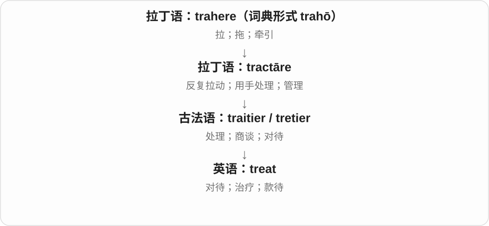
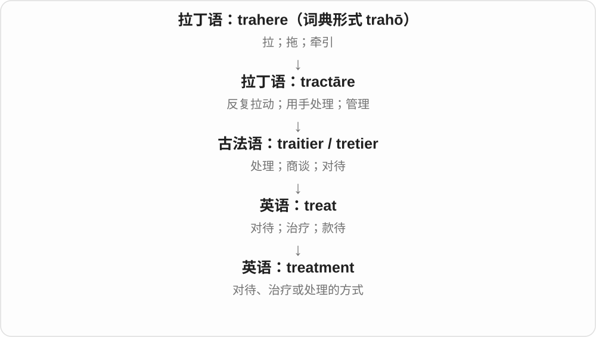

# 0811 · treat — 处理、治疗与可以治疗

[逐词精讲目录](../00_逐词精讲目录.md) · [总目录](../00_总目录_按常用程度.md)

## 核心词根与来源

法语处理词在英语中有对待、治疗、款待等分支。treatable 的现代医疗用法选的是治疗分支。

**TREAT：怎么对待；TREATABLE：能施以治疗**

treat 与 treatment 已精讲，接 treatable，再共享 mistreat，分清治疗能力和治愈结果。

- **处理、过程与可能性**：treat · treatment · treatable
- **不当对待**：mistreat
- **treat、treatment → treatments：处理与对待的方式**：treat · treatment · treatments

## 词形与演化规律

treat → treatment、treatable；mis- + treat → mistreat。

本族后缀对应与法语 traitement 可比较，现代复数末尾 ts。

entreat 经古法语 en- + traitier／traiter 的相应形式而来，更早接拉丁 tractare；从对待、商谈发展出恳求。与 treat 同源，不按现代“请客／治疗”义相加。

## 单词速览（按词族由简到繁）

同一基础词的相关扩展放在一起，先读基础形式，再读扩展；各组之间优先读常用的。具体词源关系见各词讲解。

| 单词 | 音标 | 核心意思 |
|---|---|---|
| [treat](#w-2) | /triːt/ | 对待；处理；治疗；款待；乐事 |
| [entreat](#w-6) | 英、美 /ɪnˈtriːt/；重音在后一个音节，ea 读 /iː/ | 恳求；央求；郑重而迫切地请求〔正式用语〕 |
| [treatment](#w-1) | /ˈtriːtmənt/ | 对待；治疗；处理方式 |
| [treatments](#w-5) | /ˈtriːtmənts/ | 处理方式；治疗；对待、表现题材的方式〔复数〕 |
| [treatable](#w-3) | /ˈtriːtəbl/ | 可治疗的；可以处理的 |
| [mistreat](#w-4) | /ˌmɪsˈtriːt/ | 虐待；恶劣地对待 |

## 逐词讲解

### 1. treat — 对待；处理；治疗；款待；乐事

**音标**：/triːt/

**先抓住这个画面**

treat 先抓住“怎样处理、怎样对待”：对人友好、处理问题、治疗疾病、请人吃点好的，都是对不同对象采取做法。

**怎么拆**

来自古法语 tretier / traitier，追溯到拉丁语 tractāre“处理、管理”，再往前是 trahere“拉”。现代 treat 已不能按字母硬切。

**怎么变成今天的意思**

历史从动手处理扩展到商谈、对待和照料。治疗是对疾病作处理；款待是给人好的招待，名词 a treat 又可指带来快乐的食物或经历。

**常见搭配与例句**

treat someone with respect；treat A as B；treat a disease；treat someone to lunch；a special treat。

> She treats every customer with respect.

她尊重每一位顾客。

> Let me treat you to lunch; it is my birthday.

让我请你吃午饭吧，今天是我生日。

**别混淆**

treat a disease 是治疗，并不保证治好；cure 更强调治愈。treat someone to dinner 是请客，不能省略 to 后直接照搬“治疗某人”。

### 2. entreat — 恳求；央求；郑重而迫切地请求〔正式用语〕

**音标**：英、美 /ɪnˈtriːt/；重音在后一个音节，ea 读 /iː/

**先抓住这个画面**

你急需对方帮助，单说一句普通的“请”还不够，于是认真、恳切地求对方答应。entreat 带有这种迫切和感情色彩，但请求是否成功，要看后文。

**怎么拆**

可借 en- + treat 记住外形，历史上来自古法语 entraitier／entraiter，内部与 en- 和 traitier／traiter（处理、对待、商谈）有关。后者接拉丁语 tractāre（处理、管理），再往前联系 trahere／tractus（拉、拖）词族。这里是经过法语词义演变的借词，不能按“使 + 请客”或“在里面治疗”硬译，也不能把恳求理解成真的拉扯对方。

**怎么变成今天的意思**

**拉丁 trahere／tractus → tractāre**  
拉、拖 → 用手处理、管理、对待

↓

**古法语 traitier／traiter → entraitier／entraiter**  
处理、对待、商谈；带 en- 的相应形式

↓

**中古英语 entreat：商谈、以某种方式对待**  
早期用法包含协商、交涉，不只指今天的恳求

↓

**英语 entreat 的常用义：恳求、央求**  
认真而迫切地请求某人做某事

书中的 I entreat you rather to send ... 是史密斯向公司董事们恳求派来木匠、农夫等有实用技能的人。句子的骨架是 I entreat you to send ...：“我恳请你们派来……”。rather 表示他宁愿要这些人；这里不是款待董事，也不是强迫他们。entreat 是动作，不保证对方答应；如果说 tried to persuade，也只描述试图说服，而 persuaded someone to do 常表示已经说服。

**常见搭配与例句**

entreat somebody to do something 恳求某人做某事；entreat somebody not to do something 恳求某人不要做某事；I entreat you 我恳求你。常用结构直接接人，不照搬 plead with 的 with：entreat him to stay，对照 plead with him to stay。词形：entreats /ɪnˈtriːts/；entreated /ɪnˈtriːtɪd/；entreating /ɪnˈtriːtɪŋ/。相关名词 entreaty 是恳求、请求，复数 entreaties。

> The settlers entreated the company to send skilled workers and tools.

定居者恳求公司派来技术工人并送来工具。

> She entreated her brother not to abandon the search.

她恳求哥哥不要放弃寻找。

> The villagers entreated the officials to repair the bridge before winter.

村民们恳请官员在入冬前修好桥梁。

**别混淆**

ask 是中性的请求；entreat 更郑重、恳切，常见于正式或文学语境；beg 更常用于日常的苦苦请求，也有乞讨义，但 entreat 并不专指讨钱。plead with 与 implore 也可表示恳求。coerce 是通过威胁或压力迫使对方服从，entreat 则是在请求对方答应；treat 与 entreat 有历史联系，现代常用义却不能互换。

### 3. treatment — 对待；治疗；处理方式

**音标**：/ˈtriːtmənt/

**先抓住这个画面**

treatment 把“怎样对待”变成可讨论的一整套做法：病人接受什么治疗，员工受到怎样的待遇，材料经过什么处理。

**怎么拆**

treat + -ment；-ment 形成动作、过程或结果名词，也可与法语 traitement 对照。

**怎么变成今天的意思**

核心始终是对象被怎样处理。medical treatment 只是一支；equal treatment 说一视同仁，water treatment 说水处理。

**常见搭配与例句**

receive treatment；equal treatment；the treatment of…；water treatment；special treatment。

> All applicants should receive equal treatment.

所有申请者都应受到平等对待。

> The water passes through several stages of treatment.

这些水会经过几个处理阶段。

**别混淆**

treatment 可以指治疗过程；medicine 可以指药物或医学。一次治疗未必只靠吃药。

### 4. treatments — 处理方式；治疗；对待、表现题材的方式〔复数〕

**音标**：/ˈtriːtmənts/

**先抓住这个画面**

同一个对象，可以有几种处理办法；同一个题材，也可以有不同写法或画法。这些 treatments 都在说怎样对待、怎样处理。

**怎么拆**

treatment 现代可对照 treat + -ment，也有法语 traitement 对应；treat 较远接拉丁 tractare 处理。现代 treatment + -s，/t/ 后读 /s/。

**怎么变成今天的意思**

**拉丁 tractare → 法语、英语 treat；treatment 与 traitement 对照**  
处理、对待 → 处理的过程或方式

↓

**treatment + -s → treatments**  
不同处理办法；治疗、题材表现方式等

different treatments 不同处理方式；treatments of the same theme 对同一主题的不同表现；surface treatments 表面处理。

**常见搭配与例句**

two treatments of the story 对故事的两种处理；available treatments 可采用的治疗方式。

> The artists used different treatments of the same theme.

几位艺术家用不同方式表现了同一主题。

> The chapter compares several surface treatments.

这一章比较了几种表面处理方法。

**别混淆**

treatments 不都在讲医疗。美术、文学里的 treatments 常指怎样表现一个题材；材料加工里则是处理方法。

### 5. treatable — 可治疗的；可以处理的

**音标**：/ˈtriːtəbl/

**先抓住这个画面**

有办法进行治疗或处理，仍要分清能干预和能完全消除。

**怎么拆**

treat + -able；中古英语已有对应形式，也与法语 traitable 相关。医疗义对应 treat 治疗，不是请客的 treat 加能请客。

**怎么变成今天的意思**

**法语 traiter → 英语 treat**  
处理、对待；治疗

↓

**treat + -able → treatable**  
可以施以治疗、处理的

a treatable condition 可治疗的病症，a treatable problem 可处理的问题；这个词本身不说明具体方法或疗效幅度。

**常见搭配与例句**

a treatable condition；a treatable problem；considered treatable。

> The doctor explained that the condition was treatable.

医生解释说这种病症可以治疗。

> The report describes it as a treatable problem rather than an inevitable outcome.

报告把它描述为可处理的问题，而非不可避免的结果。

**别混淆**

treatable 可治疗，不必等于 curable 可治愈；treatment 治疗过程和 cure 治愈结果的着眼点不同。

### 6. mistreat — 虐待；恶劣地对待

**音标**：/ˌmɪsˈtriːt/

**先抓住这个画面**

对象是一个人或动物，问题出在你怎样对待它，而非你怎样理解它。

**怎么拆**

mis- “恶劣、不当” + treat“对待”。

**怎么变成今天的意思**

**日耳曼语系的 mis-，古英语已有**  
方向或结果不对；不是希腊“厌恶”

↓

**英语 mis- + treat**  
以不好的方式对待

↓

**mistreat**  
恶劣对待，程度可到虐待

mistreat someone 可以是羞辱、苛待或伤害等不良对待。treat 在这里不是“请客”的意思，也不是只限于医疗治疗。翻译成“虐待”还是“恶劣对待”，要看行为程度。

**常见搭配与例句**

mistreat workers；mistreat animals；be mistreated by someone。

> The report describes how workers were mistreated at the factory.

报告描述了工人在那家工厂受到怎样的恶劣对待。

> The shelter cares for animals that have been mistreated.

这家收容所照料曾受到虐待的动物。

**别混淆**

misbehave 是自己行为不当；mistreat 后面常接受到不当对待的对象。mistreat animals 不等于 misuse a tool。

## 这一组要分清什么

treatable 可治疗不保证 curable 治愈；treat 有多个固定用法，后缀不能替代具体词义。

## 串起来练习

The explanation distinguished a treatable condition from a guaranteed cure.

讲解区分了可以治疗与保证治愈。
