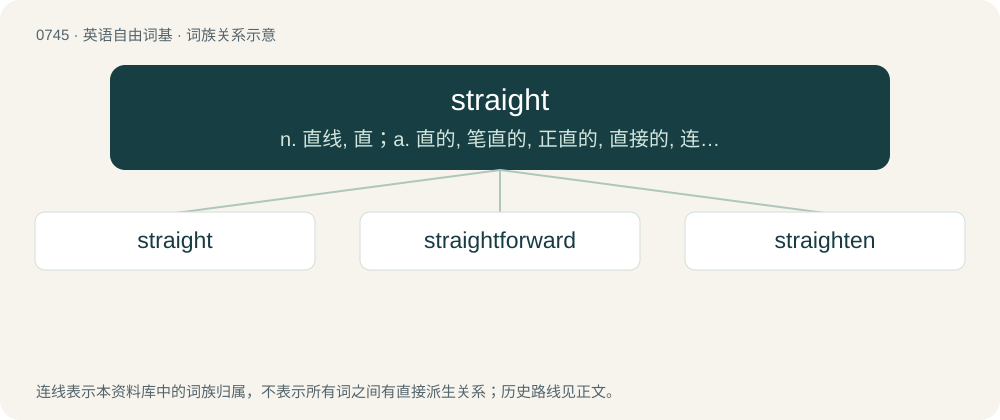

# 0812 · straight — n. 直线, 直；a. 直的, 笔直的, 正直的, 直接的, 连续的, 整齐的；adv. 直接地, 立即, 不断地

[总目录](../00_总目录_按常用程度.md)

**类型**：英语自由词基　｜　**来源语言**：见词源记录

## 核心含义与来源

- 核心含义：n. 直线, 直；a. 直的, 笔直的, 正直的, 直接的, 连续的, 整齐的；adv. 直接地, 立即, 不断地
- 英文含义：Not crooked, curly, or bent; having a constant direction throughout its length.
- 词形：straight

**来源记录 1**（形容词；Not crooked, curly, or bent; having a constant direction throughout its length.）

From Middle English streight, streght, streiȝt, the past participle of strecchen (“to stretch”), from Old English streċċan (past participle ġestreaht, ġestreht), from Proto-West Germanic \*strakkjan (“to stretch”). Cognate with Scots straicht (“straight”), Dutch gestrekt (“stretched”), German gestreckt (“stretched”), Danish strakt (“stretched”), Faroese and Norn strekti (“stretched”), Icelandic strekkti (“stretched”), Norwegian strekte (“stretched”), Swedish sträckte (“stretched”). Doublet of straught. Equivalent to stretch + -ed. In some senses, conflated with strait (“narrow, constricted”), which is from Latin strictus via Old French estreit.

## 词族图

## 单词速览（常用到不常用）

| 单词 | 音标 | 释义 |
|---|---|---|
| [straight](#w-1) | /stɹeɪt/ | n. 直线, 直；a. 直的, 笔直的, 正直的, 直接的, 连续的, 整齐的；adv. 直接地, 立即, 不断地 |
| [straightforward](#w-2) | /ˌstɹeɪtˈfɔː(ɹ)wə(ɹ)d/ | a. 笔直的, 率直的, 明确的, 简单的, 直接的 |
| [straighten](#w-3) | /ˈstɹeɪtn̩/ | vt. 弄直, 整顿, 清理, 使改正；vi. 直起来, 改正, 好转 |

## 逐词详解

### 1. straight

**词性**：形容词　｜　**音标**：/stɹeɪt/

**中文释义**：n. 直线, 直；a. 直的, 笔直的, 正直的, 直接的, 连续的, 整齐的；adv. 直接地, 立即, 不断地

**英文义项**：Not crooked, curly, or bent; having a constant direction throughout its length. / Direct, undeviating.

**构词拆分**：stretch + -ed

**词源与演化**：

From Middle English streight, streght, streiȝt, the past participle of strecchen (“to stretch”), from Old English streċċan (past participle ġestreaht, ġestreht), from Proto-West Germanic \*strakkjan (“to stretch”). Cognate with Scots straicht (“straight”), Dutch gestrekt (“stretched”), German gestreckt (“stretched”), Danish strakt (“stretched”), Faroese and Norn strekti (“stretched”), Icelandic strekkti (“stretched”), Norwegian strekte (“stretched”), Swedish sträckte (“stretched”). Doublet of straught. Equivalent to stretch + -ed. In some senses, conflated with strait (“narrow, constricted”), which is from Latin strictus via Old French estreit.

**例句**：

> After four straight wins, Mudchester United are top of the league.

该用例对应义项：In a row, in unbroken sequence; consecutive.

### 2. straightforward

**词性**：形容词　｜　**音标**：/ˌstɹeɪtˈfɔː(ɹ)wə(ɹ)d/

**中文释义**：a. 笔直的, 率直的, 明确的, 简单的, 直接的

**英文义项**：Proceeding in a straight course or manner; not deviating. / Easy, simple, uncomplicated, without difficulty.

**构词拆分**：straight + forward

**词源与演化**：

From straight + forward.

**例句**：

> He is not being as straightforward as it appears.

该用例对应义项：without evasion or compromise

### 3. straighten

**词性**：动词　｜　**音标**：/ˈstɹeɪtn̩/

**中文释义**：vt. 弄直, 整顿, 清理, 使改正；vi. 直起来, 改正, 好转

**英文义项**：To cause to become straight. / To become straight.

**构词拆分**：straight + -en

**词源与演化**：

From straight + -en. Compare Scots strauchten (“to straighten”).

**用法示例／搭配（非完整句）**：

> to straighten one's affairs

该用例对应义项：To put in order; to sort; to tidy up.
