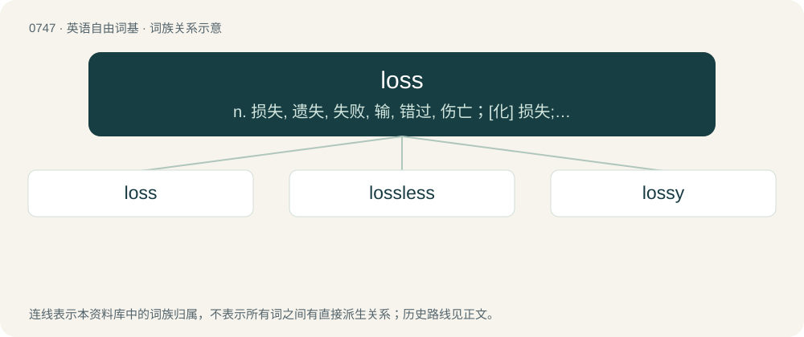

# 0813 · loss — n. 损失, 遗失, 失败, 输, 错过, 伤亡；\[化\] 损失; 损耗

[总目录](../00_总目录_按常用程度.md)

**类型**：英语自由词基　｜　**来源语言**：见词源记录

## 核心含义与来源

- 核心含义：n. 损失, 遗失, 失败, 输, 错过, 伤亡；\[化\] 损失; 损耗
- 英文含义：The result of no longer possessing an object, a function, or a characteristic due to external causes or misplacement.
- 词形：loss

**来源记录 1**（名词；The result of no longer possessing an object, a function, or a characteristic due to external causes or misplacement.）

From Middle English los, from Old English los (“damage, destruction, loss”), from Proto-West Germanic \*los, from Proto-Germanic \*lusą (“dissolution, break-up, loss”), from Proto-Indo-European \*lews- (“to cut, sunder, separate, loose, lose”). Cognate with Icelandic los (“dissolution, looseness, break-up”), Old English lor, forlor (“loss, ruin”), Middle High German verlor (“loss, ruin”). More at lose.

## 词族图

## 单词速览（常用到不常用）

| 单词 | 音标 | 释义 |
|---|---|---|
| [loss](#w-1) | 英 /lɒs/；/lɔs/ | n. 损失, 遗失, 失败, 输, 错过, 伤亡；\[化\] 损失; 损耗 |
| [lossless](#w-2) | 英 /ˈlɒs.ləs/ | a. 无损的; 无损耗; 无耗 |
| [lossy](#w-3) | 英 /ˈlɒsi/；美 /ˈlɑsi/ | \[计\] 有损耗的, 有损失的 |

## 逐词详解

### 1. loss

**词性**：名词　｜　**音标**：英 /lɒs/；/lɔs/

**中文释义**：n. 损失, 遗失, 失败, 输, 错过, 伤亡；\[化\] 损失; 损耗

**英文义项**：The result of no longer possessing an object, a function, or a characteristic due to external causes or misplacement. / The destruction or ruin of an object.

**词源与演化**：

From Middle English los, from Old English los (“damage, destruction, loss”), from Proto-West Germanic \*los, from Proto-Germanic \*lusą (“dissolution, break-up, loss”), from Proto-Indo-European \*lews- (“to cut, sunder, separate, loose, lose”). Cognate with Icelandic los (“dissolution, looseness, break-up”), Old English lor, forlor (“loss, ruin”), Middle High German verlor (“loss, ruin”). More at lose.

**例句**：

> The sum of expenditures and taxes minus total income is a loss, when this difference is positive.

该用例对应义项：The sum an entity loses on balance.

### 2. lossless

**词性**：形容词　｜　**音标**：英 /ˈlɒs.ləs/

**中文释义**：a. 无损的; 无损耗; 无耗

**英文义项**：Free from loss, especially not losing electrical energy or force. / Not losing information.

**构词拆分**：loss + -less

**词源与演化**：

From loss + -less.

### 3. lossy

**词性**：形容词　｜　**音标**：英 /ˈlɒsi/；美 /ˈlɑsi/

**中文释义**：\[计\] 有损耗的, 有损失的

**英文义项**：Of a communication channel, subject to loss of signal strength. / Of an electricity transmission line, subject to various forms of power loss.

**构词拆分**：From loss + -y.

**词源与演化**：

From loss + -y.

**例句**：

> JPEG is a lossy image compression format.

该用例对应义项：Of an algorithm for converting or compressing data, reducing the amount of information in data.
