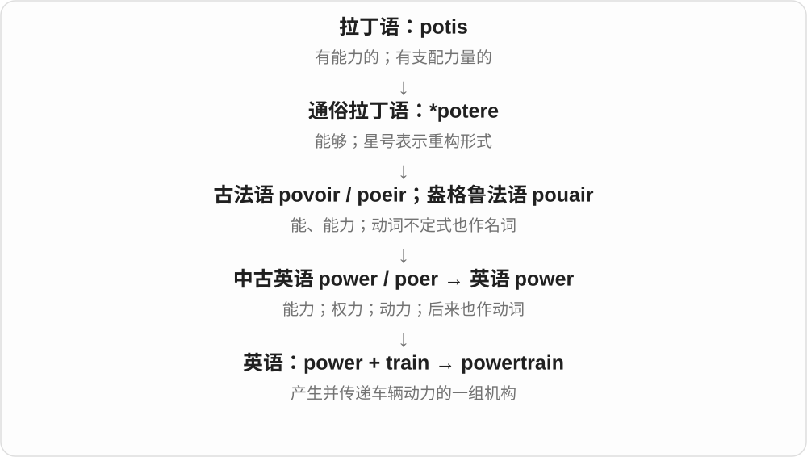

# 0816 · train — 训练、培训与受训角色

[逐词精讲目录](../00_逐词精讲目录.md) · [总目录](../00_总目录_按常用程度.md)

## 核心词根与来源

经法语接拉丁拉、牵引词族。训练与引导培养有关，不能解释成坐火车才能学技能；powertrain、drivetrain 为已有机械词族共享内容。

**TRAIN：引导、培养；火车名词在相关历史分支**

train 已精讲，本页把 trained、trainer、trainee 紧挨着，再看 retrain 与 trainable。

- **基本词与训练结果**：train · trained
- **培训双方**：trainer · trainee
- **重新训练与可训练性**：retrain · trainable
- **机械传动词**：powertrain · drivetrain
- **train → trains：牵引的一列与训练**：train · trains
- **trainers：教练们；英式运动鞋**：trainers

## 词形与演化规律

train → trained、trainer、trainee、trainable；re- + train → retrain；power、drive + train。

拖、牵引词族经法语发展；火车、训练通过不同语义分支形成。

trainer 的复数，train 训练 + -er + -s。鞋义接运动、训练的用途，两个现代名词用法按上下文分辨。

## 单词速览（按词族由简到繁）

同一基础词的相关扩展放在一起，先读基础形式，再读扩展；各组之间优先读常用的。具体词源关系见各词讲解。

| 单词 | 音标 | 核心意思 |
|---|---|---|
| [train](#w-1) | /treɪn/ | 火车；一列；训练；培养 |
| [trained](#w-2) | /treɪnd/ | 训练过、受过培训的 |
| [trains](#w-9) | /treɪnz/ | 火车；一列、连续的一串〔复数〕；训练、培训〔第三人称单数〕 |
| [trainer](#w-3) | 英 /ˈtreɪnə/；美 /ˈtreɪnər/ | 教练；培训师；英式运动鞋 |
| [trainers](#w-10) | 英 /ˈtreɪnəz/；美 /ˈtreɪnɚz/ | 教练，培训师〔复数〕；运动鞋〔常见英式用法〕；训练设备〔复数〕 |
| [trainee](#w-4) | /ˌtreɪˈniː/ | 受训者；见习人员 |
| [trainable](#w-8) | /ˈtreɪnəbəl/ | 可训练的；能接受培训的 |
| [powertrain](#w-5) | 英 /ˈpaʊətreɪn/；美 /ˈpaʊərtreɪn/ | 车辆动力系统；动力传动总成 |
| [drivetrain](#w-6) | /ˈdraɪvtreɪn/ | 车辆传动系统 |
| [retrain](#w-7) | /ˌriːˈtreɪn/ | 重新培训；转学新职业技能 |

## 逐词讲解

### 1. train — 火车；一列；训练；培养

**音标**：/treɪn/

**先抓住这个画面**

名词 train 可以先想“一串被带着往前走的东西”：车厢成列。动词则是把人或能力持续带向某个目标。

**怎么拆**

经古法语 train“拖带的一列”和 traïner“拖、牵引”追溯到拉丁语 trahere；中间还涉及重建的通俗拉丁语形式。英语动词由名词发展而来。

**怎么变成今天的意思**

列车义来自一列连续相接的东西，早于现代铁路还有拖尾、随从等用法。训练义沿引导、使形成习惯发展；不能把火车速度快当作训练义的词源。

**常见搭配与例句**

catch a train；a train of thought；train someone to do…；train for a race；train a dog。

> I missed the train and had to wait for the next one.

我错过了火车，只好等下一班。

> She trains new staff to handle customer complaints.

她培训新员工处理顾客投诉。

**别混淆**

teach 常突出教授知识或方法；train 常突出反复练习、形成技能或习惯。两者经常一起发生。

### 2. trained — 训练过、受过培训的

**音标**：/treɪnd/

**先抓住这个画面**

不是天生就会，而是经过练习、教导，具备了某种能力。

**怎么拆**

train + -ed，过去分词兼形容词，末尾读 /d/。培训义在 train 历史中接引导、培养，不是受训者乘了火车。

**怎么变成今天的意思**

**拉丁 trahere 拉 → 法语 traîner、train → 英语 train**  
拉出、延伸；一串随行之物

↓

**现代 train**  
火车；引导、培养 → 训练与培训

↓

**train + -ed → trained**  
培养、训练 → 已受训练的

a trained nurse 受过专业训练的护士，a trained dog 训练过的狗，a trained eye 内行的眼光。

**常见搭配与例句**

a trained professional；a trained eye；highly trained。

> A trained guide led us through the cave.

一位受过训练的向导带我们穿过洞穴。

> To a trained eye, the difference is obvious.

在内行眼里，区别很明显。

**别混淆**

trained 经过训练，talented 有天分；二者可同时具备。trained 不保证对所有任务都合适。

### 3. trains — 火车；一列、连续的一串〔复数〕；训练、培训〔第三人称单数〕

**音标**：/treɪnz/

**先抓住这个画面**

一节节车厢连着、被带着向前走，是 trains 的火车画面。训练义则是把能力引导、培养到所需状态，沿同一较早词族的另一支发展。

**怎么拆**

train + -s，/n/ 后读 /z/。古法语 train、trainer 接拉丁 trahere 拖、拉，中间涉及重建形式；英语名词有拖在后面的一列，后来用于铁路列车，动词再发展出训练等义。

**怎么变成今天的意思**

**拉丁 trahere → 通俗拉丁重建形式 → 古法语 train、trainer**  
拖拉 → 拖带的一列

↓

**英语 train → trains；不同意义分支**  
列车；引导、培养 → 单数主语训练

catch trains 赶火车；trains new staff 培训新员工；trains for a race 为比赛训练。

**常见搭配与例句**

trains leaving the city；trains every morning。

> Trains run every fifteen minutes during the day.

白天每十五分钟就有一班火车。

> She trains new staff at the hotel.

她在酒店培训新员工。

**别混淆**

trains 作动词可接被培训的人，也可用 trains for 说明目标。火车义与训练义要通过历史中的拖带、引导理解，不必编成火车产生训练。

### 4. trainer — 教练；培训师；英式运动鞋

**音标**：英 /ˈtreɪnə/；美 /ˈtreɪnər/

**先抓住这个画面**

教人练习、帮助提升能力的人；英国口语里复数 trainers 也常是运动鞋。

**怎么拆**

train + -er，执行训练的人或器物。鞋的用法来自训练鞋的用途，不是鞋子在给人上课。

**怎么变成今天的意思**

**拉丁 trahere 拉 → 法语 traîner、train → 英语 train**  
拉出、延伸；一串随行之物

↓

**现代 train**  
火车；引导、培养 → 训练与培训

↓

**train + -er → trainer**  
训练者 → 教练、培训师；训练鞋

a personal trainer 私人健身教练，a staff trainer 员工培训师；a pair of trainers 一双运动鞋。

**常见搭配与例句**

a personal trainer；a staff trainer；a pair of trainers。

> The trainer explained the new booking system.

培训师讲解了新预订系统。

> She wore trainers for the walk.

她穿运动鞋去散步。

**别混淆**

trainer 培训者，trainee 受训者；trainers 复数在英式可指鞋，不能所有句子都译成多个教练。

### 5. trainers — 教练，培训师〔复数〕；运动鞋〔常见英式用法〕；训练设备〔复数〕

**音标**：英 /ˈtreɪnəz/；美 /ˈtreɪnɚz/

**先抓住这个画面**

健身房里的 trainers 可以是教练；脚上 a pair of trainers 则是运动鞋。共享训练这个用途，具体是人还是鞋，要看搭配。

**怎么拆**

train 训练 + -er → trainer；加 -s → trainers。人的用法是训练者，鞋、设备的用法接训练用途，不必讲成教练后来变成鞋。

**怎么变成今天的意思**

**train + -er → trainer**  
训练的人，也可用于训练的设备

↓

**训练用鞋的命名 → trainer、trainers**  
鞋义在英式日常常见

↓

**trainer + -s → trainers**  
教练等的复数；一双鞋常用 a pair 来数

fitness trainers 是健身教练；a pair of trainers 是一双运动鞋；flight trainers 可能指飞行训练设备，需看上下文。

**常见搭配与例句**

fitness trainers；a pair of trainers；experienced trainers。

> The new staff met their trainers on Monday.

新员工周一见了培训师。

> I put on my trainers before going for a walk.

出门散步前，我穿上了运动鞋。

**别混淆**

运动鞋义常对应美式 sneakers；职业人物义与地区鞋名要分开，不把所有 trainers 都译成培训师。

### 6. trainee — 受训者；见习人员

**音标**：/ˌtreɪˈniː/

**先抓住这个画面**

正在学岗位技能的人，身份仍处于培训、见习阶段。

**怎么拆**

train + -ee，后缀表示接受训练的一方。-ee 在这里与 trainer 的 -er 形成执行方、接受方的对照。

**怎么变成今天的意思**

**拉丁 trahere 拉 → 法语 traîner、train → 英语 train**  
拉出、延伸；一串随行之物

↓

**现代 train**  
火车；引导、培养 → 训练与培训

↓

**train + -ee → trainee**  
接受培训的人

a trainee teacher 见习教师，a management trainee 管理培训生；a trainee 不意味着永久初学者。

**常见搭配与例句**

a trainee teacher；a trainee nurse；a management trainee。

> Each trainee works with an experienced colleague.

每位受训者都与一位有经验的同事一起工作。

> She joined the company as a management trainee.

她以管理培训生身份加入公司。

**别混淆**

trainee 受训身份，intern 实习身份；制度安排可能重叠，但不是所有 trainee 都是学生实习。

### 7. trainable — 可训练的；能接受培训的

**音标**：/ˈtreɪnəbəl/

**先抓住这个画面**

有可能通过练习学会、改善；先说能够学，不是说已经学会。

**怎么拆**

train + -able，构成能被训练、可以培训的形容词。对象可以是人、动物，也可以是机器学习模型。

**怎么变成今天的意思**

**拉丁 trahere 拉 → 法语 traîner、train → 英语 train**  
拉出、延伸；一串随行之物

↓

**现代 train**  
火车；引导、培养 → 训练与培训

↓

**train + -able → trainable**  
可以被训练的

a trainable dog 易训练的狗，trainable staff 可培养的员工；trainable parameters 可训练参数。

**常见搭配与例句**

a trainable dog；trainable skills；trainable parameters。

> The breed is known for being intelligent and trainable.

这个犬种以聪明、易训练著称。

> The model has several trainable parameters.

模型有若干可训练参数。

**别混淆**

trainable 能训练，trained 已经训练；可训练不意味着训练结果必然完美。

### 8. powertrain — 车辆动力系统；动力传动总成

**音标**：英 /ˈpaʊətreɪn/；美 /ˈpaʊərtreɪn/

**先抓住这个画面**

powertrain 是从“产生动力”到“把动力送到车轮”的一整条配合链。

**怎么拆**

power 动力 + train 一系列相连部件；train 在这里不是列车，而是一组依次配合的机构。

**怎么变成今天的意思**

可包括发动机或电动机，以及把动力传给驱动轮的相关部件。不同工程或保修资料的具体边界可能不同，要按文中定义理解。

**常见搭配与例句**

an electric powertrain；powertrain components；a powertrain warranty。

> The engineers redesigned the powertrain for the electric model.

工程师为电动车型重新设计了动力系统。

> The warranty covers several major powertrain components.

保修涵盖了动力总成中的几个主要部件。

**别混淆**

engine 是发动机本身；powertrain 是更大的动力系统。drivetrain 通常侧重传递动力的部分，常不包含发动机。

### 9. drivetrain — 车辆传动系统

**音标**：/ˈdraɪvtreɪn/

**先抓住这个画面**

发动机等动力源有了力，还得通过一串部件传到车轮；这里看的是这条传力链。

**怎么拆**

drive + train；train 可指一连串相接部件，不是火车开进了发动机。

**怎么变成今天的意思**

**drive；train〔串联部件〕**  
并列构词部分

↓

**drivetrain**  
把动力传到驱动轮的传动部件系统

drivetrain components 传动系统部件，drivetrain noise 传动系统噪声。行业对系统边界用法会有差别，通常与范围更广的 powertrain 对照。

**常见搭配与例句**

drivetrain components；drivetrain noise；inspect the drivetrain。

> The mechanic inspected the drivetrain.

修理工检查了传动系统。

> The article compares different drivetrain layouts.

文章比较了不同传动系统布局。

**别混淆**

drivetrain 是整套传力部件，driveshaft 只是一类传动轴；一个部件不等于整个系统。

### 10. retrain — 重新培训；转学新职业技能

**音标**：/ˌriːˈtreɪn/

**先抓住这个画面**

原来学过一套能力，现在为了新要求再训练，或换一种职业重新学。

**怎么拆**

re- 再、重新 + train，可以培训别人，也可以自己转训。不是再次乘火车。

**怎么变成今天的意思**

**拉丁 trahere 拉 → 法语 traîner、train → 英语 train**  
拉出、延伸；一串随行之物

↓

**现代 train**  
火车；引导、培养 → 训练与培训

↓

**re- + train → retrain**  
重新培养技能 → 再培训、转训

retrain staff 重新培训员工，retrain as a teacher 转训做教师，retrain for a new career 为新职业再培训。

**常见搭配与例句**

retrain staff；retrain as；retrain for。

> The company retrained staff to use the new equipment.

公司重新培训员工使用新设备。

> He decided to retrain as a teacher.

他决定重新学习技能，转行做教师。

**别混淆**

retrain 重新学习技能，retire 退休；字形有点像，过程和意思不同。

## 这一组要分清什么

trainer 教练，trainee 学员；trained 已训练，trainable 能训练；英式 trainers 还指运动鞋。

## 串起来练习

The trainer retrained the trainees to use the new equipment.

培训师重新培训学员使用新设备。
