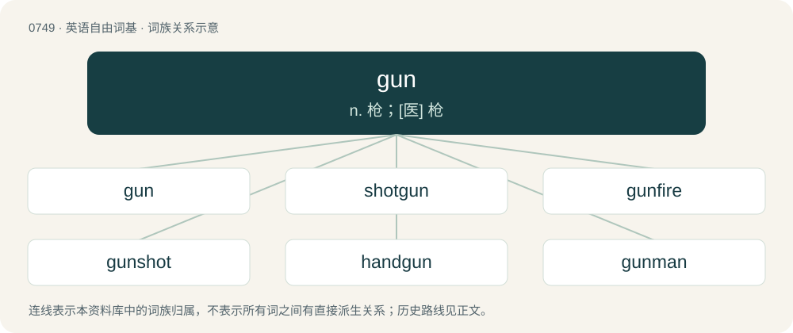

# 0817 · gun — n. 枪；\[医\] 枪

[总目录](../00_总目录_按常用程度.md)

**类型**：英语自由词基　｜　**来源语言**：见词源记录

## 核心含义与来源

- 核心含义：n. 枪；\[医\] 枪
- 英文含义：A device for shooting projectiles or ditto (a shooter), functioning through stored energy: a firearm, cannon, harpoon gun/spear gun, raygun, etc, not a bow and arrow, or slingshot.
- 词形：gun

**来源记录 1**（名词；A device for shooting projectiles or ditto (a shooter), functioning through stored energy: a firearm, cannon, harpoon gun/spear gun, raygun, etc, not a bow and arrow, or slingshot.）

From Middle English gunne, gonne, possibly from Gunnhild, a female given name formerly used as a nickname for engines of war (compare Nordic Gunn, a female name meaning “battle”). The name is composed of the Norse elements gunnr and hildr, both meaning "battle".

## 词族图

## 单词速览（常用到不常用）

| 单词 | 音标 | 释义 |
|---|---|---|
| [gun](#w-1) | /ˈɡʌn/ | n. 枪；\[医\] 枪 |
| [shotgun](#w-2) | 英 /ˈʃɒtɡʌn/；美 /ˈʃɑtɡʌn/ | n. 散弹猎枪, 媒人；v. 用猎枪射击 |
| [gunfire](#w-3) | 英 /ˈɡʌnfʌɪə/ | n. 炮火, 号炮报时, 炮击 |
| [gunshot](#w-4) | 英 /ˈɡʌn.ʃɒt/；美 /ˈɡʌn.ʃɑt/ | n. 枪弹, (枪炮)射击, 炮击, 射程；a. 射击的 |
| [handgun](#w-5) | 美 /ˈhændˌɡʌn/ | n. 手枪 |
| [gunman](#w-6) | /ˈɡʌnmən/ | n. 枪手, 持枪的歹徒, 制造枪械者；\[法\] 持枪歹徒, 持枪抢劫或杀人者, 枪炮工人 |
| [gunner](#w-7) | 英 /ˈɡʌn.ə(ɹ)/；美 /ˈɡʌn.ɚ/ | n. 炮手, 炮长, 机关枪手, 带枪猎人 |
| [gunpowder](#w-8) | 英 /ˈɡʌnˌpaʊdə/；美 /ˈɡʌnˌpaʊdɚ/ | n. 火药；\[化\] 有烟火药; 火药 |
| [gunpoint](#w-9) | /ˈɡʌnpɔɪnt/ | n. 枪口 |
| [gunfight](#w-10) | 美 /ˈɡʌnˌfaɪt/ | n. 枪战 |
| [gunnery](#w-11) | /ˈɡʌn.əɹ.i/ | n. 火炮制造与射击学, 射击, 炮击, 枪炮制造 |
| [gunslinger](#w-12) |  | n. 带枪的歹徒, 被收买来行凶的人；\[法\] 枪手, 带枪的歹徒, 被收买来行凶的人 |
| [gunship](#w-13) | /ˈɡʌnʃɪp/ | n. 武装直升机 |
| [gunboat](#w-14) | 美 /ˈɡʌnˌboʊt/ | n. 炮舰, 炮艇 |
| [gunsmith](#w-15) | 美 /ˈɡʌnˌsmɪθ/ | n. 枪炮工 |
| [gunplay](#w-16) | 美 /ˈɡʌnˌpleɪ/ | n. （美）枪战；射击技巧 |
| [gunny](#w-17) | /ˈɡʌni/ | 【英文】Resembling or characteristic of a gun. |
| [gunmetal](#w-18) | 英 /ˈɡʌnmɛt(ə)l/；美 /ˈɡʌnmɛt(ə)l/ | n. 炮铜, 青铜, 炮铜色 |
| [gunfighter](#w-19) |  | n. 用枪格斗出名的人 |
| [railgun](#w-20) | /ˈɹeɪl.ɡʌn/ | 磁轨炮 |

## 逐词详解

### 1. gun

**词性**：名词　｜　**音标**：/ˈɡʌn/

**中文释义**：n. 枪；\[医\] 枪

**英文义项**：A device for shooting projectiles or ditto (a shooter), functioning through stored energy: a firearm, cannon, harpoon gun/spear gun, raygun, etc, not a bow and arrow, or slingshot. / A very portable, short firearm, for hand use, which fires bullets or projectiles, such as a handgun, revolver, pistol, or Derringer.

**词源与演化**：

From Middle English gunne, gonne, possibly from Gunnhild, a female given name formerly used as a nickname for engines of war (compare Nordic Gunn, a female name meaning “battle”). The name is composed of the Norse elements gunnr and hildr, both meaning "battle".

**例句**：

> Guns were considered improvements of crossbows and catapults.

该用例对应义项：A device for shooting projectiles or ditto (a shooter), functioning through stored energy: a firearm, cannon, harpoon gun/spear gun, raygun, etc, not a bow and arrow, or slingshot.

### 2. shotgun

**词性**：名词　｜　**音标**：英 /ˈʃɒtɡʌn/；美 /ˈʃɑtɡʌn/

**中文释义**：n. 散弹猎枪, 媒人；v. 用猎枪射击

**英文义项**：A gun which fires loads typically consisting of small metal balls, called shot, from a cartridge. / The front passenger seat in a vehicle, next to the driver; so called because the position of the shotgun-armed guard on a horse-drawn stage-coach, wagon train, or gold transport was next to the driver on a forward-mounted bench seat. Can also be used in situations of claiming other resources such as bedrooms.

**构词拆分**：shot + gun

**词源与演化**：

From shot + gun. Front passenger seat sense comes from ride shotgun.

**例句**：

> The farmer's son brought home a Thanksgiving turkey from the wild that he killed with his shotgun.

该用例对应义项：A gun which fires loads typically consisting of small metal balls, called shot, from a cartridge.

### 3. gunfire

**词性**：名词　｜　**音标**：英 /ˈɡʌnfʌɪə/

**中文释义**：n. 炮火, 号炮报时, 炮击

**英文义项**：Shots from a gun or guns, typically creating loud report. / The use of gunpowder-type weapons, mainly cannon, as opposed to swords or bayonets.

**构词拆分**：gun + fire

**词源与演化**：

From gun + fire.

**例句**：

> Killing people became much easier and faster once armies started using gunfire.

该用例对应义项：The use of gunpowder-type weapons, mainly cannon, as opposed to swords or bayonets.

### 4. gunshot

**词性**：名词　｜　**音标**：英 /ˈɡʌn.ʃɒt/；美 /ˈɡʌn.ʃɑt/

**中文释义**：n. 枪弹, (枪炮)射击, 炮击, 射程；a. 射击的

**英文义项**：The discharging a firearm. / The firing of guns; gunfire.

**构词拆分**：gun + shot

**词源与演化**：

From gun + shot.

**用法示例／搭配（非完整句）**：

> they heard gunshot all around them

该用例对应义项：The firing of guns; gunfire.

### 5. handgun

**词性**：名词　｜　**音标**：美 /ˈhændˌɡʌn/

**中文释义**：n. 手枪

**英文义项**：A small gun with a relatively short barrel, designed to be held and operated with a single hand.

**构词拆分**：hand + gun

**词源与演化**：

From hand + gun.

**例句**：

> Ziri lifted his T-shirt to reveal a handgun tucked into his waistband.

### 6. gunman

**词性**：名词　｜　**音标**：/ˈɡʌnmən/

**中文释义**：n. 枪手, 持枪的歹徒, 制造枪械者；\[法\] 持枪歹徒, 持枪抢劫或杀人者, 枪炮工人

**英文义项**：A person armed with a gun, especially a gunned evildoer. / An American.

**构词拆分**：From gun + -man.

**词源与演化**：

From gun + -man.

**例句**：

> When she saw the gunman, Soraya nearly had a fit.

### 7. gunner

**词性**：名词　｜　**音标**：英 /ˈɡʌn.ə(ɹ)/；美 /ˈɡʌn.ɚ/

**中文释义**：n. 炮手, 炮长, 机关枪手, 带枪猎人

**英文义项**：An artillery soldier, especially one who holds private rank. / A person who operates a gun.

**构词拆分**：gun + -er

**词源与演化**：

From Middle English gonner; equivalent to gun + -er.

**例句**：

> Tim's uncle was a machine gunner on a helicopter in Vietnam.

### 8. gunpowder

**词性**：名词　｜　**音标**：英 /ˈɡʌnˌpaʊdə/；美 /ˈɡʌnˌpaʊdɚ/

**中文释义**：n. 火药；\[化\] 有烟火药; 火药

**英文义项**：An explosive mixture of saltpetre (potassium nitrate), charcoal and sulfur; formerly used in gunnery but now mostly used in fireworks.

**构词拆分**：gun + powder

**词源与演化**：

From gun + powder.

**例句**：

> We must prevent the fire from reaching the gunpowder at any cost.

### 9. gunpoint

**词性**：名词　｜　**音标**：/ˈɡʌnpɔɪnt/

**中文释义**：n. 枪口

**英文义项**：A location in the front of the muzzle of a gun. / Threat or coercion by display or aiming a firearm or similar weapon.

**构词拆分**：gun + point

**词源与演化**：

From gun + point.

**例句**：

> The sheriff said the victim was carjacked at gunpoint on Park Street.

### 10. gunfight

**词性**：名词　｜　**音标**：美 /ˈɡʌnˌfaɪt/

**中文释义**：n. 枪战

**英文义项**：A battle (or a duel) using small arms.

**构词拆分**：From gun + fight.

**词源与演化**：

From gun + fight.

**例句**：

> A gunfight started and Ziri was immediately got shot in the thigh.

### 11. gunnery

**词性**：名词　｜　**音标**：/ˈɡʌn.əɹ.i/

**中文释义**：n. 火炮制造与射击学, 射击, 炮击, 枪炮制造

**英文义项**：The science of guns and gunfire, including aspects of bullet flight and impact. / The design and manufacture of guns, particularly those of a large caliber.

**构词拆分**：gun + -ery

**词源与演化**：

From gun + -ery.

### 12. gunslinger

**词性**：名词

**中文释义**：n. 带枪的歹徒, 被收买来行凶的人；\[法\] 枪手, 带枪的歹徒, 被收买来行凶的人

**英文义项**：A person who behaves with the reckless bravado expected of someone who would duel with guns.

**构词拆分**：gun + slinger

**词源与演化**：

From gun + slinger.

**例句**：

> The man in black fled across the desert and the gunslinger followed.

### 13. gunship

**词性**：名词　｜　**音标**：/ˈɡʌnʃɪp/

**中文释义**：n. 武装直升机

**英文义项**：A ship equipped with heavy artillery. / An armed helicopter tasked to attack the enemy.

**构词拆分**：gun + ship

**词源与演化**：

From gun + ship.

### 14. gunboat

**词性**：名词　｜　**音标**：美 /ˈɡʌnˌboʊt/

**中文释义**：n. 炮舰, 炮艇

**英文义项**：Any of the various types of small armed vessels.

**构词拆分**：gun + boat

**词源与演化**：

From gun + boat.

**例句**：

> They have made, and will make, use of gunboat diplomacy.

### 15. gunsmith

**词性**：名词　｜　**音标**：美 /ˈɡʌnˌsmɪθ/

**中文释义**：n. 枪炮工

**英文义项**：A manufacturer of guns. / A person skilled in the repair and servicing of firearms.

**构词拆分**：gun + smith

**词源与演化**：

From gun + smith.

### 16. gunplay

**词性**：名词　｜　**音标**：美 /ˈɡʌnˌpleɪ/

**中文释义**：n. （美）枪战；射击技巧

**英文义项**：The discharge of firearms, usually with violent intent and in confrontations. / A sexual practice involving the use of a (usually unloaded) firearm for physical and mental stimulation.

**构词拆分**：gun + play

**词源与演化**：

From gun + play.

**例句**：

> In the aftermath of the Iraq War, the streets of Baghdad were sometimes filled with gunplay.

该用例对应义项：The discharge of firearms, usually with violent intent and in confrontations.

### 17. gunny

**词性**：形容词　｜　**音标**：/ˈɡʌni/

**英文义项**：Resembling or characteristic of a gun. / Full of guns or gunplay.

**构词拆分**：gun + -y

**词源与演化**：

From gun + -y.

### 18. gunmetal

**词性**：名词　｜　**音标**：英 /ˈɡʌnmɛt(ə)l/；美 /ˈɡʌnmɛt(ə)l/

**中文释义**：n. 炮铜, 青铜, 炮铜色

**英文义项**：An alloy of 88% copper, 10% tin and 2% zinc, originally used for making guns. / A dark grey or bluish-grey colour; gunmetal grey.

**构词拆分**：gun + metal

**词源与演化**：

From gun + metal.

### 19. gunfighter

**词性**：名词

**中文释义**：n. 用枪格斗出名的人

**英文义项**：A person who engages in gunfights; a gunslinger.

**构词拆分**：gun + fighter

**词源与演化**：

From gun + fighter.

### 20. railgun

**词性**：名词　｜　**音标**：/ˈɹeɪl.ɡʌn/

**中文释义**：磁轨炮

**英文义项**：An electromagnetic gun that uses a large electrical current to propel a projectile down a track of two parallel conductive rails. / A railway gun.

**构词拆分**：rail + gun

**词源与演化**：

From rail + gun. \* (railway gun): From being a gun mounted on a rail car, and being railroad-mobile. \* (EM gun): From being a projectile ejecting device with a pair of electric conducting rails that a launch sled runs along, which shoots the projectile.
