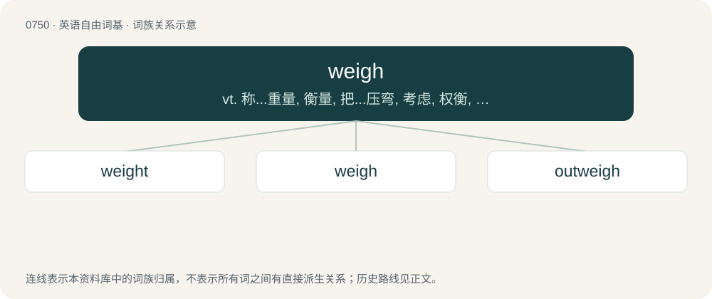

# 0819 · weigh — vt. 称...重量, 衡量, 把...压弯, 考虑, 权衡, 起锚；vi. 称分量, 有意义, 重压, 起锚；n. 过秤, 称分量

[总目录](../00_总目录_按常用程度.md)

**类型**：英语自由词基　｜　**来源语言**：见词源记录

## 核心含义与来源

- 核心含义：vt. 称...重量, 衡量, 把...压弯, 考虑, 权衡, 起锚；vi. 称分量, 有意义, 重压, 起锚；n. 过秤, 称分量
- 英文含义：To determine the weight of an object.
- 词形：weigh

**来源记录 1**（动词；To determine the weight of an object.）

From Middle English weyen, from Old English wegan, from Proto-West Germanic \*wegan, from Proto-Germanic \*weganą (“to move, carry, weigh”), from Proto-Indo-European \*wéǵʰeti, from \*weǵʰ- (“to bring, transport”). Cognates Cognate with Scots wey, wee, Dutch wegen, German wiegen, wägen, Danish veje, Norwegian Bokmål veie, Norwegian Nynorsk vega. Doublet of wedge, wagon, way, and vector.

## 词族图

## 单词速览（常用到不常用）

| 单词 | 音标 | 释义 |
|---|---|---|
| [weight](#w-1) | /weɪt/ | n. 重, 重量, 体重, 砝码, 重大, 影响, 力量；vt. 加重量于, 压迫, 使加权, 称重量；\[计\] 粗细 |
| [weigh](#w-2) | /weɪ/ | vt. 称...重量, 衡量, 把...压弯, 考虑, 权衡, 起锚；vi. 称分量, 有意义, 重压, 起锚；n. 过秤, 称分量 |
| [outweigh](#w-3) | /ˌaʊtˈweɪ/ | vt. 比...重, 比...重要, 比...有价值 |

## 逐词详解

### 1. weight

**词性**：名词　｜　**音标**：/weɪt/

**中文释义**：n. 重, 重量, 体重, 砝码, 重大, 影响, 力量；vt. 加重量于, 压迫, 使加权, 称重量；\[计\] 粗细

**英文义项**：The downwards force an object experiences due to gravity. / An object used to make something heavier.

**构词拆分**：weigh + -t (abstract nominal suffix)

**词源与演化**：

From Middle English weight, weiȝte, weght, wight, from Old English wiht, ġewiht (“weight”), from Proto-Germanic \*wihtiz ("weight"; compare \*weganą (“to move”)), from Proto-Indo-European \*weǵʰ- (“to move; pull; draw; drive”). Equivalent to weigh + -t (abstract nominal suffix). Cognate with Scots wecht, weicht (“weight”), Saterland Frisian Wächte (“scale”), Gewicht (“weight”), West Frisian gewicht (“weight”), Dutch gewicht (“weight”), German Low German Wicht, Gewicht (“weight”), German Wucht (“massiveness, force”), Gewicht (“weight”).

**例句**：

> He's working out with weights. Weight-bearing exercise is now understood to be just as important as cardio.

该用例对应义项：An object, such as a weight plate or barbell, used for strength training.

### 2. weigh

**词性**：动词　｜　**音标**：/weɪ/

**中文释义**：vt. 称...重量, 衡量, 把...压弯, 考虑, 权衡, 起锚；vi. 称分量, 有意义, 重压, 起锚；n. 过秤, 称分量

**英文义项**：To determine the weight of an object. / Often with "out", to measure a certain amount of something by its weight, e.g. for sale.

**词源与演化**：

From Middle English weyen, from Old English wegan, from Proto-West Germanic \*wegan, from Proto-Germanic \*weganą (“to move, carry, weigh”), from Proto-Indo-European \*wéǵʰeti, from \*weǵʰ- (“to bring, transport”). Cognates Cognate with Scots wey, wee, Dutch wegen, German wiegen, wägen, Danish veje, Norwegian Bokmål veie, Norwegian Nynorsk vega. Doublet of wedge, wagon, way, and vector.

**例句**：

> You have been weighed in the balance and found wanting.

该用例对应义项：To determine the intrinsic value or merit of an object, to evaluate.

### 3. outweigh

**词性**：动词　｜　**音标**：/ˌaʊtˈweɪ/

**中文释义**：vt. 比...重, 比...重要, 比...有价值

**英文义项**：To exceed in weight or mass. / To exceed in importance or value.

**构词拆分**：out- + weigh

**词源与演化**：

From out- + weigh.

**例句**：

> The risks of such a project would clearly outweigh any putative benefit.
