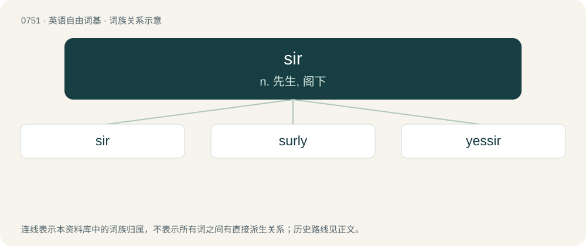

# 0820 · sir — n. 先生, 阁下

[总目录](../00_总目录_按常用程度.md)

**类型**：英语自由词基　｜　**来源语言**：见词源记录

## 核心含义与来源

- 核心含义：n. 先生, 阁下
- 英文含义：A man of a higher rank or position.
- 词形：sir

**来源记录 1**（名词；A man of a higher rank or position.）

From Middle English sir, unstressed form of sire, borrowed from Old French sire (“master, sir, lord”), from Latin senior (“older, elder”), from senex (“old”). Doublet of seigneur, seignior, senhor, senior, señor, senyor, signore, and sire.

## 词族图

## 单词速览（常用到不常用）

| 单词 | 音标 | 释义 |
|---|---|---|
| [sir](#w-1) | 英 /sɜː/；美 /sɜɹ/ | n. 先生, 阁下 |
| [surly](#w-2) | 英 /ˈsɜːli/；美 /ˈsɝli/ | a. 不和蔼的, 无礼的, 板面孔的, 阴沉的, 粗暴的, 乖戾的 |
| [yessir](#w-3) | 英 /ˈjɛsɜː(ɹ)/；美 /ˈjɛsɚ/ | （表示强调）的确, 完全同意 |

## 逐词详解

### 1. sir

**词性**：名词　｜　**音标**：英 /sɜː/；美 /sɜɹ/

**中文释义**：n. 先生, 阁下

**英文义项**：A man of a higher rank or position. / A respectful term of address to a man of higher rank or position, particularly

**词源与演化**：

From Middle English sir, unstressed form of sire, borrowed from Old French sire (“master, sir, lord”), from Latin senior (“older, elder”), from senex (“old”). Doublet of seigneur, seignior, senhor, senior, señor, senyor, signore, and sire.

**例句**：

> Just be careful. He gets whingy now if you don't address him as Sir John.

该用例对应义项：to a knight or other low member of the peerage.

### 2. surly

**词性**：形容词　｜　**音标**：英 /ˈsɜːli/；美 /ˈsɝli/

**中文释义**：a. 不和蔼的, 无礼的, 板面孔的, 阴沉的, 粗暴的, 乖戾的

**英文义项**：Irritated, bad-tempered, unfriendly. / Threatening, menacing, gloomy.

**构词拆分**：sir + -ly

**词源与演化**：

16th-century alteration of sirly, from sir + -ly.

**例句**：

> The surly weather put us all in a bad mood.

该用例对应义项：Threatening, menacing, gloomy.

### 3. yessir

**词性**：感叹词　｜　**音标**：英 /ˈjɛsɜː(ɹ)/；美 /ˈjɛsɚ/

**中文释义**：（表示强调）的确, 完全同意

**英文义项**：Used to express assent, especially to a male superior. / Used to express emphatic affirmation.

**构词拆分**：yes + sir

**词源与演化**：

From yes + sir.
