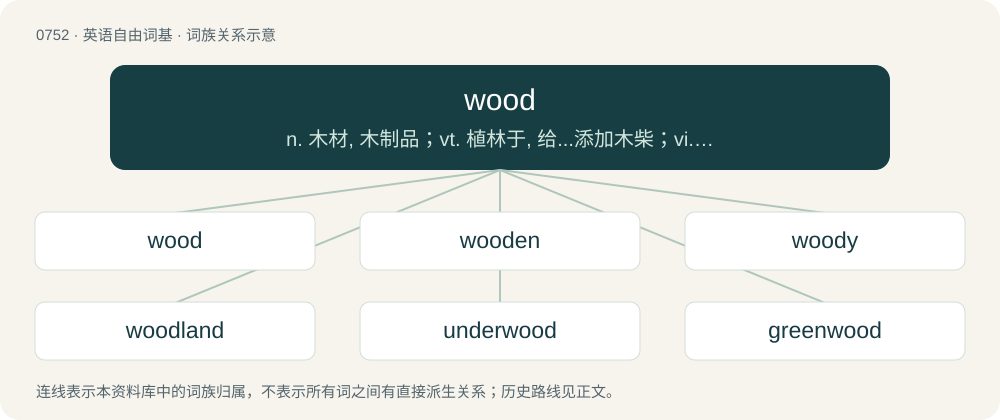

# 0821 · wood — n. 木材, 木制品；vt. 植林于, 给...添加木柴；vi. 收集木材

[总目录](../00_总目录_按常用程度.md)

**类型**：英语自由词基　｜　**来源语言**：见词源记录

## 核心含义与来源

- 核心含义：n. 木材, 木制品；vt. 植林于, 给...添加木柴；vi. 收集木材
- 英文含义：The substance making up the central part of the trunk and branches of a tree. Used as a material for construction, to manufacture various items, etc. or as fuel.
- 词形：wood

**多个词源／构词路径**：同一拼写可能有不同来源；以下按词性和含义分别列出。

**来源记录 1**（名词；The substance making up the central part of the trunk and branches of a tree. Used as a material for construction, to manufacture various items, etc. or as fuel.）

From Middle English wode, from Old English wudu, widu (“wood, forest, grove; tree; timber”), from Proto-West Germanic \*widu, from Proto-Germanic \*widuz (“wood”), from Proto-Indo-European \*h₁weydʰh₁- (“to separate”). The spelling developed as it did in wool. Cognate with Dutch wede (“wood, twig”), Middle High German wite (“wood”), Danish, Norwegian Bokmål, Norwegian Nynorsk, and Swedish ved (“wood”), Elfdalian wið (“wood, timber”), Faroese and Icelandic viður (“wood”), Norwegian Nynorsk ved (“wood, firewood”), vid (“wide, broad”). Further cognates include Irish fiodh (“a wood, tree”), Old Irish fid (“tree”) and Welsh gwŷdd (“trees”), from Proto-Celtic \*widus (“wood”). Unrelated to Dutch woud (“forest”), German Wald (“forest”) (see English wold).

**来源记录 2**（名词；A peckerwood.）

Back-formation from peckerwood.

## 词族图

## 单词速览（常用到不常用）

| 单词 | 音标 | 释义 |
|---|---|---|
| [wood](#w-1) | 英 /wʊd/ | n. 木材, 木制品；vt. 植林于, 给...添加木柴；vi. 收集木材 |
| [wooden](#w-2) | 英 /ˈwʊdn̩/ | a. 木制的, 呆笨的, 木然的 |
| [woody](#w-3) | /ˈwʊdi/ | a. 多树木的, 木质的 |
| [woodland](#w-4) | 英 /ˈwʊd.lənd/ | n. 林区, 林地 |
| [underwood](#w-5) | /ˈʌndəwud/ | n. 下木, 林下灌丛 |
| [greenwood](#w-6) | 英 /ˈɡɹiːnwʊd/；美 /ˈɡɹinwʊd/ | n. 绿林, 湿材 |
| [wooded](#w-7) | /ˈwʊdɪd/ | a. 树木繁茂的 |
| [hardwood](#w-8) | 美 /ˈhɑɹdˌwʊd/ | n. 硬木, 硬木材, 阔叶材, 落叶树；\[机\] 硬木 |
| [plywood](#w-9) | 英 /ˈplaɪwʊd/ | n. 夹板, 合板；\[机\] 层板, 木夹板, 三夹板 |
| [redwood](#w-10) | 英 /ˈɹɛdwʊd/ | n. (美国)红杉, 红树 |
| [woodwork](#w-11) | 英 /ˈwʊdˌwɜːk/；美 /ˈwʊdˌwɝk/ | n. 木制品, 木制家具, 木工手艺, 木工活, 房屋内的木建部分 |
| [firewood](#w-12) | 英 /ˈfaɪ.ə(ɹ).wʊd/；美 /ˈfaɪ.ɚ.wʊd/ | n. 木柴 |
| [woodworking](#w-13) | /ˈwud.wəːkiŋ/ | n. 木工活, 木工行业 |
| [rosewood](#w-14) | 美 /ˈɹoʊzˌwʊd/ | n. 红木 |
| [blackwood](#w-15) | /ˈblækwud/ | n. 黑檀 |
| [woodhouse](#w-16) | /ˈwʊd.haʊs/ | 【英文】A house or shed for storing (chopped) wood |
| [woodside](#w-17) |  | 【英文】The side of a wood; the land that borders a wood. |
| [woodpecker](#w-18) | 英 /ˈwʊdˌpɛkə/；美 /ˈwʊdˌpɛkɚ/ | n. 啄木鸟 |
| [cottonwood](#w-19) | /ˈkɔtənwjd/ | n. 三角叶杨 |
| [woodcock](#w-20) | /ˈwʊd.kɒk/ | n. 丘鹬 |
| [woodman](#w-21) | /ˈwʊdmən/ | n. 樵夫, 林区人 |
| [deadwood](#w-22) | 英 /ˈdɛdwʊd/ | n. 枯枝, 朽木, 无用(或冗赘的)人员 |
| [driftwood](#w-23) | /ˈdɹɪftwʊd/ | n. 漂流木, 浮木 |
| [sandalwood](#w-24) | /ˈsandəlwʊd/ | n. 檀香木, 棕色, 檀香木色；\[医\] 檀木, 檀香 |
| [torchwood](#w-25) | 英 /ˈtɔːtʃwʊd/；美 /ˈtɔɹt͡ʃˌwʊd/ | n. 火炬木；脂檀 |
| [pinewood](#w-26) | /ˈpaɪnwʊd/ | n. 松林, 松木 |
| [wildwood](#w-27) | /ˈwaildwud/ | n. 天然林 |
| [oakwood](#w-28) |  | \[地名\] \[澳大利亚、美国、英国\] 奥克伍德 |
| [woodbine](#w-29) |  | 【英文】Any of several climbing vines, especially the honeysuckle (Lonicera spp.) and the creepers of genus Parthenocissus. |
| [wormwood](#w-30) | 英 /ˈwɜːm.wʊd/；美 /ˈwɚm.wʊd/ | n. 苦艾, 苦恼；\[医\] 苦艾 |
| [dogwood](#w-31) | 英 /ˈdɒɡwʊd/ | n. 山茱萸科植物；\[医\] 北美山茱萸 |
| [hazelwood](#w-32) | /ˈheɪzəlwʊd/ | 【英文】The wood of the hazel. |
| [woodcut](#w-33) | 美 /ˈwʊdˌkʌt/ | n. 木刻, 木刻印版 |
| [woodwind](#w-34) | /ˈwʊdwɪnd/ | n. 木管乐器 |
| [elmwood](#w-35) | /ˈelmwjd/ | n. 榆木 ；a. 榆木制的 |
| [ironwood](#w-36) | /ˈaiənwud/ | n. 铁木 |
| [rockwood](#w-37) |  | \[人名\] 罗克伍德; \[地名\] \[加拿大、美国\] 罗克伍德 |
| [softwood](#w-38) | /ˈsɒftwud/ | n. 软木材 |
| [beechwood](#w-39) | 美 /ˈbit͡ʃˌwʊd/ | n. 山毛榉木材 |
| [boxwood](#w-40) | /ˈbɒkswud/ | n. 黄杨木材, 黄杨木；\[医\] 黄杨 |
| [woodblock](#w-41) | /ˈwʊdblɒk/ | n. 木板, 木版; 版画; 木刻版 |
| [woodshed](#w-42) | 美 /ˈwʊdˌʃɛd/ | n. 柴间 |
| [woodworker](#w-43) | /ˈwud.wəːkə/ | n. 木工 |
| [springwood](#w-44) | /ˈspriŋwud/ | n. 春材 |
| [kingwood](#w-45) | /ˈkiŋ,wud/ | n. \[植\] 西阿拉黄檀树(产于南美洲), 西阿拉黄檀木 |
| [woodcutter](#w-46) | 美 /ˈwʊdˌkʌtɚ/ | n. 伐木者, 木刻师 |
| [woodie](#w-47) | /ˈwʊ.di/ | n. 斑尾林鸽（等于wood pigeon） |
| [birchwood](#w-48) | /ˈbɜːtʃwʊd/ | \[地名\] \[美国、新西兰\] 伯奇伍德 |
| [woodcraft](#w-49) | /ˈwudkræft/ | n. 森林生活技巧, 木工技术 |
| [basswood](#w-50) | /ˈbæswʊd/ | n. 椴木；\[化\] 椴树 |
| [heartwood](#w-51) | 美 /ˈhɑɹtˌwʊd/ | n. 心材 |

## 逐词详解

### 1. wood

**词性**：名词　｜　**音标**：英 /wʊd/

**中文释义**：n. 木材, 木制品；vt. 植林于, 给...添加木柴；vi. 收集木材

**英文义项**：The substance making up the central part of the trunk and branches of a tree. Used as a material for construction, to manufacture various items, etc. or as fuel. / The wood from a particular species of tree.

**词源与演化**：

From Middle English wode, from Old English wudu, widu (“wood, forest, grove; tree; timber”), from Proto-West Germanic \*widu, from Proto-Germanic \*widuz (“wood”), from Proto-Indo-European \*h₁weydʰh₁- (“to separate”). The spelling developed as it did in wool. Cognate with Dutch wede (“wood, twig”), Middle High German wite (“wood”), Danish, Norwegian Bokmål, Norwegian Nynorsk, and Swedish ved (“wood”), Elfdalian wið (“wood, timber”), Faroese and Icelandic viður (“wood”), Norwegian Nynorsk ved (“wood, firewood”), vid (“wide, broad”). Further cognates include Irish fiodh (“a wood, tree”), Old Irish fid (“tree”) and Welsh gwŷdd (“trees”), from Proto-Celtic \*widus (“wood”). Unrelated to Dutch woud (“forest”), German Wald (“forest”) (see English wold).

**例句**：

> A wood beyond this moor was viewed as a border area in the seventeenth century.

该用例对应义项：A forested or wooded area.

### 2. wooden

**词性**：形容词　｜　**音标**：英 /ˈwʊdn̩/

**中文释义**：a. 木制的, 呆笨的, 木然的

**英文义项**：Made of wood. / As if made of wood; moving awkwardly, or speaking with dull lack of emotion.

**构词拆分**：wood + -en

**词源与演化**：

From wood + -en. Dates from 1530s, gradually replaced treen (“made from a tree”), from Middle English treen, from Old English triewen.

**例句**：

> On a recent windy day, hundreds of visitors climbed wooden stairs to take pictures in front of the glacier.

该用例对应义项：Made of wood.

### 3. woody

**词性**：形容词　｜　**音标**：/ˈwʊdi/

**中文释义**：a. 多树木的, 木质的

**英文义项**：Covered in woods; wooded. / Consisting of wood; resembling wood in appearance or texture.

**构词拆分**：wood + -y

**词源与演化**：

From Middle English woodi, wody, wodi, equivalent to wood + -y.

**例句**：

> Subshrubs, shrubs, trees and lianas are all woody plants.

该用例对应义项：Non-herbaceous.

### 4. woodland

**词性**：形容词　｜　**音标**：英 /ˈwʊd.lənd/

**中文释义**：n. 林区, 林地

**英文义项**：Of a creature or object: growing, living, or existing in a woodland.

**构词拆分**：wood + land

**词源与演化**：

From Middle English wodeland, wodelond, from Old English wuduland (“woodland; forestland; forest”), equivalent to wood + land. Compare West Frisian wâldlân, Dutch bosland, German Waldland, Icelandic skóglendi. Eclipsed non-native Middle English salt (“woodland”), borrowed from Latin saltus (“woodland, forest”).

**例句**：

> The woodland creatures ran from the fire.

该用例对应义项：Of a creature or object: growing, living, or existing in a woodland.

### 5. underwood

**词性**：名词　｜　**音标**：/ˈʌndəwud/

**中文释义**：n. 下木, 林下灌丛

**英文义项**：Underbrush, undergrowth.

**构词拆分**：under- + wood

**词源与演化**：

From under- + wood.

**例句**：

> This is Carrie Underwood's latest album.

### 6. greenwood

**词性**：名词　｜　**音标**：英 /ˈɡɹiːnwʊd/；美 /ˈɡɹinwʊd/

**中文释义**：n. 绿林, 湿材

**英文义项**：A forest in full leaf, as in summer. / Wood that is green; in other words, not seasoned.

**构词拆分**：green + wood

**词源与演化**：

From Middle English grene wode (“a forest that is leafed out, a greenwood" also "unseasoned firewood”), equivalent to green + wood.

**例句**：

> The greenwood was Robin Hood's home.

该用例对应义项：woodlands in full leaf

### 7. wooded

**词性**：形容词　｜　**音标**：/ˈwʊdɪd/

**中文释义**：a. 树木繁茂的

**英文义项**：Covered with trees. / Aged in wooden casks.

**构词拆分**：wood + -ed

**词源与演化**：

From Middle English woded (“concealed by trees”), equivalent to wood + -ed.

**例句**：

> A heavily wooded tract.

该用例对应义项：covered with growing trees and bushes etc

### 8. hardwood

**词性**：名词　｜　**音标**：美 /ˈhɑɹdˌwʊd/

**中文释义**：n. 硬木, 硬木材, 阔叶材, 落叶树；\[机\] 硬木

**英文义项**：The wood from any dicotyledonous tree, without regard to its hardness. / (in more general use) As the preceding, but limited to those that are commercial timbers, and are at least average in hardness.

**构词拆分**：hard + wood

**词源与演化**：

From hard + wood. The term refers to the seed coat of the tree's seeds; it does not refer to the degree of hardness of the tree's wood, but it seems to do so and is usually assumed to do so by speakers not well informed about trees and timber.

**例句**：

> You should have used hardwood for this window sill instead of this junk.

该用例对应义项：A joint term for the commercial timbers, without distinguishing which.

### 9. plywood

**词性**：名词　｜　**音标**：英 /ˈplaɪwʊd/

**中文释义**：n. 夹板, 合板；\[机\] 层板, 木夹板, 三夹板

**英文义项**：Construction material supplied in sheets, and made of three or more layers of wood veneer glued together, laid up with alternating layers having their grain perpendicular to each other. / A specific grade or type of this construction material.

**构词拆分**：ply + wood

**词源与演化**：

From ply (“sheet”) + wood.

**例句**：

> After the hurricane there was a severe regional shortage of plywood, especially exterior plywood.

该用例对应义项：Construction material supplied in sheets, and made of three or more layers of wood veneer glued together, laid up with alternating layers having their grain perpendicular to each other.

### 10. redwood

**词性**：名词　｜　**音标**：英 /ˈɹɛdwʊd/

**中文释义**：n. (美国)红杉, 红树

**英文义项**：A tree of the species Sequoia sempervirens. / Any of the evergreen conifers belonging to the genus Sequoia in the wide sense.

**构词拆分**：red + wood

**词源与演化**：

From red + wood.

**例句**：

> This redwood deck will last forever.

该用例对应义项：A tree of the species Sequoia sempervirens.

### 11. woodwork

**词性**：名词　｜　**音标**：英 /ˈwʊdˌwɜːk/；美 /ˈwʊdˌwɝk/

**中文释义**：n. 木制品, 木制家具, 木工手艺, 木工活, 房屋内的木建部分

**英文义项**：Something made from wood, especially cabinets and trim (e.g., baseboards, doorframes) made from millwork. / Working with wood.

**构词拆分**：wood + work

**词源与演化**：

From Middle English woodewerk (“carpentry”), equivalent to wood + work.

**例句**：

> Friends and relatives were coming out of the woodwork to celebrate his good fortune.

该用例对应义项：A place of concealment or obscurity.

### 12. firewood

**词性**：名词　｜　**音标**：英 /ˈfaɪ.ə(ɹ).wʊd/；美 /ˈfaɪ.ɚ.wʊd/

**中文释义**：n. 木柴

**英文义项**：Wood intended to be burned, typically for heat.

**构词拆分**：fire + wood

**词源与演化**：

From Middle English ferwode, fyrewoode, equivalent to fire + wood.

**例句**：

> After many days of hard work, we finally had enough firewood for the winter.

该用例对应义项：Wood intended to be burned, typically for heat.

### 13. woodworking

**词性**：名词　｜　**音标**：/ˈwud.wəːkiŋ/

**中文释义**：n. 木工活, 木工行业

**英文义项**：The crafts of carpentry, cabinet making and related skills of making things from wood.

**构词拆分**：From wood + working.

**词源与演化**：

From wood + working.

**例句**：

> In woodworking, we classify wood as hardwood, softwood or exotic wood.

### 14. rosewood

**词性**：名词　｜　**音标**：美 /ˈɹoʊzˌwʊd/

**中文释义**：n. 红木

**英文义项**：The fragrant wood of Dalbergia nigra, a Brazilian tree in the legume family, which has a sweet smell. / Any of several dozen woods, resembling that of Dalbergia nigra in some respect.

**构词拆分**：rose + wood

**词源与演化**：

A compound of rose + wood, originally so named because of the rose-scented aromatic oil derived from it; applied in later senses on account of these woods’ predominantly reddish-brown colour.

**例句**：

> The wood grain in Brazilian rosewood is beautiful.

### 15. blackwood

**词性**：名词　｜　**音标**：/ˈblækwud/

**中文释义**：n. 黑檀

**英文义项**：African blackwood (Dalbergia melanoxylon), of Africa. / Australian blackwood (Acacia melanoxylon), of eastern Australia.

**构词拆分**：black + wood

**词源与演化**：

From black + wood.

### 16. woodhouse

**词性**：名词　｜　**音标**：/ˈwʊd.haʊs/

**英文义项**：A house or shed for storing (chopped) wood

**构词拆分**：wood + house

**词源与演化**：

From wood + house.

### 17. woodside

**词性**：名词

**英文义项**：The side of a wood; the land that borders a wood.

**构词拆分**：wood + -side

**词源与演化**：

From wood + -side.

### 18. woodpecker

**词性**：名词　｜　**音标**：英 /ˈwʊdˌpɛkə/；美 /ˈwʊdˌpɛkɚ/

**中文释义**：n. 啄木鸟

**英文义项**：Any bird of the species-rich family Picidae, with a strong pointed beak suitable for pecking holes in wood. / A Type 92 heavy machine gun.

**构词拆分**：wood + pecker

**词源与演化**：

From wood + pecker. Compare Middle English wod spek (“woodpecker”), Middle English wodehake (“woodpecker”), Middle English wodewale (“woodpecker”). Displaced speight.

**例句**：

> The sound of the woodpecker tapping on the tree echoed through the forest.

### 19. cottonwood

**词性**：名词　｜　**音标**：/ˈkɔtənwjd/

**中文释义**：n. 三角叶杨

**英文义项**：A tree from one of number of species of tree in the genus Populus (poplars), typically growing along watercourses, with fluffy catkins. / Populus sect. Aigeiros, a taxonomic section of the poplar genus

**构词拆分**：cotton + wood

**词源与演化**：

From cotton + wood.

### 20. woodcock

**词性**：名词　｜　**音标**：/ˈwʊd.kɒk/

**中文释义**：n. 丘鹬

**英文义项**：Any of several wading birds in the genus Scolopax, characterised by a long slender bill and cryptic brown and blackish plumage. / A simpleton.

**构词拆分**：wood + cock

**词源与演化**：

From Middle English wodecocke, wode-koc, wodekok, from Old English wudecocc, wuducoc, equivalent to wood + cock.

**例句**：

> The pheasant, the bustard, the deaf wild peacock, the moorhen, the partridge, the woodcock and the thrush are said to be delicacies.

### 21. woodman

**词性**：名词　｜　**音标**：/ˈwʊdmən/

**中文释义**：n. 樵夫, 林区人

**英文义项**：Someone who cuts down trees or cuts up, splits, and sells wood. / Someone who lives in the wood and manages it; (by extension) someone who spends time in the woods and has a strong familiarity with that environment.

**构词拆分**：wood + -man

**词源与演化**：

From Middle English woodeman, wodeman, from Old English wudemann, wudumann (“woodman”), equivalent to wood + -man.

### 22. deadwood

**词性**：名词　｜　**音标**：英 /ˈdɛdwʊd/

**中文释义**：n. 枯枝, 朽木, 无用(或冗赘的)人员

**英文义项**：Dead branches or wood on a tree, or coarse woody debris. / People or things judged to be superfluous to an organization or project.

**构词拆分**：dead + wood

**词源与演化**：

From dead + wood.

**例句**：

> I like prune the deadwood from plants to allow them to regrow healthy branches that bear fruit.

### 23. driftwood

**词性**：名词　｜　**音标**：/ˈdɹɪftwʊd/

**中文释义**：n. 漂流木, 浮木

**英文义项**：Floating wood that drifts with the current of a body of water. / Such a piece of wood that has been cast ashore.

**构词拆分**：drift + wood

**词源与演化**：

From drift + wood.

**例句**：

> They made a raft by lashing pieces of driftwood together with vines.

### 24. sandalwood

**词性**：名词　｜　**音标**：/ˈsandəlwʊd/

**中文释义**：n. 檀香木, 棕色, 檀香木色；\[医\] 檀木, 檀香

**英文义项**：Any of various tropical trees of the genus Santalum, native or long naturalized in India, Australia, Hawaii, and many south Pacific islands. / The aromatic heartwood of these trees used in ornamental carving, in the construction of insect-repellent boxes and chests, and as a source of certain perfumes.

**构词拆分**：sandal + wood

**词源与演化**：

From sandal + wood, the first component being from Middle English sandal (“sandalwood”), from Medieval Latin sandalum, from Byzantine Greek σάνδανον (sándanon), σάνταλον (sántalon), from Arabic صَنْدَل (ṣandal), from Middle Persian \[script needed\] (cndl /⁠čandal⁠/, “sandalwood”), from Sanskrit चन्दन (candana, “sandalwood”).

**例句**：

> The candle comes with notes of sandalwood.

### 25. torchwood

**词性**：名词　｜　**音标**：英 /ˈtɔːtʃwʊd/；美 /ˈtɔɹt͡ʃˌwʊd/

**中文释义**：n. 火炬木；脂檀

**英文义项**：Wood exhibiting fungal bioluminescence or foxfire. / Wood used to make torches.

**构词拆分**：torch + wood

**词源与演化**：

From torch + wood.

### 26. pinewood

**词性**：名词　｜　**音标**：/ˈpaɪnwʊd/

**中文释义**：n. 松林, 松木

**英文义项**：The wood of a pine. / A forest or grove of pine trees, either natural or as a plantation.

**构词拆分**：pine + wood

**词源与演化**：

From pine + wood.

**用法示例／搭配（非完整句）**：

> pinewood furniture

该用例对应义项：The wood of a pine.

### 27. wildwood

**词性**：名词　｜　**音标**：/ˈwaildwud/

**中文释义**：n. 天然林

**英文义项**：Woodland that has developed naturally, especially where a suitable climate has developed with it.

**构词拆分**：wild + wood

**词源与演化**：

From wild + wood.

### 28. oakwood

**词性**：名词

**中文释义**：\[地名\] \[澳大利亚、美国、英国\] 奥克伍德

**英文义项**：A wood populated with oak trees. / The wood of the oak tree.

**构词拆分**：oak + wood

**词源与演化**：

From Old English āc wudu; equivalent to oak + wood.

**例句**：

> Phragmites plants growing on Staten Island draft in a breeze in the Oakwood Beach neighborhood of Staten Island.

### 29. woodbine

**词性**：名词

**英文义项**：Any of several climbing vines, especially the honeysuckle (Lonicera spp.) and the creepers of genus Parthenocissus. / European honeysuckle or common honeysuckle (Lonicera periclymenum).

**构词拆分**：wood + bine

**词源与演化**：

From Middle English wodebynd, wodebynde, from Old English wudubind, wudubinde (“woodbine”), equivalent to wood + bine.

**例句**：

> Unlike Virginia creeper, woodbine cannot climb smooth walls because its tendrils lack adhesive discs.

### 30. wormwood

**词性**：名词　｜　**音标**：英 /ˈwɜːm.wʊd/；美 /ˈwɚm.wʊd/

**中文释义**：n. 苦艾, 苦恼；\[医\] 苦艾

**英文义项**：An intensely bitter herb (Artemisia absinthium and similar plants in genus Artemisia) used in medicine, in the production of absinthe and vermouth, and as a tonic. / Something that causes bitterness or affliction; a cause of mortification or vexation.

**构词拆分**：worm + wood

**词源与演化**：

From Middle English wormwode, a folk etymology (as if worm + wood) of wermode (“wormwood”), from Old English wermōd (“wormwood, absinthe”), from Proto-West Germanic \*warjamōdā (“wormwood”). Cognate with Middle Low German wermode, wermede (“wormwood”), German Wermut (“wormwood”). Doublet of vermouth.

**例句**：

> The artemisia plant also known as Sweet Wormwood contains artemisinin which has been used in Chinese traditional medicine for centuries in treating fevers.

### 31. dogwood

**词性**：名词　｜　**音标**：英 /ˈdɒɡwʊd/

**中文释义**：n. 山茱萸科植物；\[医\] 北美山茱萸

**英文义项**：Any of various small trees of the genus Cornus, especially the wild cornel and the flowering cornel. / The wood of such trees and shrubs.

**构词拆分**：dag + wood

**词源与演化**：

From dag + wood, from dag (“a sharp object”).

**例句**：

> Of all the flowers that bloom in spring, I particularly like the cherry blossom and dogwood.

### 32. hazelwood

**词性**：名词　｜　**音标**：/ˈheɪzəlwʊd/

**英文义项**：The wood of the hazel.

**构词拆分**：hazel + wood

**词源与演化**：

From hazel + wood.

### 33. woodcut

**词性**：名词　｜　**音标**：美 /ˈwʊdˌkʌt/

**中文释义**：n. 木刻, 木刻印版

**英文义项**：An engraved block of wood, especially one used as a printing form. / A method of printmaking from such a block.

**构词拆分**：wood + cut

**词源与演化**：

From wood + cut.

### 34. woodwind

**词性**：名词　｜　**音标**：/ˈwʊdwɪnd/

**中文释义**：n. 木管乐器

**英文义项**：Any (typically wooden) musical instrument that produces sound by the player blowing into it, through a reed, or across an opening. Woodwind instruments include the recorder, flute, piccolo, clarinet, oboe, cor anglais and bassoon.

**构词拆分**：wood + wind

**词源与演化**：

From wood + wind.

**例句**：

> Tom can play several brass instruments, but he can't play any woodwind instruments.

### 35. elmwood

**词性**：名词　｜　**音标**：/ˈelmwjd/

**中文释义**：n. 榆木 ；a. 榆木制的

**英文义项**：A wood populated with elm trees. / The wood of the elm tree.

**构词拆分**：elm + wood

**词源与演化**：

From elm + wood.

### 36. ironwood

**词性**：名词　｜　**音标**：/ˈaiənwud/

**中文释义**：n. 铁木

**英文义项**：Acacia esthrophiolata, Acacia excelsa, Acacia melanoxylon, Acacia stenophylla, or Erythrophleum chlorostachys. / Aegiphilia martinicensis

**构词拆分**：iron + wood

**词源与演化**：

From iron + wood, because of its toughness.

### 37. rockwood

**词性**：名词

**中文释义**：\[人名\] 罗克伍德; \[地名\] \[加拿大、美国\] 罗克伍德

**英文义项**：ligniform asbestos / fossil wood

**构词拆分**：rock + wood

**词源与演化**：

From rock + wood.

### 38. softwood

**词性**：名词　｜　**音标**：/ˈsɒftwud/

**中文释义**：n. 软木材

**英文义项**：The wood from any gymnosperm, without regard to its softness. / Wood of this kind, but limited to those that are commercial timbers.

**构词拆分**：soft + wood

**词源与演化**：

From soft + wood. The term refers to the seed coat, or absence thereof, of the tree's seeds; it does not refer to the degree of softness or hardness of the tree's wood, but it seems to do so and is usually assumed to do so by speakers not well informed about trees and timber.

**例句**：

> You should have used softwood for the frame of this shed, instead of overbuilding it like this.

该用例对应义项：Any commercial timber.

### 39. beechwood

**词性**：名词　｜　**音标**：美 /ˈbit͡ʃˌwʊd/

**中文释义**：n. 山毛榉木材

**英文义项**：The wood of beech trees (Fagus spp.). / A wood largely populated with beech trees.

**构词拆分**：beech + wood

**词源与演化**：

From beech + wood.

**例句**：

> This beechwood is one of my favorite places.

### 40. boxwood

**词性**：名词　｜　**音标**：/ˈbɒkswud/

**中文释义**：n. 黄杨木材, 黄杨木；\[医\] 黄杨

**英文义项**：The box tree, Buxus sempervirens. / The hard, close-grained wood of this tree, used in delicate woodwork and in making inlays.

**构词拆分**：box + wood

**词源与演化**：

From box + wood; box from Latin buxus (“box-tree, object made of boxwood”), of uncertain origin; compare Ancient Greek πύξος (púxos).

### 41. woodblock

**词性**：名词　｜　**音标**：/ˈwʊdblɒk/

**中文释义**：n. 木板, 木版; 版画; 木刻版

**英文义项**：A woodcut. / A percussion instrument consisting of a hollow block of wood struck with a drumstick.

**构词拆分**：wood + block

**词源与演化**：

From wood + block.

### 42. woodshed

**词性**：名词　｜　**音标**：美 /ˈwʊdˌʃɛd/

**中文释义**：n. 柴间

**英文义项**：An enclosed, roofed structure, often an outbuilding, used primarily to store firewood. / A place where punishments or reprimands are administered.

**构词拆分**：wood + shed

**词源与演化**：

From wood + shed.

**例句**：

> Can I have those broken pieces of china that are out in the woodshed?

### 43. woodworker

**词性**：名词　｜　**音标**：/ˈwud.wəːkə/

**中文释义**：n. 木工

**英文义项**：A person skilled at woodworking.

**构词拆分**：wood + worker

**词源与演化**：

From wood + worker.

**例句**：

> Carlos is a skilled woodworker who understands the intricacies of different types of wood and tools.

### 44. springwood

**词性**：名词　｜　**音标**：/ˈspriŋwud/

**中文释义**：n. 春材

**英文义项**：The wood in a tree's growth ring formed earlier in the growing season, when growth is more rapid, thus composed of wider elements and usually lighter in colour.

**构词拆分**：spring + wood

**词源与演化**：

From spring + wood.

### 45. kingwood

**词性**：名词　｜　**音标**：/ˈkiŋ,wud/

**中文释义**：n. \[植\] 西阿拉黄檀树(产于南美洲), 西阿拉黄檀木

**英文义项**：Dalbergia cearensis, a Brazilian tree having a violet-brown, hard texture. / The wood of this tree, used in cabinetmaking.

**构词拆分**：king + wood

**词源与演化**：

From king + wood.

### 46. woodcutter

**词性**：名词　｜　**音标**：美 /ˈwʊdˌkʌtɚ/

**中文释义**：n. 伐木者, 木刻师

**英文义项**：A person who cuts down trees, especially as an occupation; a lumberjack. / A person who cuts wood.

**构词拆分**：wood + cutter

**词源与演化**：

From wood + cutter.

**例句**：

> The terrified woodcutter fled as fast as his legs would carry him.

### 47. woodie

**词性**：名词　｜　**音标**：/ˈwʊ.di/

**中文释义**：n. 斑尾林鸽（等于wood pigeon）

**英文义项**：An early station wagon or estate car whose rear bodywork is made of wood, often associated with Southern California surfing culture. / A wooden rollercoaster; an amusement ride whose rails are overlaid upon a wooden track.

**构词拆分**：wood + -ie

**词源与演化**：

From wood + -ie.

### 48. birchwood

**词性**：名词　｜　**音标**：/ˈbɜːtʃwʊd/

**中文释义**：\[地名\] \[美国、新西兰\] 伯奇伍德

**英文义项**：A wood largely populated with birch trees (Betula spp.). / The wood from a birch tree.

**构词拆分**：birch + wood

**词源与演化**：

From birch + wood.

### 49. woodcraft

**词性**：名词　｜　**音标**：/ˈwudkræft/

**中文释义**：n. 森林生活技巧, 木工技术

**英文义项**：Any of the skills related to a woodland habitat, especially those relating to outdoor survival; these skills collectively. / The art or skill of wood carving.

**构词拆分**：wood + -craft

**词源与演化**：

From wood + -craft.

### 50. basswood

**词性**：名词　｜　**音标**：/ˈbæswʊd/

**中文释义**：n. 椴木；\[化\] 椴树

**英文义项**：Any of several trees of the genus Tilia; the lindens, especially Tilia americana, the American basswood.

**构词拆分**：bass (“fibrous inner bark”) + wood

**词源与演化**：

From bass (“fibrous inner bark”) + wood.

### 51. heartwood

**词性**：名词　｜　**音标**：美 /ˈhɑɹtˌwʊd/

**中文释义**：n. 心材

**英文义项**：The wood nearer the heart of a stem or branch, different in color from the sapwood.

**构词拆分**：heart + wood

**词源与演化**：

From heart + wood.
