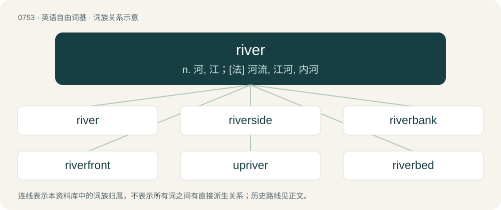

# 0822 · river — n. 河, 江；\[法\] 河流, 江河, 内河

[总目录](../00_总目录_按常用程度.md)

**类型**：英语自由词基　｜　**来源语言**：见词源记录

## 核心含义与来源

- 核心含义：n. 河, 江；\[法\] 河流, 江河, 内河
- 英文含义：A large and often winding stream which drains a land mass, carrying water down from higher areas to a lower point, oftentimes ending in another body of water, such as an ocean or in an inland sea.
- 词形：river

**多个词源／构词路径**：同一拼写可能有不同来源；以下按词性和含义分别列出。

**来源记录 1**（名词；A large and often winding stream which drains a land mass, carrying water down from higher areas to a lower point, oftentimes ending in another body of water, such as an ocean or in an inland sea.）

From Middle English ryver, from Anglo-Norman rivere, from Early Medieval Latin rīpāria (“littoral, riverbank”), from Latin rīpārius (“of a riverbank”), from Latin rīpa (“river bank”), from Proto-Indo-European \*h₁reyp- (“to scratch, tear, cut”). Unrelated to Latin rīvus (“stream”) (whence rival, derive). Doublet of riviera and rivière. Displaced native Old English ēa.

**来源记录 2**（名词；One who rives or splits.）

From rive + -er.

## 词族图

## 单词速览（常用到不常用）

| 单词 | 音标 | 释义 |
|---|---|---|
| [river](#w-1) | 英 /ˈɹɪvə/；美 /ˈɹɪvɚ/ | n. 河, 江；\[法\] 河流, 江河, 内河 |
| [riverside](#w-2) | 美 /ˈɹɪvɚˌsaɪd/ | n. 河边, 河畔 |
| [riverbank](#w-3) | 英 /ˈɹɪv.əˌbæŋk/；美 /ˈɹɪv.ɚˌbæŋk/ | n. 河堤, 河岸 |
| [riverfront](#w-4) | /ˈrivəfrʌnt/ | n. (城镇的)河边地区,河边陆地 |
| [upriver](#w-5) | /ˈʌpˈrivə/ | a. 上游的, 向水源的 |
| [riverbed](#w-6) | 英 /ˈɹɪv.əˌbɛd/；美 /ˈɹɪv.ɚˌbɛd/ | n. 河床 |
| [riverboat](#w-7) | 美 /ˈɹɪvɚˌboʊt/ | n. 江河中行驶的船 |
| [downriver](#w-8) | /ˈdajnˈrivə(r)/ | a. 下游的；adv. 向下游 |
| [riverine](#w-9) | 英 /ˈɹɪvəɹaɪn/；美 /ˈɹɪvɚ.ɪn/ | a. 河的, 河边的, 河岸边 |
| [riverwalk](#w-10) |  | 【英文】A pedestrian street or pathway alongside a river, providing a space for outdoor activity. |
| [riverhead](#w-11) | /ˈrivəhed/ | n. 河源, 水源 |
| [riverbend](#w-12) | 美 /ˈɹɪvɚˌbɛnd/ | 【英文】A knee or meander in a river. |
| [riverdance](#w-13) |  | 【英文】A theatrical show based on traditional Irish music and dance. |

## 逐词详解

### 1. river

**词性**：名词　｜　**音标**：英 /ˈɹɪvə/；美 /ˈɹɪvɚ/

**中文释义**：n. 河, 江；\[法\] 河流, 江河, 内河

**英文义项**：A large and often winding stream which drains a land mass, carrying water down from higher areas to a lower point, oftentimes ending in another body of water, such as an ocean or in an inland sea. / Any large flow of a liquid in a single body.

**词源与演化**：

From Middle English ryver, from Anglo-Norman rivere, from Early Medieval Latin rīpāria (“littoral, riverbank”), from Latin rīpārius (“of a riverbank”), from Latin rīpa (“river bank”), from Proto-Indo-European \*h₁reyp- (“to scratch, tear, cut”). Unrelated to Latin rīvus (“stream”) (whence rival, derive). Doublet of riviera and rivière. Displaced native Old English ēa.

**例句**：

> Occasionally rivers overflow their banks and cause floods.

该用例对应义项：A large and often winding stream which drains a land mass, carrying water down from higher areas to a lower point, oftentimes ending in another body of water, such as an ocean or in an inland sea.

### 2. riverside

**词性**：名词　｜　**音标**：美 /ˈɹɪvɚˌsaɪd/

**中文释义**：n. 河边, 河畔

**英文义项**：A bank or side of a river.

**构词拆分**：river + side

**词源与演化**：

From river + side.

**例句**：

> Gonna lay down my burden; Down by the riverside...

该用例对应义项：A bank or side of a river.

### 3. riverbank

**词性**：名词　｜　**音标**：英 /ˈɹɪv.əˌbæŋk/；美 /ˈɹɪv.ɚˌbæŋk/

**中文释义**：n. 河堤, 河岸

**英文义项**：A sloped side of a river acting as a barrier between the water and level ground to either side.

**构词拆分**：From river + bank.

**词源与演化**：

From river + bank.

**例句**：

> Two men arrived and prepared themselves a comfortable seat on the riverbank.

### 4. riverfront

**词性**：名词　｜　**音标**：/ˈrivəfrʌnt/

**中文释义**：n. (城镇的)河边地区,河边陆地

**英文义项**：The real estate located along the banks of a river.

**构词拆分**：river + front

**词源与演化**：

From river + front.

**例句**：

> Even in rural areas, dirt-cheap riverfront property seems to be a thing of the past.

该用例对应义项：The real estate located along the banks of a river.

### 5. upriver

**词性**：形容词　｜　**音标**：/ˈʌpˈrivə/

**中文释义**：a. 上游的, 向水源的

**英文义项**：Towards the source of a river.

**构词拆分**：From up- + river.

**词源与演化**：

From up- + river.

**例句**：

> According to the map, there should be a bridge about three miles upriver.

### 6. riverbed

**词性**：名词　｜　**音标**：英 /ˈɹɪv.əˌbɛd/；美 /ˈɹɪv.ɚˌbɛd/

**中文释义**：n. 河床

**英文义项**：The path where a river runs, or where a river once ran; the bottom earthen part of a river, not including the riverbanks.

**构词拆分**：river + bed

**词源与演化**：

From river + bed. Compare Dutch rivierbedding (“riverbed”), German Flussbett (“riverbed”), Swedish flodbädd (“riverbed”).

**例句**：

> Layers of sediment lay at the bottom of the riverbed.

### 7. riverboat

**词性**：名词　｜　**音标**：美 /ˈɹɪvɚˌboʊt/

**中文释义**：n. 江河中行驶的船

**英文义项**：A watercraft designed for operating on rivers.

**构词拆分**：river + boat

**词源与演化**：

From river + boat.

**例句**：

> He's a labourer on a riverboat.

### 8. downriver

**词性**：形容词　｜　**音标**：/ˈdajnˈrivə(r)/

**中文释义**：a. 下游的；adv. 向下游

**英文义项**：Closer to the mouth of a river.

**构词拆分**：down- + river

**词源与演化**：

From down- + river.

**例句**：

> My house is downriver to his.

该用例对应义项：Closer to the mouth of a river.

### 9. riverine

**词性**：形容词　｜　**音标**：英 /ˈɹɪvəɹaɪn/；美 /ˈɹɪvɚ.ɪn/

**中文释义**：a. 河的, 河边的, 河岸边

**英文义项**：Of or pertaining to rivers, or located on or by a river; inhabiting a river or its surrounds.

**构词拆分**：river + -ine

**词源与演化**：

From river + -ine.

### 10. riverwalk

**词性**：名词

**英文义项**：A pedestrian street or pathway alongside a river, providing a space for outdoor activity.

**构词拆分**：river + walk

**词源与演化**：

From river + walk.

### 11. riverhead

**词性**：名词　｜　**音标**：/ˈrivəhed/

**中文释义**：n. 河源, 水源

**英文义项**：The head or source of a river.

**构词拆分**：river + head

**词源与演化**：

From river + head.

### 12. riverbend

**词性**：名词　｜　**音标**：美 /ˈɹɪvɚˌbɛnd/

**英文义项**：A knee or meander in a river.

**构词拆分**：river + bend

**词源与演化**：

From river + bend.

### 13. riverdance

**词性**：名词

**英文义项**：A theatrical show based on traditional Irish music and dance.

**构词拆分**：river + dance

**词源与演化**：

From river + dance, originally the trademarked name of an interval performance act during the 1994 Eurovision Song Contest.
