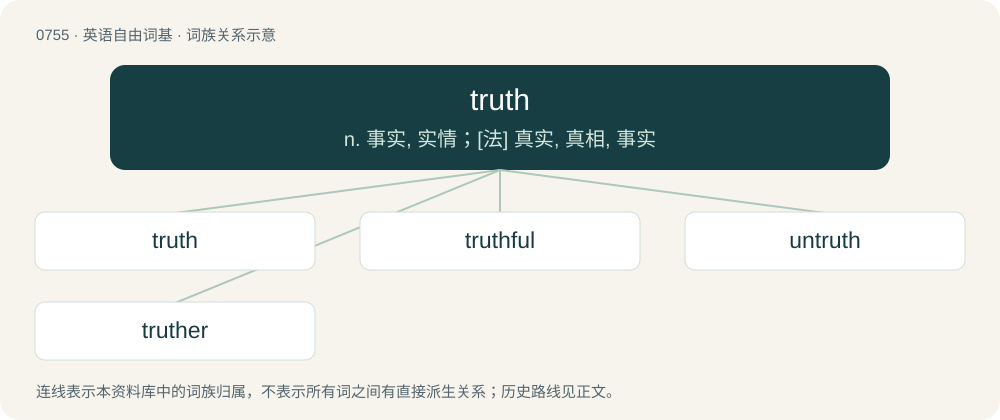

# 0823 · truth — n. 事实, 实情；\[法\] 真实, 真相, 事实

[总目录](../00_总目录_按常用程度.md)

**类型**：英语自由词基　｜　**来源语言**：见词源记录

## 核心含义与来源

- 核心含义：n. 事实, 实情；\[法\] 真实, 真相, 事实
- 英文含义：True facts, genuine depiction or statements of reality.
- 词形：truth

**来源记录 1**（名词；True facts, genuine depiction or statements of reality.）

Inherited from Middle English trouthe, from Old English trēowþ, from Proto-Germanic \*triwwiþō, from \*triwwiz + \*-iþō. By surface analysis, true + -th. Doublet of troth. Cognate with Norwegian trygd (“trustworthiness, security, insurance”), Icelandic tryggð (“loyalty, fidelity”).

## 词族图

## 单词速览（常用到不常用）

| 单词 | 音标 | 释义 |
|---|---|---|
| [truth](#w-1) | 英 /tɹuːθ/；美 /tɹuθ/ | n. 事实, 实情；\[法\] 真实, 真相, 事实 |
| [truthful](#w-2) | /ˈtɹuːθ.f(ə)l/ | a. 说真话的, 诚实的, 真实的, 如实的；\[法\] 真实的, 说实话的, 诚实的 |
| [untruth](#w-3) | /ʌnˈtɹuːθ/ | n. 不真实, 虚假, 谎言 |
| [truther](#w-4) | 英 /ˈtɹuːθə/；美 /ˈtɹuθɚ/ | 【英文】Someone who tells the truth. |

## 逐词详解

### 1. truth

**词性**：名词　｜　**音标**：英 /tɹuːθ/；美 /tɹuθ/

**中文释义**：n. 事实, 实情；\[法\] 真实, 真相, 事实

**英文义项**：True facts, genuine depiction or statements of reality. / Conformity to fact or reality; correctness, accuracy.

**词源与演化**：

Inherited from Middle English trouthe, from Old English trēowþ, from Proto-Germanic \*triwwiþō, from \*triwwiz + \*-iþō. By surface analysis, true + -th. Doublet of troth. Cognate with Norwegian trygd (“trustworthiness, security, insurance”), Icelandic tryggð (“loyalty, fidelity”).

**例句**：

> The truth is that our leaders knew a lot more than they were letting on.

该用例对应义项：True facts, genuine depiction or statements of reality.

### 2. truthful

**词性**：形容词　｜　**音标**：/ˈtɹuːθ.f(ə)l/

**中文释义**：a. 说真话的, 诚实的, 真实的, 如实的；\[法\] 真实的, 说实话的, 诚实的

**英文义项**：Honest, and always telling the truth. / Accurately depicting what is real.

**构词拆分**：truth + -ful

**词源与演化**：

From truth + -ful. Piecewise doublet of trothful, from Middle English trouþeful.

**例句**：

> He drew a truthful portrait of the prince.

该用例对应义项：Accurately depicting what is real.

### 3. untruth

**词性**：名词　｜　**音标**：/ʌnˈtɹuːθ/

**中文释义**：n. 不真实, 虚假, 谎言

**英文义项**：A lie or falsehood. / The condition of being false; truthlessness.

**构词拆分**：un- + truth

**词源与演化**：

Inherited from Middle English untreuth, from Old English untrēowþ and unġetrēowþ, from Proto-West Germanic \*untriuwiþu and \*ungatriuwiþu, equivalent to un- + truth. Cognate with Old High German ungitriuwida.

### 4. truther

**词性**：名词　｜　**音标**：英 /ˈtɹuːθə/；美 /ˈtɹuθɚ/

**英文义项**：Someone who tells the truth. / Someone who believes that the US government was responsible for the 9/11 attacks.

**构词拆分**：truth + -er (occupational suffix)

**词源与演化**：

From truth + -er (occupational suffix) or + -er (“supporter”). For sense 2, directly from name of the 9/11 Truth movement.
